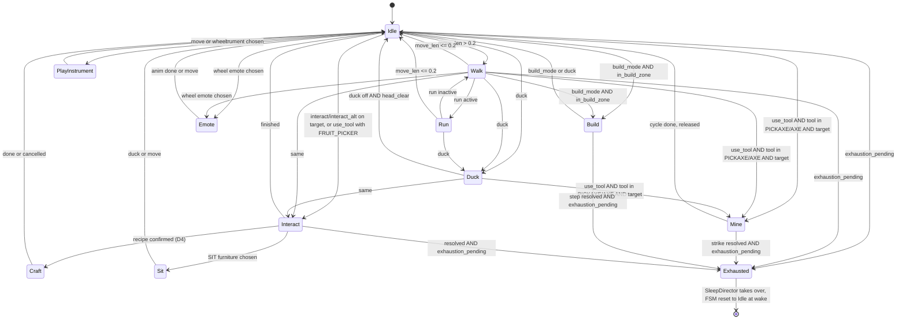
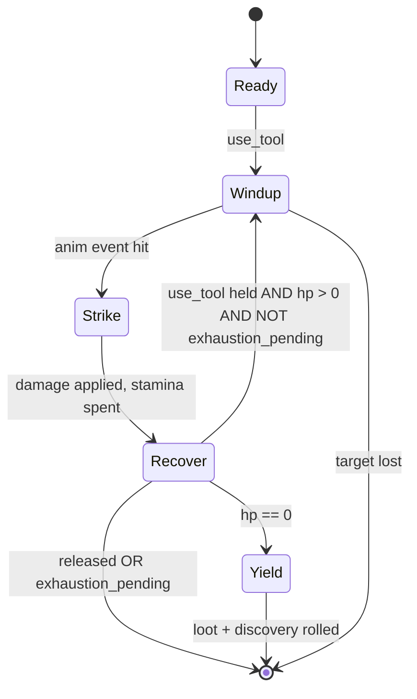
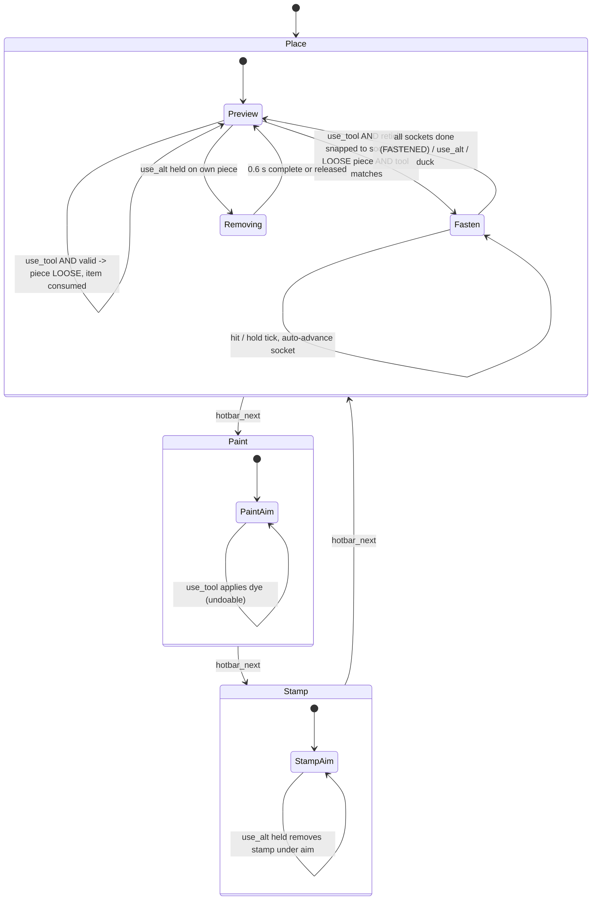
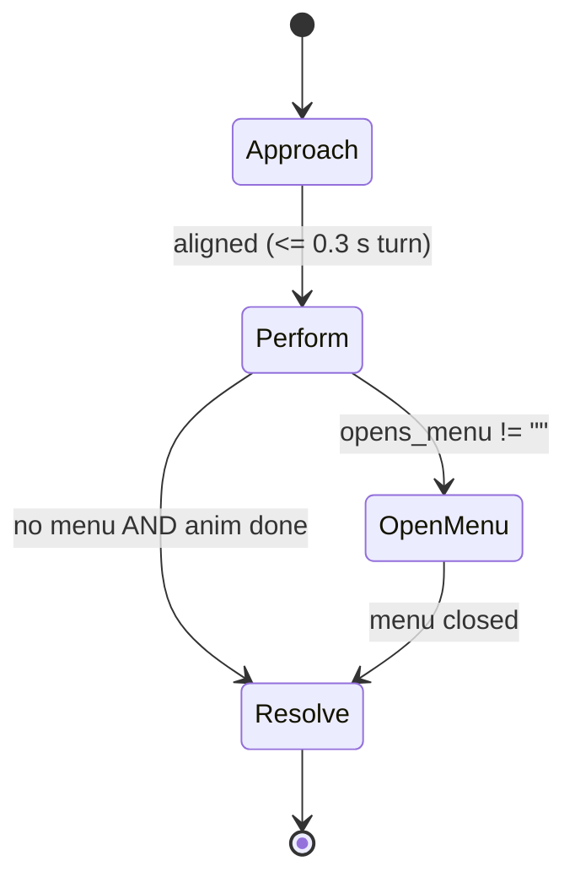
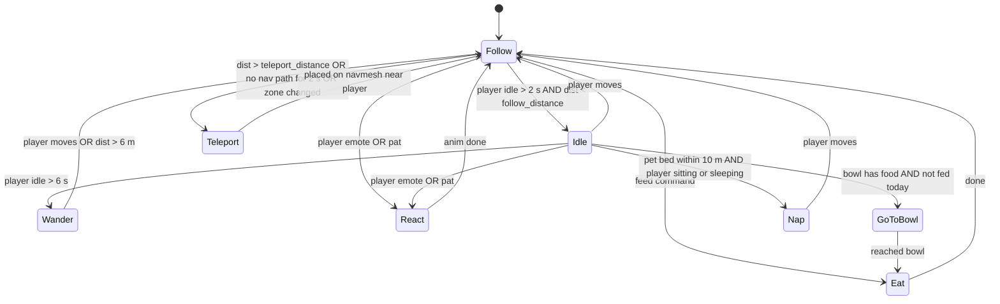
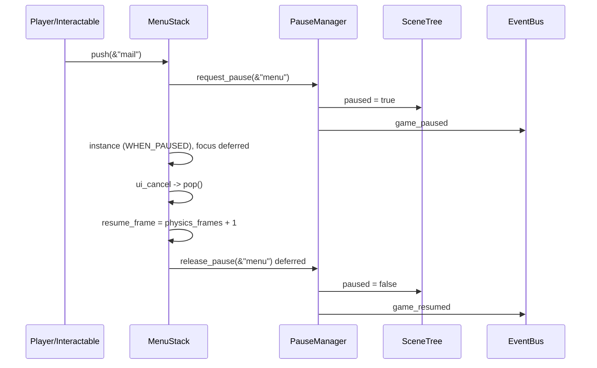
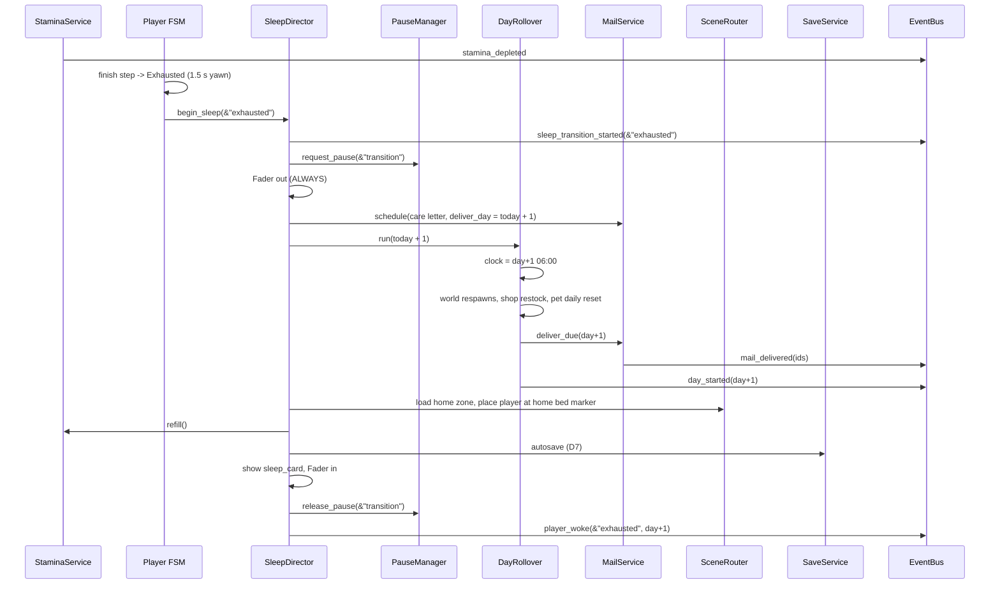

# Spec 1: Core Functional Specification

| Field | Value |
|---|---|
| Status | DRAFT rev 2, pending review of Section 0.3 (Open Decisions) |
| Revision | rev 1: core systems. rev 2: kid-friendly, accessibility, forgiving logic, expression systems, integration test specs |
| Engine | Godot 4.7 stable (4.7.2 latest patch found, 2026-08-18), GDScript |
| Physics | Jolt Physics (built-in module) |
| Renderer | Forward+ (see D13) |
| Tests | gdUnit4 v6.2.3 (latest release found, 2026-11-01) |
| Targets | Windows, Linux, macOS desktop |
| Audience | Kids and families; single player, offline |

Section map: 0 scope and decisions, 1 architecture, 2 input and automation, 3 data structures, 4 FSMs, 5 UI and pause, 6 forgiving game logic, 7 expression systems, 8 testing.

---

## 0. Scope, Constraints, and Verified Facts

### 0.1 Scope (v1)
- 3D third-person cozy life sim: tall humanoid player, outfit customizer, ducking, foraging (apple trees), mining (resources, currency, non-violent discoveries), grid building with hammering/screwing.
- Economy: coin wallet, shops, starter cabin, house plot purchasing.
- Jobs: Builder, Tailor (Tailor also makes pet accessories).
- NPCs: dialogue, gifting, job and shop access, Museum curator.
- Mail: letters and packages with attachments, including exhaustion care packages.
- Stamina instead of health. No damage, no hazards, no fail state.
- Museum and Collection Book.
- Pet companion with feeding and accessories.
- Painting and stamping placed objects, interactive furniture, emote and instrument wheel.
- Gamepad-primary input with keyboard/mouse secondary; every menu pauses the game.

Out of scope for v1: multiplayer or any network feature, farming (see D9), procedural voxel terrain (D1), Steam Input-specific handling, mobile/web, localization beyond key-based strings.

### 0.2 Design pillars (kid-friendly rules, apply to every system)
| ID | Rule | Enforcement |
|---|---|---|
| K1 | No fail states. Nothing the player does loses items, coins, progress, or the pet. | All commands are all-or-nothing; overflow items drop as pickups; tests assert no loss (8.5) |
| K2 | No damage, no enemies, no hazards. | No health stat exists. Falls and water are handled by SafeGround (6.3) |
| K3 | Icon-first communication. Every prompt is readable without reading text. | World prompts are glyph + pictogram; labels optional (2.8) |
| K4 | Never color-only. Every color signal has a shape, icon, or pattern twin. | Colorblind palettes and patterns (2.7, 2.8) |
| K5 | Forgiving input. Generous snap and aim radii, auto-tool, toggle instead of hold, no timing-critical inputs. | Settings defaults (5.10) |
| K6 | Fair randomness. Bad-luck protection on all drop tables; unlocks never duplicate. | Pity counters and unique pools (6.4) |
| K7 | Gentle pacing. Low stamina is a nudge, not a punishment. Exhaustion is a cozy event. | 6.1, 6.2 |
| K8 | Offline and private. No accounts, telemetry, chat, or purchases. | No network code in v1 |

### 0.3 Engine and test-framework facts this spec relies on
Godot facts verified against `godotengine/godot` tag `4.7-stable` class reference XML. gdUnit4 facts verified against `MikeSchulze/gdUnit4` tag `v6.2.3` source.

| Fact | Consequence |
|---|---|
| `physics/3d/physics_engine` default `DEFAULT` "is currently equivalent to GodotPhysics3D"; Jolt is default only for projects created in 4.6+. | `project.godot` MUST set `physics/3d/physics_engine="Jolt Physics"` explicitly. |
| Desktop joypad input uses SDL3 since 4.5. `JOY_BUTTON_A`=0 is the bottom face button (Cross on DualShock). | One binding set covers XInput and DualShock; only glyphs differ. |
| `Input.get_joy_info(device)` returns `vendor_id`, `product_id`, `raw_name`; `Input.joy_connection_changed(device, connected)` exists. | Glyph set by vendor ID; disconnect auto-pauses. |
| `SceneTree.paused = true` stops 2D/3D physics globally and stops callbacks for nodes resolving to `PAUSABLE`. | Menus need `WHEN_PAUSED`/`ALWAYS`; pet, NPCs, stamina regen freeze while paused. |
| Autoloads default to `PROCESS_MODE_INHERIT` (effectively pausable). | Each autoload's mode is specified in 1.2. |
| `SceneTree.create_timer(time_sec, process_always = true, ...)` runs while paused by default. | Gameplay code passes `false` or uses `Timer` nodes. |
| `Node.create_tween()` binds to the node (`TWEEN_PAUSE_BOUND`); `SceneTree.create_tween()` is unbound. | Gameplay tweens use `Node.create_tween()`. |
| `JSON.stringify` writes all numbers as float; `JSON.parse` returns floats. | Loader casts integer fields with `int()`. |
| `ui_*` built-in actions cannot be removed; their events can be modified. | UI events are specified explicitly (2.4). |
| GridMap stores only MeshLibrary index + orientation per cell. | Custom grid for stateful pieces (1.6). |
| `Decal` is supported only in Forward+ and Mobile, not Compatibility. Mobile shows at most 8 decals per mesh resource. | Stamps use Decals and require Forward+ (D13). Cap 8 stamps per piece regardless. |
| `GeometryInstance3D.set_instance_shader_parameter()` requires `instance uniform` in the shader. | Paint uses per-instance uniforms, no material duplication (7.2). |
| `DisplayServer.tts_speak()` is implemented on Linux (X11/Wayland), macOS, Windows. `audio/general/text_to_speech` enables TTS on startup. | Optional read-aloud for letters and prompts (D14). OS voice availability not verified per distro. |
| gdUnit4: `monitor_signals(source, _auto_free := true)` **frees the source at test end by default**. | Monitoring an autoload (`EventBus`) MUST use `monitor_signals(EventBus, false)` or the autoload is freed. |
| gdUnit4: `GdUnitSceneRunner.simulate_frames()` awaits `process_frame`, not `physics_frame`. | Area3D overlap tests explicitly await `get_tree().physics_frame` (8.2). |
| gdUnit4 headless: "InputEvents are not transported by the Godot engine in headless mode". | Integration tests inject `InputFrame`s and call commands; no simulated button events (8.2). |
| gdUnit4 signal asserts: `await assert_signal(obj).wait_until(ms).is_emitted(name, args...)` and `is_not_emitted(...)`. | Used in all integration specs. |

### 0.4 Open decisions (owner confirmation needed before plan1)
| ID | Question | Proposed default | Alternative |
|---|---|---|---|
| D1 | Mining model | Discrete resource nodes on a 1 m grid | Destructible voxel terrain (roughly 10x cost) |
| D2 | Jump | None in v1; button reserved | Add `Jump`/`Fall` states |
| D3 | Forage/Talk as states | One generic `Interact` state | Separate states |
| D4 | Crafting time vs pause-on-menu | Choose recipe in paused menu, timed `Craft` state runs in world | Instant crafting |
| D5 | House purchase | Upfront coins | Mortgage by mail |
| D6 | Day length | 20 real minutes, 06:00 to 02:00 | Any |
| D7 | Saving | 3 manual slots + autosave on every sleep (bed, late night, exhaustion) | Save anywhere |
| D8 | "Axe/picker for trees": can apple trees be chopped? | **No.** Fruit trees use the `FRUIT_PICKER` and are never destroyable. A separate `timber_tree` and `fallen_log` use the `AXE` for wood. Prevents a child destroying their orchard by accident. | Single tree type; axe chops apple trees |
| D9 | "Crops" for museum donation, but farming is not in scope | v1 crops = **foraged produce** category `PRODUCE` (apples, wild berries, mushrooms, flowers) | Add a farming system (new spec) |
| D10 | "Wake at home" before the player owns a house | Player starts with a free **starter cabin** (bed + mailbox). Any owned bed can be set as Home. | Wake at inn |
| D11 | Pets | One pet in v1, choice of dog or cat on day 1, delivered by letter | Multiple pets, shelter adoption |
| D12 | Dyes | Dye is an **unlock**, never consumed | Consumable dye items |
| D13 | Renderer | **Forward+** (Decals for stamps). Low-end fallback without stamps is not supported in v1. | Compatibility renderer with mesh-projected stamp quads (more work, wider hardware) |
| D14 | Read-aloud (TTS) for letters, prompts, dialogue | Setting, default off; uses OS voices | Recorded VO; none |
| D15 | Auto-tool after leaving all target zones | Revert to empty hands after 1.0 s | Keep last tool |

### 0.5 Known issues and risks raised
1. **CLAUDE.md test command is wrong for gdUnit4 v6.2.3.** The entry script is `res://addons/gdUnit4/bin/GdUnitCmdTool.gd`; headless runs exit with `RETURN_ERROR_HEADLESS_NOT_SUPPORTED` unless `--ignoreHeadlessMode` is passed; tests are selected with `-a`. Proposed (verify in plan1 task 1):
   `godot --headless --path . -s -d res://addons/gdUnit4/bin/GdUnitCmdTool.gd --ignoreHeadlessMode -a res://test`
2. **Headless tests cannot drive UI via InputEvents.** Integration tests assert on signals and direct calls.
3. **gdUnit4 4.7 support is implicit.** v6.1.0 declares 4.6.x; v6.2.3 fixes a "fresh Godot 4.7 editor" issue. Smoke test first.
4. **Pause ownership.** Only `PauseManager` writes `get_tree().paused`, with ref-counted reasons.
5. **Input bleed on unpause.** Resume-frame guard (5.5).
6. **EventBus is not a transaction mechanism.** Commands (direct calls returning results) vs events (1.5).
7. **Untrusted `.tres` saves.** Saves are JSON only.
8. **Red/green placement boxes fail for the most common color-vision deficiencies.** Requested green/red stays the default palette, but every state also has an icon and pattern, and blue/orange and high-contrast palettes exist (2.7).
9. **"Glowing green A / DualShock Cross" is not one color.** Xbox A is green; the classic PlayStation Cross is blue. Prompts use each glyph set's native colors plus the glyph shape; "green" is not a cross-platform meaning (2.8).
10. **Auto-tool can fight the player.** Without debounce, hysteresis, action locks, and manual override, tools flicker at zone borders or switch mid-swing (2.6).
11. **Day rollover must not depend on signal connection order.** Exhaustion letters must be scheduled before mail delivery runs. Rollover is an explicit ordered pipeline (6.2).
12. **Exhaustion snack farming.** Free snacks on every exhaustion invite deliberate exhaustion. Snack is limited to once per in-game day; the real cost of exhaustion is losing the rest of the day.
13. **Museum reward duplication on reload.** Rewards are recorded as granted and never re-derived into a second grant (6.5).
14. **gdUnit4 `monitor_signals` frees the monitored object by default.** Must pass `false` for autoloads.
15. **Paused state leaking between tests.** A failing test that leaves the tree paused stalls all following tests. `PauseManager.reset_for_tests()` runs in every `after_test`.
16. **Zone overlaps need physics ticks.** `simulate_frames` advances process frames; tests must await physics frames.
17. **Instrument mode reuses B (duck) and triggers as notes.** Safe only because instrument actions are a disjoint FSM context; rebinding validation must enforce context disjointness (2.5).

---

## 1. System Architecture and Node Hierarchy

### 1.1 Layering
```
+------------------------------------------------------------+
| Presentation   scenes/ (3D), ui/ (Controls)                |
+------------------------------------------------------------+
| Adapters       Node wrappers: Player, Pet, Interactables,  |
|                ToolAutoSelector, SnapAssist, UI            |
+------------------------------------------------------------+
| Services       GameSession-owned; validate commands, emit  |
|                EventBus events                             |
+------------------------------------------------------------+
| Models         RefCounted pure logic, no SceneTree access  |
+------------------------------------------------------------+
| Data           resources/*.tres (read-only definitions)    |
|                user://saves/*.json, user://settings.cfg    |
+------------------------------------------------------------+
```
Rule: Models never call `get_tree()`, never read `Input`, never emit EventBus signals.

### 1.2 Autoloads (order is significant)
| # | Name | process_mode | Responsibility |
|---|---|---|---|
| 1 | `EventBus` | ALWAYS | Signal declarations only |
| 2 | `Database` | ALWAYS | Loads and validates definitions (3.9) |
| 3 | `Settings` | ALWAYS | Loads/saves `user://settings.cfg`, exposes accessibility options (5.10) |
| 4 | `InputService` | ALWAYS | Device detection, glyph set, rebinding, joypad events |
| 5 | `PauseManager` | ALWAYS | Sole writer of `get_tree().paused` |
| 6 | `GameClock` | PAUSABLE | In-game day/minute; triggers `DayRollover` (6.2) |
| 7 | `SaveService` | ALWAYS | Serialize/deserialize, slots, migrations |
| 8 | `SceneRouter` | ALWAYS | Zone transitions with fade |

### 1.3 Main scene tree (`res://scenes/main.tscn`)
```
Main (Node)                                   PAUSABLE
+-- GameSession (Node)                        PAUSABLE, owns all services
|   +-- InventoryService                      backpack, hotbar, containers
|   +-- ToolBeltService                       owned tools (one active per type)
|   +-- WalletService
|   +-- EconomyService                        shops, TransactionCoordinator
|   +-- HousingService                        plots, deeds, home bed
|   +-- JobService                            Builder, Tailor contracts
|   +-- MailService                           inbox, scheduled mail
|   +-- NpcService                            friendship, schedules
|   +-- BuildService                          pieces, fastening, paint, stamps, furniture state
|   +-- WorldStateService                     mine nodes, trees, chests, respawns
|   +-- StaminaService                        stamina, regen, depletion edge
|   +-- SleepDirector                         ALWAYS: bed / late-night / exhaustion transitions
|   +-- DiscoveryService                      geodes, treasure chests, pity counters
|   +-- MuseumService                         donations, cases, trophies
|   +-- CollectionService                     discovered entries (Collection Book)
|   +-- PetService                            pet state, feeding, accessories
|   +-- UnlockService                         recipes, dyes, stickers, emotes, outfits
|   +-- DayRollover (RefCounted helper)       ordered day pipeline (6.2)
+-- World (Node3D)                            PAUSABLE
|   +-- WorldEnvironment, Sun
|   +-- ZoneRoot (Node3D)                     current zone
|   |   +-- <Zone: Town | Orchard | Mine | Museum | StarterCabin | Plot_N>
|   |       +-- Terrain, NavigationRegion3D
|   |       +-- ResourceNodes                 MineNode (ore/geode-bearing), TimberTree, FallenLog
|   |       +-- FruitTrees                    AppleTree
|   |       +-- Interactables                 Mailbox, ShopCounter, JobBoard, Workbench,
|   |       |                                 TailorBench, Wardrobe, PetWardrobe, PlotSign,
|   |       |                                 Bed, DonationDesk, DisplayCase, TrophyPedestal
|   |       +-- Chests                        spawned TreasureChest instances
|   |       +-- BuildGrid                     BuildGridView on owned plots / job sites
|   |       +-- NPCs, SpawnPoints
|   |       +-- SafetyVolumes                 KillPlane, DeepWater (Area3D, 6.3)
|   +-- Player (CharacterBody3D)              1.4
|   +-- Pet (CharacterBody3D)                 7.1
+-- UI (CanvasLayer, layer 10)                PAUSABLE
|   +-- HUD                                   clock, stamina, wallet, hotbar, tool icon
|   +-- PromptOverlay                         world-anchored button prompts (2.8), hidden while paused
|   +-- MenuStack                             ALWAYS (5.3)
|   +-- Toasts, DeviceBanner                  ALWAYS
+-- Fader (CanvasLayer, layer 100)            ALWAYS
```

### 1.4 Player (`res://scenes/player/player.tscn`)
| Parameter | Value |
|---|---|
| Standing capsule height / radius | 2.10 m / 0.35 m |
| Ducking capsule height | 1.30 m |
| Walk / Run / Duck-walk speed | 2.2 / 5.0 / 1.2 m/s |
| Door clearance (build pieces) | 2.40 m |
| Mine tunnel clearance | 1.50 m (requires Duck) |

```
Player (CharacterBody3D)
+-- CollisionStanding, CollisionDucking (CollisionShape3D)
+-- HeadClearance (ShapeCast3D)
+-- Visual/Rig/Skeleton3D
|   +-- BodyMesh, OutfitSlots (Head, Top, Bottom, Feet, Accessory)
|   +-- ToolSocket (BoneAttachment3D, right hand)
|   +-- InstrumentSocket (BoneAttachment3D)
+-- AnimationTree
+-- CameraRig/Pitch/SpringArm3D/Camera3D
+-- InteractionProbe (Area3D)          interactable candidates within 2.0 m
+-- ToolDetector (Area3D)              detects ToolTargetZone areas (2.6)
+-- AimRay (RayCast3D)                 from camera
+-- InputReader (Node)                 only node that reads Input (2.1)
+-- ToolAutoSelector (Node)            2.6
+-- SafeGroundTracker (Node)           6.3
+-- StateMachine (Node)
    +-- Idle, Walk, Run, Duck, Mine, Build, Craft, Interact,
        Sit, Emote, PlayInstrument, Exhausted
```

### 1.5 Commands vs events
| Kind | Mechanism | Naming | Returns |
|---|---|---|---|
| Command | Direct call on a service via `GameSession` | imperative | `Result {ok, error: StringName, data}` |
| Event | `EventBus` signal | past tense | nothing |

Services do not reference each other, except `TransactionCoordinator` (Economy), `SleepDirector`, `DayRollover`, and `MuseumService` reward granting, which receive collaborators by constructor injection. Transaction rule: validate everything, then mutate, then emit.

### 1.6 Build grid
Custom grid (GridMap cannot hold per-piece state). 1.0 m structure cells, 0.5 m furniture sub-grid, 3.0 m storeys, 90-degree rotations. `BuildService` holds `Dictionary[Vector3i, PieceInstance]` plus footprint occupancy. Snap assist in 2.7.

### 1.7 Physics layers
| Layer | Name | Used by |
|---|---|---|
| 1 | world | terrain, static props |
| 2 | player | Player body |
| 3 | npc | NPC bodies |
| 4 | pet | Pet body (does not collide with player, 7.1) |
| 5 | interactables | interaction areas |
| 6 | tool_zones | `ToolTargetZone` areas |
| 7 | build_pieces | placed pieces |
| 8 | pickups | dropped items |
| 9 | safety | kill plane, deep water |

### 1.8 Domain summaries
| Module | Key commands | Key events |
|---|---|---|
| Inventory | `add`, `remove`, `can_add`, `move_slot`, `split` | `inventory_changed`, `item_added(item_id, qty)` |
| ToolBelt | `grant_tool`, `has_tool(type)`, `best_tool(type)`, `equip(type)`, `unequip()` | `tool_equipped(type, item_id, source)`, `tool_unequipped(source)` |
| Wallet | `can_afford`, `credit`, `debit` | `coins_changed` |
| Economy | `try_buy`, `try_sell`, `try_buy_plot` | `item_bought`, `item_sold`, `plot_purchased` |
| Housing | `grant_deed`, `set_home_bed` | `deed_granted`, `home_changed` |
| Jobs | `accept_contract`, `submit_contract` | `contract_completed`, `job_rank_up` |
| Mail | `schedule`, `deliver_due(day)`, `claim_attachments` | `mail_delivered`, `mail_claimed` |
| Build | `try_place`, `fasten_step`, `try_remove`, `try_paint`, `try_stamp`, `undo_decor`, `toggle_furniture` | `piece_placed`, `piece_fastened`, `piece_painted`, `piece_stamped`, `furniture_toggled` |
| WorldState | `damage_node`, `harvest_tree`, `open_chest` | `node_depleted`, `tree_harvested`, `chest_opened` |
| Stamina | `spend(amount, reason)`, `restore(amount, reason)`, `refill()` | `stamina_changed`, `stamina_low(level)`, `stamina_depleted` |
| SleepDirector | `begin_sleep(reason)` | `sleep_transition_started(reason)`, `player_woke(reason, day)` |
| Discovery | `roll_on_depletion(node_key)`, `open_geode(item_id)` | `geode_found`, `chest_spawned`, `unlock_granted(kind, id)` |
| Museum | `try_donate(item_id)`, `try_donate_batch(ids)` | `item_donated`, `display_case_unlocked`, `trophy_unlocked` |
| Collection | `mark_discovered(item_id)` | `entry_discovered` |
| Pet | `adopt`, `pat`, `try_feed(item_id)`, `equip_accessory`, `remove_accessory` | `pet_fed`, `pet_happiness_changed`, `pet_accessory_changed` |
| Unlock | `grant(kind, id)`, `is_unlocked(kind, id)` | `unlock_granted` |

Economy rules: integer coins only; buy price rounded up, sell rounded down; default sell 50% of `base_value`.

---

## 2. Input and Automation

### 2.1 Abstraction rule (referenced by CLAUDE.md)
1. Gameplay and UI code reads only named actions.
2. No gameplay script references device-specific events or constants. Exceptions: `InputService`, rebinding UI.
3. Only `Player/InputReader` polls gameplay actions, producing an `InputFrame` consumed by the FSM. `InputReader.inject(frame)` is the test seam.
4. Mouse motion delta is the one raw event, read only in `InputReader`.

`InputFrame` fields: `move: Vector2`, `look: Vector2`, `run_held`, `duck_pressed`, `duck_held`, `interact_pressed`, `interact_alt_pressed`, `use_pressed`, `use_held`, `use_released`, `alt_pressed`, `alt_held`, `build_toggle_pressed`, `rotate_cw_pressed`, `rotate_ccw_pressed`, `hotbar_next_pressed`, `hotbar_prev_pressed`, `hotbar_select: int`, `catalog_pressed`, `undo_pressed`, `wheel_pressed`, `quick_eat_pressed`, `notes_pressed: int` (bitmask of 8 notes), `frame: int`.

### 2.2 Gameplay actions
| Action | Xbox | PlayStation | Godot joypad event | KB/M | Behavior |
|---|---|---|---|---|---|
| `move_*` | Left stick | Left stick | `JOY_AXIS_LEFT_X/Y` | W/A/S/D | deadzone 0.2 |
| `look_*` | Right stick | Right stick | `JOY_AXIS_RIGHT_X/Y` | Mouse | sensitivity, invert-Y |
| `run` | L3 | L3 | `JOY_BUTTON_LEFT_STICK` | Left Shift | toggle (default) or hold |
| `duck` | B | Circle | `JOY_BUTTON_B` | C, Left Ctrl | toggle (default) or hold |
| `interact` | A | Cross | `JOY_BUTTON_A` | E | primary world prompt |
| `interact_alt` | X | Square | `JOY_BUTTON_X` | F | secondary world prompt |
| `use_tool` | RT | R2 | `JOY_AXIS_TRIGGER_RIGHT` (0.5) | LMB | use auto-selected tool |
| `use_alt` | LT | L2 | `JOY_AXIS_TRIGGER_LEFT` (0.5) | RMB | build: remove (hold) |
| `hotbar_next` / `hotbar_prev` | RB / LB | R1 / L1 | shoulders | Wheel, ] / [ | hotbar (food, placeables, pet food) |
| `hotbar_1..8` | none | none | none | 1..8 | KB only |
| `build_mode` | Y | Triangle | `JOY_BUTTON_Y` | B | toggle Build mode |
| `emote_wheel` | D-pad up | D-pad up | `JOY_BUTTON_DPAD_UP` | G | opens wheel (menu, pauses) |
| `quick_eat` | D-pad down | D-pad down | `JOY_BUTTON_DPAD_DOWN` | Q | eat best food for stamina |
| `camera_reset` | R3 | R3 | `JOY_BUTTON_RIGHT_STICK` | Middle mouse | recenter |
| `open_inventory` | View | Touchpad / Create | `JOY_BUTTON_BACK`, `JOY_BUTTON_TOUCHPAD` | I | Backpack, Outfit, Pet, Collection, Jobs, Map |
| `pause_menu` | Menu | Options | `JOY_BUTTON_START` | Esc | pause menu |
| `jump` | reserved | reserved | unbound | unbound | D2 |

There is no manual tool-cycling action in gameplay. Tools come from the ToolBelt via auto-select (2.6) or the wheel's Tools page (manual override).

### 2.3 Context overrides
Meaning changes by FSM context, never by rebinding. Contexts are disjoint; validation in 2.5.

| Action | Build: Place | Build: Paint | Build: Stamp | PlayInstrument |
|---|---|---|---|---|
| `use_tool` | place ghost / fasten snapped socket | paint selected region | place stamp | note 8 |
| `use_alt` (hold 0.6 s) | remove piece | none | remove stamp under aim | note 7 |
| `rotate_cw/ccw` (D-pad R/L, R / Shift+R) | rotate ghost | cycle paint region | rotate stamp 45 deg | none |
| `hotbar_next/prev` (RB/LB) | next/prev Build tool (Place, Paint, Stamp) | same | same | notes 6 / 5 |
| `interact_alt` (X) as `build_catalog` | piece catalog | dye palette | sticker sheet + size | note 3 |
| `undo` (D-pad down / Z) | none | undo last decor op | undo last decor op | none |
| `interact` (A) | pick piece under aim | eyedropper (copy dye) | none | note 1 |
| `duck` (B) | exit Build | exit Build | exit Build | note 2 |
| `build_mode` (Y) | exit Build | exit Build | exit Build | note 4 |
| `move` | walk | walk | walk | exits instrument |
| `emote_wheel` | none | none | none | reopens wheel |

Instrument KB/M: notes on keys 1..8.

### 2.4 UI actions (explicit events)
| Action | Gamepad | KB/M |
|---|---|---|
| `ui_accept` | A / Cross | Enter, Space |
| `ui_cancel` | B / Circle | Esc |
| `ui_up/down/left/right` | D-pad + left stick (0.5) | Arrows, W/A/S/D |
| `ui_tab_next/prev` | RB / LB | E / Q |
| `ui_page_next/prev` | RT / LT | Page Down / Page Up |
| `ui_secondary` | X / Square | Right click |
| `ui_tertiary` | Y / Triangle | Shift+Enter |
| `ui_wheel_select` | right or left stick direction (0.6) | Mouse direction from center |

### 2.5 Device handling and rebinding
- Active device switches on last meaningful input; emits `EventBus.input_device_changed(kind, glyph_set)`.
- Glyph set from `vendor_id`: `0x054C` PlayStation, `0x045E` Xbox, `0x057E` Nintendo (glyph-only change), else Xbox. User override.
- Mouse captured in gameplay, visible in menus or when window unfocused.
- Active pad disconnect opens Pause with `DeviceBanner`.
- Rebinds stored as plain dictionaries in `user://settings.cfg`; never serialized `InputEvent` objects.
- Conflict rule: one physical input may map to several actions only if they belong to disjoint contexts. Context table: `GAMEPLAY`, `BUILD`, `INSTRUMENT`, `UI`. `pause_menu`, `ui_accept`, `ui_cancel` cannot be unbound from the gamepad.

### 2.6 Auto-tool context switching
Tools live in the **ToolBelt**, not in inventory slots. Acquiring a `TOOL` item grants it to the belt. For each `ToolType`, the highest owned tier is the active instance.

`ToolType`: `PICKAXE, AXE, FRUIT_PICKER, HAMMER, SCREWDRIVER, PAINTBRUSH, STAMP`.

**Targets** carry a `ToolTargetZone` (Area3D, layer `tool_zones`):
| Target | `required_tool` | Enter radius | Priority | Active when |
|---|---|---|---|---|
| MineNode (ore, gem, geode-bearing) | PICKAXE | 2.5 m | 30 | always |
| TimberTree, FallenLog | AXE | 2.5 m | 20 | always |
| AppleTree (fruit > 0) | FRUIT_PICKER | 3.0 m | 20 | fruit > 0 |
| Loose structural piece, fastener NAILS | HAMMER | 3.0 m | 40 | Build mode, Place tool |
| Loose structural piece, fastener SCREWS | SCREWDRIVER | 3.0 m | 40 | Build mode, Place tool |
| Blueprint frame at job site (loose) | by fastener | 3.0 m | 40 | Build mode, Place tool |

PAINTBRUSH and STAMP are selected by the Build tool cycle, not by zones.

**Selection model** (`ToolSelectionModel`, pure RefCounted; `ToolAutoSelector` is the node adapter):
1. Candidate set = zones currently overlapping `ToolDetector` and active for the current context.
2. Best candidate: zone whose target is hit by `AimRay`; else highest priority; else nearest by distance; ties by stable `zone_key` order.
3. **Debounce**: a new best candidate must remain best for 0.15 s before a switch.
4. **Hysteresis**: a zone stays a candidate until distance exceeds enter radius + 0.5 m, even after the Area3D reports exit. Implemented as an exit-distance check, not a second shape.
5. **Action lock**: no switch while Mine sub-FSM is past `Ready`, Fasten is in progress, or in Craft, Interact, Sit, Emote, PlayInstrument, Exhausted. Pending switch evaluates when the lock ends.
6. **Manual override**: choosing a tool on the wheel suspends auto-select until the player leaves all candidate zones or 10 s pass.
7. **Missing tool**: equipment unchanged; prompt shows the required tool pictogram with a lock badge (`prompt_changed(target, &"missing_tool", tool_type)`).
8. **Tier too low** (pickaxe vs hardness): tool equips; prompt shows tier-lock badge; using it shows a friendly toast, no stamina spent.
9. **Leave all zones**: after 1.0 s with no candidates, unequip to empty hands (D15).
10. **Setting off** (`auto_tool = false`): selector inert; wheel Tools page is the only way to equip.
11. **Paused**: selector does not tick (PAUSABLE).

Emitted by ToolBelt: `tool_equipped(tool_type, item_id, &"auto" | &"manual")`, `tool_unequipped(&"auto" | &"manual")`. `ToolAutoSelector` additionally emits `EventBus.tool_auto_selected(tool_type, target_kind, reason)` with `reason` in `&"zone_enter" | &"aim_change" | &"lock_released"`.

### 2.7 Magnetic grid and snap assist
**Ghost placement**
- AimRay hit gives a raw point; candidate cell = nearest grid cell for the piece's grid (1.0 m or 0.5 m).
- Snap sockets: each `BuildPieceDef` declares `snap_sockets: Array[SnapSocket]` (`position`, `normal`, `accepts_tags`, `provides_tags`). Walls provide `wall_end`, floors provide `floor_edge`, walls provide `wall_face` for furniture backs.
- Magnetic radius (by `Settings.snap_strength`):

| Strength | Structure radius | Furniture radius | Screw/nail reticle angle |
|---|---|---|---|
| Low | 0.30 m | 0.20 m | 4 deg |
| Normal | 0.45 m | 0.30 m | 6 deg |
| **High (default)** | 0.60 m | 0.35 m | 9 deg |

- The nearest compatible socket within radius wins; the ghost snaps to it and auto-rotates to align (walls to floor edges, furniture back to the nearest wall face, facing outward).
- Sticky snap: once snapped, the ghost stays until the raw point moves beyond 1.5x radius. Prevents stick jitter.
- If no socket is in range, fall back to plain grid cell + current manual rotation.

**Validity indicator**
| State | Default palette | Blue/Orange palette | High contrast | Always also shown |
|---|---|---|---|---|
| Valid | green translucent box + green outline | blue | white outline, solid | check icon above ghost |
| Invalid | red translucent box + red outline | orange | black/yellow diagonal stripes | X icon + reason pictogram |
| Snapped | outline pulse (off if `reduce_motion`) | same | thicker outline | magnet icon |

Invalid reasons with pictograms: `occupied`, `no_support`, `outside_plot`, `overlaps_player`, `missing_item`. Overlapping the pet is not invalid; the pet is nudged (7.1).

**Fastening mini-game (screws and nails)**
- Each fastenable piece has `fastener_sockets: Array[Marker3D]`. `fasten_steps = sockets * hits_per_socket` (nails 2 hits, screws 1 hold of 0.8 s).
- The reticle magnetically snaps to the nearest unfastened socket within the reticle angle. After a socket completes, the reticle auto-advances to the next nearest socket on the same piece, so a child never needs to re-aim.
- Hammer: each `use_tool` press drives the snapped nail one hit. Screwdriver: hold `use_tool`; progress fills; release keeps partial progress (no reset).
- `fasten_mode = HOLD` turns hammering into hold-to-progress too.
- No miss state exists. Pressing with no socket in range does nothing.

### 2.8 Color-coded controller prompts
`PromptOverlay` draws prompts in screen space over the focused target, positioned with `Camera3D.unproject_position()` and hidden when `Camera3D.is_position_behind()` is true or the target is occluded (AimRay line-of-sight check).

- Max 3 prompts per target: tool prompt (RT/R2/LMB) when a tool target, `interact` (A), `interact_alt` (X).
- Each prompt = glyph + pictogram (e.g. speech bubble, gift, paw, chair, magnifier). Text label optional (`Settings.prompt_labels`, default on).
- Glyph colors by glyph set:

| Button | Xbox | PlayStation (classic) | Nintendo | KB/M |
|---|---|---|---|---|
| Bottom face | A green | Cross blue | B (neutral) | key cap neutral |
| Right face | B red | Circle red | A (neutral) | key cap neutral |
| Left face | X blue | Square pink | Y (neutral) | key cap neutral |
| Top face | Y yellow | Triangle green | X (neutral) | key cap neutral |
| Triggers | RT/LT white | R2/L2 white | ZR/ZL white | mouse icon |

- Glow pulse when actionable; dimmed with lock badge when not (missing tool, tier, full inventory, already fed today). `reduce_motion` replaces pulse with a static outline. High-contrast mode uses white glyph on black disc.
- Replaces text-heavy menus for common actions:

| Target | A | X | Tool |
|---|---|---|---|
| NPC | Talk | Gift (opens item picker filtered to giftable) | none |
| Curator NPC | Talk | Donate (donation menu) | none |
| Pet | Pat | Feed if pet food owned and not fed today, else Dress Up | none |
| Apple tree | Pick | none | FRUIT_PICKER |
| Ore node | none | none | PICKAXE |
| Treasure chest | Open | none | none |
| Chair/sofa | Sit | none | none |
| Bed | Sleep | Set as Home (if owned plot bed) | none |
| Lamp/radio/toggle | Toggle | none | none |
| Mailbox | Open mail (badge with unread count) | none | none |
| Shop / Job board / Bench | Open | none | none |

- Read-aloud: if `Settings.tts_enabled`, focusing a new target speaks the primary prompt verb once.

---

## 3. Data Structures

Conventions: `StringName` ids, lowercase snake_case, never renamed after ship. Prefixes: `item_`, `recipe_`, `piece_`, `outfit_`, `npc_`, `job_`, `contract_`, `plot_`, `mail_tpl_`, `shop_`, `dye_`, `sticker_`, `emote_`, `pet_`, `petacc_`, `case_`, `trophy_`, `loot_`. Display text is a translation key. Definitions are `Resource` subclasses under `res://resources/<type>/`, read-only. Runtime state is plain data serialized to JSON.

### 3.1 Item definition (`ItemDef`)
| Field | Type | Rule |
|---|---|---|
| `id` | StringName | `item_` prefix |
| `name_key`, `desc_key` | String | translation keys |
| `category` | enum | `RESOURCE, MINERAL, FABRIC, PRODUCE, FOOD, PET_FOOD, TOOL, BUILD_PIECE, FURNITURE, OUTFIT, PET_ACCESSORY, GEODE, KEY_ITEM` |
| `icon` | Texture2D | 128x128, must read clearly at 48 px |
| `max_stack` | int | 1..999; 1 if `has_instance_data` |
| `base_value` | int | coins >= 0 |
| `sellable`, `giftable` | bool | `KEY_ITEM` not sellable |
| `tags` | Array[StringName] | e.g. `&"snack"`, `&"ore"` |
| `has_instance_data` | bool | dyed outfits/accessories |
| `tool` | ToolData | if TOOL |
| `food` | FoodData | if FOOD or PET_FOOD: `stamina_restore: int`, `pet_happiness: int` |
| `build_piece` | BuildPieceDef | if BUILD_PIECE/FURNITURE |
| `outfit` | OutfitDef | if OUTFIT |
| `pet_accessory` | PetAccessoryDef | if PET_ACCESSORY |
| `geode` | GeodeDef | if GEODE |
| `collection` | CollectionEntryDef | if donatable (3.7) |
| `world_scene`, `display_scene` | PackedScene | pickup visual; museum display visual |

`ToolData`: `tool_type: ToolType`, `tier: int (1..4)`, `power: int`, `strike_interval_sec: float`, `stamina_cost: int`. No durability (K1).

Item stack: `{ "item_id": "item_iron_ore", "qty": 12 }`, `{ "item_id": "item_shirt_linen", "qty": 1, "data": { "dye": "dye_moss" } }`. Stacks with non-empty `data` never merge. Dye is stored as a `dye_id`, never a raw color.

### 3.2 Recipe definition (`RecipeDef`)
| Field | Type | Rule |
|---|---|---|
| `id` | StringName | `recipe_` |
| `station` | enum | `HAND, WORKBENCH, TAILOR_BENCH` |
| `inputs` | Array[ItemAmount] | 1..6, resolvable, no duplicates |
| `outputs` | Array[ItemAmount] | 1..3 |
| `coin_cost` | int | default 0 |
| `craft_time_sec` | float | 0 = instant (D4) |
| `required_job`, `required_rank` | StringName, int | optional |
| `unlock` | enum | `DEFAULT, JOB_RANK, MAIL, PURCHASE, BLUEPRINT` |
| `category_key` | String | menu grouping |
| `xp_reward` | int | job XP |

`BLUEPRINT` recipes are unlocked by treasure chests (6.4). Tailor recipes include pet accessories (`petacc_*` outputs). `try_craft` is all-or-nothing.

### 3.3 Mail schema
`MailTemplateDef`: `id`, `sender_id`, `subject_key`, `body_key`, `kind: {LETTER, PACKAGE, JOB_OFFER, RECEIPT, CATALOG_ORDER, CARE_PACKAGE, REWARD}`, `attachments: Array[MailAttachmentDef]`, `expires_after_days`, `pool_id: StringName` (templates sharing a pool are picked by seeded RNG for variety), `illustration: Texture2D` (letters are picture-first for pre-readers).

Runtime message:
```json
{
  "id": "m_000142",
  "template_id": "mail_tpl_care_neighbor_02",
  "sender_id": "npc_hilde",
  "kind": "CARE_PACKAGE",
  "params": { "reason": "exhausted" },
  "sent_day": 14,
  "deliver_day": 15,
  "expires_day": 0,
  "attachments": [ { "type": "item", "item_id": "item_honey_bun", "qty": 1 } ],
  "read": false,
  "claimed": false,
  "archived": false
}
```
Attachment types: `item`, `coins`, `unlock_recipe`, `unlock_dye`, `unlock_sticker`, `unlock_emote`, `contract`, `pet_adoption`.

Rules:
- Ids are monotonic from `next_mail_seq` (deterministic).
- `deliver_due(day)` moves scheduled messages with `deliver_day <= day` into the inbox; idempotent.
- Claim is all-or-nothing; full inventory leaves attachments in place with a "make room" pictogram.
- `CARE_PACKAGE` and `REWARD` never expire (`expires_day = 0`). Other expired packages go to Lost and Found, never deleted.
- Inbox cap 100; prune only archived and claimed.

### 3.4 Other definitions
| Resource | Key fields |
|---|---|
| `OutfitDef` | `id`, `slot {HEAD, TOP, BOTTOM, FEET, ACCESSORY}`, `mesh`, `dyeable`, `default_dye_id`, `hide_body_regions`, `unlock` |
| `BuildPieceDef` | `id`, `scene`, `footprint: Array[Vector3i]`, `grid {STRUCTURE_1M, FURNITURE_0_5M}`, `fastener {NONE, NAILS, SCREWS}`, `fastener_sockets` (node paths in scene), `hits_per_socket`, `requires_support`, `provides_support`, `snap_sockets: Array[SnapSocket]`, `paint_regions: Array[PaintRegionDef]` (max 3), `stampable: bool`, `interactions: Array[FurnitureInteractionDef]` |
| `SnapSocket` | `position: Vector3`, `normal: Vector3`, `provides_tags`, `accepts_tags` |
| `PaintRegionDef` | `region_id {PRIMARY, SECONDARY, TRIM}`, `shader_param: StringName` (instance uniform name), `default_dye_id` |
| `FurnitureInteractionDef` | `kind {SIT, SLEEP, TOGGLE, PET_BED, FEED_BOWL, STORAGE, INSTRUMENT}`, `seat_markers: Array[NodePath]`, `toggle_states: int` (2 = on/off), `toggle_target: NodePath`, `stamina_regen_per_sec: float` (SIT), `instrument_id` (INSTRUMENT) |
| `MineNodeDef` | `id`, `scene`, `hardness_tier`, `max_hp`, `loot: LootTableDef`, `discovery: DiscoveryTableDef`, `respawn_days`, `tool_zone_radius` |
| `LootTableDef` | `entries: Array[{item_id or "coins", min, max, weight}]`, `rolls`, `guaranteed` |
| `DiscoveryTableDef` | `geode_chance_pct`, `geode_item_ids` (weighted), `chest_chance_pct`, `chest_table: TreasureTableDef`, `geode_pity: int`, `chest_pity: int` |
| `TreasureTableDef` | `entries: Array[{kind {BLUEPRINT, DYE, STICKER, COINS, ITEM}, id_pool: Array[StringName], weight, coins_min, coins_max}]` |
| `GeodeDef` | `contents: Array[{item_id, weight}]` (minerals), `undiscovered_bias_pct` (default 200) |
| `FruitTreeDef` | `id`, `fruit_item_id`, `fruit_min/max`, `regrow_days`, `destructible = false` |
| `TimberTreeDef` | `id`, `max_hp`, `loot`, `respawn_days` |
| `DyeDef` | `id`, `name_key` (spoken/labelled name, required for accessibility), `color: Color`, `pattern_tex: Texture2D` (optional, for high-contrast) |
| `StickerDef` | `id`, `name_key`, `texture`, `rarity {COMMON, RARE, SPECIAL}` |
| `EmoteDef` | `id`, `icon`, `anim`, `duration_sec`, `pet_reaction: StringName`, `npc_reaction: StringName` |
| `InstrumentDef` | `id`, `icon`, `mesh`, `notes: Array[AudioStream]` (8, major scale), `anim_idle`, `anim_play` |
| `PetSpeciesDef` | `id` (`pet_dog`, `pet_cat`), `scene`, `walk_speed`, `run_speed`, `follow_distance`, `teleport_distance`, `accessory_bones: {HEAD, NECK, BODY: StringName}`, `favorite_food_tags` |
| `PetAccessoryDef` | `slot {HEAD, NECK, BODY}`, `meshes: Dictionary[StringName, Mesh]` (per species id), `dyeable`, `default_dye_id` |
| `NpcDef` | `id`, `name_key`, `scene`, `dialogue`, `gift_prefs`, `shop_id`, `job_id`, `schedule`, `is_curator: bool` |
| `JobDef`, `ContractDef`, `BlueprintDef`, `PlotDef`, `ShopDef` | as rev 1: ranks, contracts (BUILD_BLUEPRINT, DELIVER_ITEMS, CRAFT_ITEMS), blueprint pieces must be fastened, plot bounds and price, shop multipliers and stock |
| `StaminaConfig` | see 6.1 |
| `MuseumDef` | see 3.7 |

### 3.5 Save file schema (`user://saves/slot_<n>.json`)
```json
{
  "schema_version": 1,
  "game_version": "0.1.0",
  "saved_at_unix": 1763164800,
  "slot": 1,
  "rng": { "seed": 918273, "counters": { "loot": 412, "discovery": 77, "mail_pool": 9 } },
  "meta": { "player_name": "Robin", "day": 14, "coins": 1340, "playtime_sec": 18342 },
  "clock": { "day": 14, "minute": 545 },
  "player": {
    "zone_id": "zone_town", "position": [12.5, 0.0, -4.0], "yaw": 1.57, "ducking": false,
    "stamina": 82, "max_stamina_bonus": 10,
    "home": { "zone_id": "zone_starter_cabin", "bed_key": "zone_starter_cabin/bed_01" },
    "outfit": {
      "HEAD": null,
      "TOP": { "item_id": "item_shirt_linen", "data": { "dye": "dye_moss" } },
      "BOTTOM": { "item_id": "item_trousers_denim", "data": {} },
      "FEET": { "item_id": "item_boots_leather", "data": {} },
      "ACCESSORY": null
    },
    "hotbar_index": 2
  },
  "exhaustion": { "last_snack_day": 13, "count_total": 3 },
  "toolbelt": { "PICKAXE": "item_pickaxe_copper", "FRUIT_PICKER": "item_picker_basic", "HAMMER": "item_hammer_basic" },
  "inventory": {
    "backpack": [ { "item_id": "item_apple", "qty": 6 }, null ],
    "hotbar_refs": [0, 3, null, null, null, null, null, null],
    "containers": { "chest_plot_03_a": [ null ] }
  },
  "wallet": { "coins": 1340 },
  "unlocks": {
    "recipes": ["recipe_fence_pine"], "outfits": ["outfit_shirt_linen"],
    "dyes": ["dye_moss", "dye_sky"], "stickers": ["sticker_star"], "emotes": ["emote_wave", "emote_dance"],
    "instruments": ["inst_flute"]
  },
  "housing": { "owned_plots": ["plot_03"] },
  "build": {
    "plot_03": [
      {
        "piece_id": "piece_wall_pine", "cell": [2, 0, 5], "rot": 1,
        "fasten": 8, "fasten_max": 8, "state": 0,
        "paint": { "PRIMARY": "dye_sky", "TRIM": "dye_cream" },
        "stamps": [ { "sticker_id": "sticker_star", "pos": [0.1, 1.2, 0.05], "normal": [0, 0, 1], "rot_deg": 45, "size": "M" } ]
      }
    ]
  },
  "world": {
    "mine_nodes": { "zone_mine_1/node_017": { "hp": 0, "respawn_day": 16 } },
    "trees": { "zone_orchard/tree_004": { "fruit": 0, "regrow_day": 17 } },
    "chests": { "zone_mine_1/chest_0003": { "pos": [4.0, 0.0, 9.0], "table": "loot_chest_mine_1", "opened": false } }
  },
  "discovery": { "pity": { "geode": 3, "chest": 11 } },
  "museum": {
    "donated": { "item_quartz": 9, "item_cotton_cloth": 12 },
    "cases_unlocked": ["case_minerals_common"],
    "trophies_unlocked": ["trophy_first_donation"],
    "rewards_granted": ["trophy_first_donation"]
  },
  "collection": { "discovered": ["item_quartz", "item_cotton_cloth", "item_apple"] },
  "pets": [
    {
      "pet_uid": "pet_0001", "species_id": "pet_dog", "name": "Biscuit", "color_variant": 2,
      "happiness": 74, "fed_day": 14, "pat_day": 14,
      "accessories": { "HEAD": { "item_id": "petacc_beanie", "data": { "dye": "dye_sky" } }, "NECK": null, "BODY": null }
    }
  ],
  "jobs": { "job_builder": { "rank": 2, "xp": 340 }, "job_tailor": { "rank": 0, "xp": 0 }, "active_contracts": [], "completed_contracts": [] },
  "mail": { "next_mail_seq": 143, "inbox": [], "scheduled": [] },
  "npcs": { "npc_hilde": { "friendship": 220, "met": true, "gifted_day": 14, "flags": [] } },
  "shops": { "shop_general": { "stock_day": 14, "remaining": {} } }
}
```
Rules:
- JSON only; never load Resources from `user://`.
- Atomic write: `.tmp`, then rotate to `.bak`, then rename. Load falls back to `.bak` on parse or structural validation failure.
- Integer fields are cast with `int()` on load and rejected if non-integral. Museum `donated` values (days) are integers.
- Unknown content ids are dropped with a warning and a one-time notice; never crash.
- Content-level sanitization (does not fail the load): duplicate entries removed, `museum.donated` keys added to `collection.discovered` if missing, chests whose zone no longer exists dropped.
- Structural failures (wrong JSON type for a section) fail the load and trigger `.bak` fallback.
- Settings, including accessibility options, live in `user://settings.cfg`, shared across slots.
- Save is refused while `PauseManager.has_reason(&"transition")`, except the autosave step inside SleepDirector which runs at a defined point (6.2).

### 3.6 Pet runtime state
See `pets[]` in 3.5. Rules: `happiness` int 0..100 with floor 40 (K1/K7: never sad beyond "sleepy"); `fed_day` and `pat_day` gate once-per-day bonuses; `accessories` per slot hold an item stack (instance data allowed for dye).

### 3.7 Museum and collection definitions
`CollectionEntryDef` (embedded in `ItemDef.collection`):
| Field | Type | Rule |
|---|---|---|
| `category` | enum | `MINERAL, FABRIC, PRODUCE` |
| `set_id` | StringName | display grouping (e.g. `set_gems`) |
| `case_id` | StringName | display case that shows it |
| `hint_key` | String | silhouette hint for undiscovered entry |
| `sort_order` | int | book ordering |

Collection key is the `item_id`. Instance data (e.g. dye on a fabric) is ignored: a dyed and an undyed cotton cloth are the same entry.

`MuseumDef` (`res://resources/museum/museum.tres`):
- `cases: Array[DisplayCaseDef]`: `id`, `category`, `unlock_rule {COUNT, SET_COMPLETE}`, `count`, `set_id`, `scene`, `slot_markers` (one per entry it displays).
- `trophies: Array[TrophyDef]`: `id`, `condition {TOTAL_COUNT, CATEGORY_COUNT, SET_COMPLETE, ALL_COMPLETE}`, `category`, `set_id`, `count`, `statue_scene`, `pedestal_key`, `reward: RewardDef`.
- `RewardDef`: `max_stamina_bonus: int`, `coins: int`, `unlocks: Array[{kind, id}]`, `mail_template_id` (reward delivered as a `REWARD` letter so it is never lost).

Display cases exist from the start as locked silhouettes; unlocking reveals the case; donated entries appear inside unlocked cases. Entries donated before their case unlocks are shown as soon as it unlocks.

### 3.8 Settings schema (`user://settings.cfg`, ConfigFile)
Sections: `[input]` (rebinds as plain dicts, `run_mode`, `duck_mode`, `fasten_mode`, `sensitivity`, `invert_y`, `glyph_override`), `[assist]` (`auto_tool`, `auto_tool_revert`, `snap_strength`), `[accessibility]` (`color_palette {DEFAULT, BLUE_ORANGE, HIGH_CONTRAST}`, `prompt_labels`, `text_scale {1.0, 1.25, 1.5}`, `reduce_motion`, `tts_enabled`, `tts_rate`), `[audio]`, `[video]`.

### 3.9 Static data validation (`Database` boot check and unit test)
- Unique ids and prefixes; all references resolve.
- `max_stack == 1` when `has_instance_data`.
- Every `BUILD_PIECE` with `fastener != NONE` has at least one fastener socket.
- Every `paint_regions[].shader_param` exists as an instance uniform in the piece shader.
- Every donatable item has a `case_id` that exists; every case's `count` is reachable by available entries; every trophy condition is satisfiable.
- Every `DiscoveryTableDef` pool is non-empty; every unlock id in treasure pools exists.
- Every `PetAccessoryDef` has a mesh for every species, or the item is flagged species-specific.
- Every `DyeDef` has a `name_key`.
- At least one `mail_tpl_care_*` template exists with a `CARE_PACKAGE` kind and one without a snack for repeat exhaustion.

---

## 4. FSM State Diagrams

### 4.1 Framework
- `StateMachine` + `State` nodes (`enter(msg)`, `exit()`, `handle_input(frame) -> StringName`, `physics_update(delta) -> StringName`).
- Transition rules live in a pure `PlayerTransitionTable` mapping `(state, InputFrame, PlayerContext) -> next_state`, unit-tested without a scene.
- `PlayerContext`: `move_len`, `is_ducking`, `head_clear`, `in_build_zone`, `focused_target_kind`, `equipped_tool_type`, `tool_target_kind`, `tool_tier_ok`, `stamina`, `exhaustion_pending`, `seat_available`.
- Every transition emits `EventBus.player_state_changed(from, to)`.
- Paused tree: FSM does not tick; there is no Paused state.
- **Global rule**: `exhaustion_pending` is checked after the current state's step resolves; if true, the next state is `Exhausted` from any state.

### 4.2 Player FSM (top level)


Transition table (first match wins):
| From | Condition | To | Side effects |
|---|---|---|---|
| any | `exhaustion_pending` after current step | Exhausted | input ignored, yawn-and-sit anim 1.5 s |
| locomotion | `interact_pressed`/`interact_alt_pressed` on target | Interact | face target |
| Idle/Walk/Duck | `use_pressed`, tool FRUIT_PICKER, tree with fruit | Interact (FORAGE) | same as A on tree |
| Idle/Walk/Duck | `use_pressed`, tool PICKAXE/AXE, target in range, tier ok | Mine | lock yaw |
| Idle/Walk/Duck | `use_pressed`, tier too low | stay | friendly toast, no stamina spent |
| Run | `use_pressed` or `interact_pressed` | Walk, then re-evaluate next frame | |
| Idle/Walk | `build_toggle_pressed`, in build zone | Build | |
| Idle/Walk | `build_toggle_pressed`, not in build zone | stay | pictogram toast (house + X) |
| Idle/Walk/Run | duck on | Duck | collider swap |
| Duck | duck off, head clear | Idle/Walk | |
| Duck | duck off, not head clear | Duck | "low ceiling" pictogram |
| Idle/Walk | wheel closed with emote | Emote | pet/NPC reaction (7.4) |
| Idle | wheel closed with instrument | PlayInstrument | instrument in hand |
| Interact | SIT chosen, `seat_available` | Sit | snap to seat marker |
| Sit | `duck_pressed` or `move_len > 0.5` | Idle | stand anim |
| Craft | timer elapsed | Idle | `try_craft` commit |
| Craft | move or duck | Idle | cancelled, nothing consumed |

Invariants (unit-tested): Run never active while ducking; leaving Duck requires head clear; exactly one state active; Exhausted only entered once per depletion; no stamina is spent in Sit, Emote, PlayInstrument, Build Paint/Stamp, Craft.

### 4.3 Mine sub-FSM (pickaxe and axe)

- Each strike spends `tool.stamina_cost`. The strike that reaches 0 stamina still lands (K1).
- Yield: loot rolled with seeded RNG; `DiscoveryService.roll_on_depletion(node_key)` runs (6.4). Overflow drops as pickups.

### 4.4 Build sub-FSM

- Catalog (X) opens a menu and pauses; returns to the same sub-state.
- Paint and Stamp only target pieces on plots the player owns (never job-site blueprint pieces before contract completion).
- Removing a painted/stamped piece returns the piece item; decor data is discarded (stickers and dyes are unlocks, nothing is lost).

### 4.5 Interact sub-FSM
`InteractionSpec`: `kind {FORAGE, TALK, GIFT, DONATE, MAILBOX, SHOP, JOB_BOARD, WORKBENCH, TAILOR_BENCH, WARDROBE, PET_PAT, PET_FEED, PET_DRESS, PLOT_SIGN, BED, SET_HOME, SIT, TOGGLE, CHEST, PICKUP}`, `anim`, `duration_sec`, `opens_menu`, `stamina_cost`.


| Kind | Perform | Menu | Resolve |
|---|---|---|---|
| FORAGE | pick anim 1.2 s | none | add fruit (overflow drops), `stamina -1`, regrow timer |
| TALK | greet | dialogue | friendship, met |
| GIFT | none | gift picker | NpcService gift rules |
| DONATE | none | donation | 6.5 |
| CHEST | open anim 1.0 s | reveal card (pauses) | treasure granted (6.4) |
| PET_PAT | pat anim | none | happiness + (once/day bonus) |
| PET_FEED | feed anim | none | `PetService.try_feed` |
| PET_DRESS | none | pet wardrobe | accessories applied on confirm |
| SIT | sit anim | none | to `Sit` state |
| TOGGLE | press anim 0.3 s | none | `BuildService.toggle_furniture` |
| BED | sleep fade | confirm (pictogram moon) | `SleepDirector.begin_sleep(&"bed")` |
| SET_HOME | none | confirm | `HousingService.set_home_bed` |
| others | as rev 1 | shop, job board, crafting, wardrobe, plot purchase, mail | as rev 1 |

### 4.6 Pet AI FSM


### 4.7 Dialogue, mail, donation menus
- Dialogue: `Greeting -> Choices -> {Chat, JobTalk, Shop} -> Choices -> End`. Gift moved to the X world prompt (fewer menu layers).
- Mail: `InboxList -> Reading -> Claim -> InboxList`. Letters show illustration first, text second; TTS reads body if enabled.
- Donation: `List (only not-yet-donated collectibles in inventory, plus a "Donate all new" button) -> Confirm (icon grid) -> Result (case/trophy celebration if any) -> List`. A second tab "Geodes" opens geodes one at a time with a crack animation.

### 4.8 Emote/instrument wheel FSM (menu, paused)
`Open -> Hover(slot by stick direction) -> Commit (release D-pad up, or A) -> Close`. `ui_cancel` or neutral stick on release closes with no action. Pages via `ui_tab_next/prev`: Emotes, Instruments, Tools (manual override, 2.6).

---

## 5. UI and Game Pause Flow

### 5.1 Principles
1. Every menu is pushed onto `MenuStack`.
2. Only `PauseManager` writes `get_tree().paused`.
3. Each menu has one `initial_focus` and restores focus on return.
4. Focus graph has no unreachable controls (debug validator).
5. Icon-first layouts: every list item shows an icon; text sits beside, never instead.

### 5.2 PauseManager
```
request_pause(reason: StringName)
release_pause(reason: StringName)
has_reason(reason) -> bool
is_paused() -> bool
reset_for_tests()                     # releases all reasons, unpauses; called in after_test
```
Reasons: `&"menu"`, `&"transition"`, `&"focus_lost"`, `&"device_lost"`. Emits `EventBus.game_paused` / `game_resumed` and `pause_changed(paused, reasons)` only on 0 <-> 1 edges. This is the global pause signal CLAUDE.md requires.

### 5.3 MenuStack
`push(menu_id, args)`, `pop()`, `pop_to(menu_id)`, `close_all()`, `top()`, `is_open()`.
- Push on empty stack: `request_pause(&"menu")`, mouse visible, `menu_opened(menu_id)`.
- Menus instance with `PROCESS_MODE_WHEN_PAUSED`; `initial_focus.grab_focus.call_deferred()`.
- Pop to empty: restore mouse, `menu_closed`, set `resume_frame`, `release_pause.call_deferred(&"menu")`.
- `push` is refused while `PauseManager.has_reason(&"transition")`.

Global keys (`MenuStack._unhandled_input`, ALWAYS):
| Input | Stack empty | Stack non-empty |
|---|---|---|
| `pause_menu` | push `pause_menu` | `close_all()` |
| `ui_cancel` | ignored | `top.on_cancel()` (default `pop()`) |
| `open_inventory` | push `inventory` | pop if top is `inventory` |
| `emote_wheel` | handled by Player via InputFrame (state-gated) | ignored |

### 5.4 Flow


### 5.5 Resume input guard
`InputReader` drops `*_pressed` flags for physics frames `<= resume_frame` and requires a release for any action held at resume. Axes pass through. Also applies after `player_woke`.

### 5.6 Automatic pause triggers
| Trigger | Behavior |
|---|---|
| Window focus lost | push `pause_menu` if stack empty |
| Active pad disconnected | push `pause_menu`, `request_pause(&"device_lost")`, banner; release on any input from a connected device |
| Zone transition / sleep transition | `request_pause(&"transition")` for the whole fade-load-fade; menus refused meanwhile |

### 5.7 Process mode matrix
| Node | Mode | Note |
|---|---|---|
| Main, World, GameSession, Player, Pet, NPCs, GameClock | PAUSABLE | stamina regen and pet AI freeze |
| HUD | PAUSABLE | visible, frozen |
| PromptOverlay | PAUSABLE | also hidden on `game_paused` so prompts never sit over menus |
| MenuStack | ALWAYS | |
| Menu instances | WHEN_PAUSED | |
| OutfitCustomizer / PetWardrobe preview SubViewports | WHEN_PAUSED (inherited) | turntable animation without physics |
| Donation and Chest reveal celebration animations | WHEN_PAUSED (inherited) | |
| Toasts, DeviceBanner, Fader | ALWAYS | |
| SleepDirector | ALWAYS (exception under GameSession) | its sequence runs while the `&"transition"` pause is held; awaits only `Fader` and `SceneRouter` signals |

Timer rules: gameplay timers `create_timer(t, false)` or `Timer` nodes; tweens via `Node.create_tween()`.

### 5.8 Menu inventory
| menu_id | Opened by | initial_focus | Notes |
|---|---|---|---|
| `pause_menu` | Start, focus loss, device loss | Resume | Resume, Save, Load, Settings, Quit |
| `settings` | pause | first control | tabs: Controls, Assist, Accessibility, Audio, Video |
| `rebind_capture` | settings | n/a | hold `ui_cancel` 1 s to abort |
| `inventory` | View/Touchpad | first slot | tabs: Backpack, Outfit, Pet, Collection Book, Jobs, Map |
| `collection_book` | inventory tab, curator dialogue | first entry of first page | pages per category; silhouette / icon / icon + ribbon; hint on focus |
| `outfit_customizer` | Wardrobe | HEAD | preview, dye palette by name + swatch |
| `pet_wardrobe` | pet X, PetWardrobe furniture | HEAD slot | preview pet, accessories, dye |
| `crafting` | benches | first craftable | D4 |
| `shop`, `job_board`, `mail`, `dialogue`, `house_purchase`, `save_load`, `confirm` | as rev 1 | as rev 1 | |
| `gift_picker` | NPC X | first giftable | heart icons show known preferences |
| `donation` | curator X, DonationDesk | first donatable | 4.7 |
| `chest_reveal` | chest open | Continue | shows unlock card with pictogram |
| `build_catalog` | X in Build | last used | pieces / dyes / stickers by Build tool |
| `wheel` | D-pad up | center | 4.8; radial focus by stick angle |
| `sleep_card` | SleepDirector | none (auto-advance) | "Good morning" card with day number and letter pictogram |

### 5.9 Focus rules
As rev 1: `FOCUS_ALL` on interactive controls, explicit neighbors in grids, mouse hover moves focus, focus recovery on `gui_focus_changed(null)`, `ScrollContainer.follow_focus = true`. Wheel uses angle-to-slot mapping instead of neighbors.

### 5.10 Accessibility defaults
| Setting | Default | Range |
|---|---|---|
| `run_mode`, `duck_mode` | toggle | toggle / hold |
| `fasten_mode` | press (hammer) | press / hold |
| `auto_tool` | on | on / off |
| `snap_strength` | High | Low / Normal / High |
| `color_palette` | DEFAULT (green/red) | DEFAULT / BLUE_ORANGE / HIGH_CONTRAST |
| `prompt_labels` | on | on / off |
| `text_scale` | 1.25 | 1.0 / 1.25 / 1.5 |
| `reduce_motion` | off | on / off |
| `tts_enabled` | off | on / off (D14) |
| Hold durations (remove, abort) | 0.6 s / 1.0 s | 0.4 to 1.5 s |

---

## 6. Forgiving Game Logic

### 6.1 Stamina (replaces health)
`StaminaConfig.tres`:
| Parameter | Default |
|---|---|
| `base_max` | 100 |
| `max_bonus_cap` | 50 (from trophies) |
| Costs | mine/chop strike 2, hammer hit 1, screw complete 1, forage 1; walking, running, ducking, placing, painting, stamping, crafting, talking: 0 |
| Regen while sitting | 1 per 2 s |
| Food | `FoodData.stamina_restore` |
| Low thresholds | 25% (yawn anim, HUD pulse), 10% (stronger hint, `quick_eat` prompt if food owned) |
| Wake value | full (`max`) |

`StaminaModel` (pure):
- `spend(amount, reason) -> {spent, depleted_now}`: clamps at 0, never negative. If `current > 0` and `amount > current`, the action is still allowed and lands (K1). `depleted_now` is true only on the transition `> 0 -> 0` (edge-triggered).
- At `current == 0`, `spend` returns `{spent: 0, depleted_now: false}`; costed actions are blocked, but exhaustion is already pending so this state is transient.
- `restore`, `refill` clamp to `max = base_max + max_stamina_bonus`.

`StaminaService` emits `stamina_changed(old, new, reason)`, `stamina_low(level)` once per threshold crossing per day, and `stamina_depleted()` on the edge, then sets `PlayerContext.exhaustion_pending = true`.

No movement penalty at low stamina. No fall damage exists.

### 6.2 Exhaustion and sleep transition
`SleepDirector.begin_sleep(reason)`, `reason in {&"exhausted", &"bed", &"late_night"}`. Single code path for all three.

Exhaustion trigger rules:
- `stamina_depleted` -> wait for the player FSM to enter `Exhausted` (current strike/step resolves first) -> `begin_sleep(&"exhausted")`.
- If a zone transition is in progress, exhaustion is deferred until it completes. Only one sleep runs at a time; duplicate calls are ignored and logged.
- Menus cannot be open (stamina is only spent during unpaused gameplay).

Sequence:


Care letter rules:
- Template from pool `pool_care_exhausted`, sender = a befriended NPC (highest friendship; fallback `npc_neighbor`), chosen by seeded RNG.
- Snack attachment (`item` tagged `&"snack"`, qty 1) only if `exhaustion.last_snack_day != new_day`; then set `last_snack_day = new_day`. Otherwise use a no-snack template from `pool_care_exhausted_repeat`.
- `CARE_PACKAGE` never expires.
- `reason == &"bed"`: no care letter. `reason == &"late_night"` (02:00): care letter without snack, gentle "time for bed" text.
- Mailbox badge on the HUD shows unread count on wake; prompt over mailbox glows.

`DayRollover` is an explicit ordered list called by `GameClock` and `SleepDirector`. It never relies on signal connection order:
1. Set clock (day, 06:00).
2. `WorldStateService.respawn_due(day)`.
3. `EconomyService.restock(day)`.
4. `PetService.daily_reset(day)` (fed/pat flags evaluated, happiness drift toward 60, floor 40).
5. `MailService.deliver_due(day)`.
6. Emit `EventBus.day_started(day)`.

No loss guarantees (K1): inventory, wallet, tools, placed pieces (loose ones stay loose), pet, and contracts are unchanged by exhaustion, except the added snack. Contracts with deadlines are not failed by exhaustion; deadlines extend by one day if the deadline was today.

### 6.3 Zero hazards (SafeGround)
- `SafeGroundTracker` records the player's last safe position every 0.5 s when `is_on_floor()` and standing on layer `world` or `build_pieces`, not inside a safety volume.
- `KillPlane` (below each zone) and `DeepWater` areas: on player entry, quick fade (0.4 s, `&"transition"` pause), place at last safe position, no cost, no message beyond a soft pictogram.
- Shallow water is walkable decoration. No drowning, no fall damage, no hostile creatures, no hot surfaces.
- The pet uses the same rule (teleports to the player).

### 6.4 Non-violent discovery (geodes and treasure chests)
Triggered by `DiscoveryService.roll_on_depletion(node_key)` when a mine node yields. Seeded RNG stream `discovery`.

Roll order:
1. **Geode**: chance `geode_chance_pct`; forced if `pity.geode >= geode_pity`. On success: add geode item (or drop), reset `pity.geode`, else increment.
2. **Treasure chest**: chance `chest_chance_pct`; forced if `pity.chest >= chest_pity`. On success: spawn `TreasureChest` at the nearest free floor point next to the node, persisted in `world.chests` until opened. Reset/increment pity as above.

Chest open (Interact CHEST):
- Draw one entry from `TreasureTableDef` by weight. For unlock kinds (`BLUEPRINT`, `DYE`, `STICKER`), pick only from ids **not yet unlocked**. If the pool is exhausted, re-draw among unlock kinds with remaining ids; if all are exhausted, grant coins (K6: no duplicates, never empty).
- Grant via `UnlockService.grant(kind, id)` and show `chest_reveal`.
- Chest removed from `world.chests` only after the grant succeeds.

Geode open (donation menu Geodes tab, free):
- Content drawn from `GeodeDef.contents`, with undiscovered entries weighted by `undiscovered_bias_pct` (default 2x).
- Result goes to inventory (or stays as unopened geode if full: open is refused with "make room", geode not consumed).

Unlock effects: `BLUEPRINT` unlocks a `recipe_*` with `unlock = BLUEPRINT`; `DYE` adds to dye palette; `STICKER` adds to sticker sheet and the Collection Book sticker page.

### 6.5 Town Museum and Collection Book
**Discovery tracking**: `CollectionService` listens to `item_added` and marks collectible item ids discovered (`entry_discovered(item_id)` once per id).

**Donation command** `MuseumService.try_donate(item_id) -> Result`:
1. `item_id` has a `collection` entry, else `&"not_collectible"`.
2. Not already donated, else `&"already_donated"`. **Checked before any inventory change.**
3. Inventory has at least 1 of `item_id` (any instance data), else `&"not_in_inventory"`.
4. Remove exactly 1 (prefer stacks without instance data), set `donated[item_id] = current_day`, ensure discovered.
5. Evaluate cases and trophies (below).
6. Emit `item_donated(item_id, category)`, then any `display_case_unlocked(case_id)` and `trophy_unlocked(trophy_id)`.

State updates are synchronous within the call, so a second call in the same frame sees `already_donated`. UI also disables the confirm button after the first press.

`try_donate_batch(ids)`: dedupes `ids` first, then calls `try_donate` for each; returns per-id results. Partial success is allowed (each donation is independent and atomic).

**Case unlock**: when a case's rule becomes satisfied and `case_id` not in `cases_unlocked`, add and emit once.

**Trophies and rewards**:
- When a trophy condition becomes satisfied and `trophy_id` not in `trophies_unlocked`: add it, emit `trophy_unlocked`, then grant reward if `trophy_id` not in `rewards_granted`: schedule a `REWARD` letter with coins/unlocks for next morning, apply `max_stamina_bonus` immediately (capped), add to `rewards_granted`.
- `rewards_granted` is the single guard against double rewards.

**Load reconcile** (after sanitization in 3.5):
- Re-evaluate all case and trophy conditions against `donated`.
- Newly satisfied (e.g. content added in an update): unlock and reward exactly once, following the rules above.
- Already recorded: no events, no rewards. Loading never re-emits `item_donated`.

**Museum zone**: display cases instantiate `display_scene` for donated entries at `slot_markers`; trophy statues appear on pedestals. Rebuilt from state on zone load.

---

## 7. Kid-Friendly Expression Systems

### 7.1 Pet care and customization
**Adoption**: day 1 letter (`pet_adoption` attachment) opens a species and name picker (dog or cat, 3 color variants, name from preset list or on-screen keyboard). D11.

**Node**:
```
Pet (CharacterBody3D, layer pet, mask world|build_pieces)
+-- CollisionShape3D
+-- NavigationAgent3D            target = point behind player at follow_distance
+-- Visual/Rig/Skeleton3D
|   +-- BoneAttachment3D HEAD, NECK, BODY  (names from PetSpeciesDef.accessory_bones)
|       +-- MeshInstance3D (accessory mesh for this species)
+-- AnimationTree
+-- PetBrain (Node)              FSM in 4.6, logic in pure PetBrainModel
```
- Player and pet never block each other (player mask excludes `pet`; pet mask excludes `player`).
- Follow target is recomputed at 5 Hz; speed scales between walk and run with distance.
- Teleport on: distance > `teleport_distance` (20 m), no path for 2 s, or zone change (spawn next to player after load).
- Build overlap: if a placed piece's footprint covers the pet, the pet is moved to the nearest free navmesh point (`NavigationServer3D` closest point query).
- Navmesh baked for the pet's agent radius so it follows into ducking tunnels.

**Feeding** (`PetService.try_feed(item_id)`):
- Item must be `PET_FOOD` (or `FOOD` tagged favorite) and in inventory, else error, nothing removed.
- Consumes 1, `happiness += food.pet_happiness` (favorite x2), clamps 100.
- First feed of the day sets `fed_day`; later feeds still accepted (K7), half effect.
- **Feed bowl** furniture: placing pet food into the bowl (STORAGE-like, 1 slot) lets the pet self-feed once per day during `DayRollover`.
- No starvation or neglect: happiness drifts toward 60 daily and never below 40. Happiness only affects animations, hearts, and a once-daily "pet found something" gift (small item) at >= 80.

**Accessories**:
- Slots HEAD (hats, bows), NECK (collars, scarves), BODY (sweaters). Items are `PET_ACCESSORY` crafted at the TailorBench (Tailor recipes, `required_job = job_tailor`) or bought.
- `equip_accessory(slot, stack)` moves the item from inventory to the pet slot (swap returns the old one to inventory; refused with "make room" if full).
- Dye applies via instance shader parameter, same as outfits.
- Species without a mesh for an accessory cannot equip it (validated, UI greys it out with icon).

### 7.2 Painting and stamping
**Paint** (Build mode, Paint tool):
- Target: owned, placed piece with `paint_regions`. `rotate_cw/ccw` cycles the active region; the region gets an outline highlight.
- `use_tool` applies the selected dye: `BuildService.try_paint(piece_key, region_id, dye_id)` stores `paint[region] = dye_id` and calls `set_instance_shader_parameter(region.shader_param, dye.color)` on the piece's GeometryInstance3D nodes.
- Dyes are unlocks, never consumed (D12). Eyedropper (`interact`) copies a region's dye.
- High-contrast palette: dye swatches in the palette show `pattern_tex` and name.

**Stamp** (Build mode, Stamp tool):
- Target: `stampable` piece surface hit by AimRay. Places a `Decal` child at the hit point, oriented to the hit normal, rotation in 45-degree steps, size S/M/L (0.25/0.5/1.0 m).
- Max 8 stamps per piece (Mobile-renderer limit observed as general cap). The 9th is refused with a pictogram.
- `use_alt` hold removes the stamp nearest the aim point.
- Stamps stored in local piece space (`pos`, `normal`, `rot_deg`, `size`).

**Undo**: per-session ring buffer of the last 20 decor operations (paint, stamp place, stamp remove). `undo` reverts the latest; cleared on zone change. Not saved.

### 7.3 Furniture interaction
| Kind | Behavior |
|---|---|
| SIT | Interact snaps player to the nearest free seat marker (`seat_available`), plays sit anim, enters `Sit`; stamina regen applies; pet may Nap nearby |
| SLEEP | Bed: `begin_sleep(&"bed")` after pictogram confirm; X sets Home (owned plot beds) |
| TOGGLE | Cycles `state` through `toggle_states` (e.g. lamp on/off, radio station 0..2); `state` saved per piece |
| PET_BED | Pet Nap target |
| FEED_BOWL | 1-slot pet food storage, daily self-feed |
| STORAGE | Opens container menu |
| INSTRUMENT | Piano/drum furniture enters `PlayInstrument` with that instrument |

Furniture (`fastener = NONE`) is usable as soon as placed. Structural pieces only count as support and for blueprints once FASTENED.

### 7.4 Emote and instrument wheel
- D-pad up opens `wheel` (menu, pauses). 8 slots per page; pages Emotes, Instruments, Tools.
- v1 emotes: wave, dance, cheer, clap, heart, sleepy, laugh, point. Unlocked defaults: wave, dance, cheer; others via friendship letters and chests.
- Emote state: plays `EmoteDef.anim` (1.5 to 3 s); pet within 8 m runs `React`; NPCs within 6 m play `npc_reaction`; first wave to each NPC per day gives +1 friendship.
- Instruments (flute, drum, ukulele): `PlayInstrument` state; 8 note actions (`note_1..8`) mapped per 2.3; each press plays a note `AudioStreamPlayer3D` (polyphony 4); no score, no fail.
- Wheel Tools page lists owned tools for manual override (2.6 rule 6).

---

## 8. Testing

### 8.1 Unit test coverage (`res://test/unit/`)
| Component | Focus |
|---|---|
| `InventoryModel` | add/remove/merge/split, overflow, instance-data stacks |
| `WalletModel`, `TransactionCoordinator` | all-or-nothing with failure injection |
| `PlayerTransitionTable` | 4.2 table and invariants |
| Mine/Build/Interact/Pet sub-FSM tables | pure transitions |
| `ToolSelectionModel` | priority, aim preference, debounce, hysteresis, locks, override, missing tool, revert |
| `SnapAssistModel` | socket choice by radius per strength, sticky snap, auto-rotation, validity reasons |
| `StaminaModel` | clamp, edge-triggered depletion, last action lands, thresholds once per day |
| `DayRollover` | step order with spies |
| `DiscoveryModel` | pity forcing, unique unlock pools, exhausted-pool fallback to coins, seeded determinism |
| `MuseumModel` | guards, batch dedupe, case and trophy evaluation, reward guard |
| `PetBrainModel`, feeding rules | follow/teleport thresholds, happiness floor, daily flags |
| `MailboxModel` | delivery idempotence, claim all-or-nothing, never-expire kinds |
| Save round-trip and sanitization | int casting, `.bak` fallback, migrations, unknown ids |
| `Database` integrity | 3.9 |
| `InputReader` resume guard | synthetic frames |
| Pause-safety lint | grep for `create_timer(` without `false`, `get_tree().create_tween(` |

### 8.2 Integration test infrastructure (`res://test/integration/`)
Mandatory conventions for every integration suite:
1. Fixture scenes under `res://test/integration/scenes/`, loaded with `scene_runner(path)`.
2. A fresh `GameSession` per test with a fixed RNG seed (`GameSession.new_for_tests(seed)`) and content from `res://test/fixtures/resources/` where the real content would make the test fragile.
3. `before_test`: `PauseManager.reset_for_tests()`, `GameClock.set_time(day, minute)`. `after_test`: `PauseManager.reset_for_tests()` again, free the session.
4. Signals on autoloads: `monitor_signals(EventBus, false)`. Passing the default `true` frees `EventBus`.
5. Ordered-signal checks use a `SignalRecorder` helper (connects to listed EventBus signals, records `[name, args, physics_frame]`), disconnected in `after_test`.
6. Physics-dependent steps (Area3D overlaps) await physics frames via helper `await_physics_frames(n)` (loops `await get_tree().physics_frame`). `simulate_frames` alone is not sufficient. Physics tick fixed at 60 Hz; 0.15 s = 9 frames, 1.0 s = 60 frames.
7. No InputEvents. Player input is injected with `InputReader.inject(frame)`; movement into zones is done by setting `global_position` and awaiting physics frames.
8. Every await has a timeout: `await assert_signal(EventBus).wait_until(2000).is_emitted(...)`.
9. Headless run with the command in 0.5 item 1 must exit 0.

### 8.3 Suite A: auto-tool selection (`test/integration/test_auto_tool_selection.gd`)
Fixture `auto_tool_fixture.tscn`: flat floor; Player at origin; ToolBelt granted PICKAXE (tier 1), AXE, FRUIT_PICKER, HAMMER, SCREWDRIVER; MineNode tier 1 at (6,0,0); AppleTree with fruit at (-6,0,0); MineNode tier 3 at (0,0,-6); owned plot with a LOOSE nailed wall at (0,0,6) and a LOOSE screwed shelf at (3,0,6). Zones far enough apart not to overlap except where a case needs it.

| # | Case | Steps | Assertions |
|---|---|---|---|
| A1 | Enter ore zone | move player to (4.5,0,0); await 12 physics frames | `tool_auto_selected(PICKAXE, &"mine_node", &"zone_enter")` emitted once; `ToolBelt.equipped_type == PICKAXE` |
| A2 | Enter fruit tree zone | move to (-4,0,0) | FRUIT_PICKER equipped; prompt for tree shows tool prompt |
| A3 | Tree without fruit inactive | set fruit 0, re-enter | no emission; hands empty |
| A4 | Hammer in Build mode | enter Build (inject `build_toggle_pressed`), move near nailed wall | HAMMER equipped |
| A5 | Screwdriver by fastener | move near screwed shelf | SCREWDRIVER equipped |
| A6 | Loose-piece zones ignored outside Build | exit Build, stay near wall | no HAMMER emission; equipped not HAMMER |
| A7 | Exit all zones reverts | leave all zones; await 59 frames then 2 more | no `tool_unequipped` at frame 59; emitted by frame 61 with `&"auto"` |
| A8 | Debounce | oscillate between two overlapping zones every 4 frames for 24 frames | at most one `tool_auto_selected` |
| A9 | Hysteresis | move just outside enter radius (+0.3 m) | still equipped, no unequip |
| A10 | Aim preference | stand in overlap of ore and tree zones, point AimRay at tree | FRUIT_PICKER wins despite lower priority |
| A11 | Priority then distance | same overlap, no aim target | PICKAXE (priority 30 > 20) |
| A12 | Action lock | start Mine on ore (inject `use_pressed`), teleport into tree overlap mid-Windup | no switch until Mine exits; then switch with reason `&"lock_released"` |
| A13 | Manual override | choose AXE via wheel command, enter ore zone | no auto switch for 10 s (600 frames) or until all zones left |
| A14 | Missing tool | remove PICKAXE from belt, enter ore zone | no equip; `prompt_changed(target, &"missing_tool", PICKAXE)` emitted |
| A15 | Tier too low | approach tier-3 node with tier-1 pickaxe | PICKAXE equipped; prompt tier-lock badge; `use_pressed` spends 0 stamina |
| A16 | Setting off | `Settings.auto_tool = false`, enter ore zone | no emission |
| A17 | Paused | `PauseManager.request_pause(&"menu")`, move into zone, await 30 frames | no emission while paused; emission after release |

### 8.4 Suite B: stamina zero-state recovery (`test/integration/test_stamina_exhaustion.gd`)
Fixture `exhaustion_fixture.tscn`: Mine zone with one ore node; starter cabin zone registered with `SceneRouter` (bed marker `bed_01`, mailbox); player with PICKAXE; inventory with 3 known items; wallet 500; day 5, 14:00; NPC `npc_hilde` friendship 100.

| # | Case | Steps | Assertions |
|---|---|---|---|
| B1 | Edge-triggered depletion | stamina = 1; `spend(2, &"mine")` | stamina == 0 (not negative); `stamina_depleted` emitted exactly once; second `spend` emits nothing |
| B2 | Last action lands | stamina = 1, inject mine strike | node hp reduced by tool power; then FSM enters `Exhausted` |
| B3 | Signal order | B2 then await `player_woke` (timeout 5000) | recorder order: `stamina_depleted`, `sleep_transition_started(&"exhausted")`, `game_paused`, `mail_delivered`, `day_started(6)`, `player_woke(&"exhausted", 6)`, `game_resumed` |
| B4 | Wake state | after B3 | clock day 6, minute 360; current zone == starter cabin; player within 0.1 m of `bed_01` marker; stamina == max; FSM state Idle; `PauseManager.is_paused() == false` and no reasons held |
| B5 | Care letter with snack | after B3 | inbox has exactly 1 new message: kind `CARE_PACKAGE`, `deliver_day == 6`, sender `npc_hilde`, `expires_day == 0`, one `item` attachment with `&"snack"` tag, qty 1, `claimed == false`; `exhaustion.last_snack_day == 6` |
| B6 | Claim | `claim_attachments(id)` | inventory +1 snack; second claim returns error, inventory unchanged |
| B7 | Repeat same day, no snack | on day 6 set stamina 1, deplete again | second flow completes; new letter from repeat pool has no `item` attachment; day 7 |
| B8 | No loss | compare before/after | inventory equal except claimed snack; wallet unchanged; toolbelt unchanged; pet state unchanged except daily reset |
| B9 | Deferred during transition | start a zone transition, deplete stamina mid-transition | exactly one `sleep_transition_started`, emitted after `zone_loaded` |
| B10 | Duplicate begin_sleep ignored | call `begin_sleep(&"exhausted")` twice | one sequence, one letter |
| B11 | Owned home bed | grant plot, `set_home_bed(plot bed)`, deplete | wakes at plot bed marker |
| B12 | Autosave content | read autosave JSON after wake | `player.stamina == max`, care message present in `mail.inbox`, `exhaustion.last_snack_day == 6`, all ints are `TYPE_INT` after load |
| B13 | Contract deadline extension | active contract with deadline day 5 at depletion | deadline becomes day 6; contract not failed |

### 8.5 Suite C: museum collection (`test/integration/test_museum_collection.gd`)
Fixture `museum_fixture.tscn`: Museum zone with one case `case_test_minerals` (COUNT 2, MINERAL), one trophy `trophy_test_first` (TOTAL_COUNT 1, reward `max_stamina_bonus 10`, coins 50), donation desk; test resources with collectibles `item_quartz` (MINERAL), `item_amethyst` (MINERAL), `item_cotton_cloth` (FABRIC, dyeable), `item_apple` (PRODUCE), non-collectible `item_plank_pine`.

| # | Case | Steps | Assertions |
|---|---|---|---|
| C1 | First donation | inventory quartz x2; `try_donate(&"item_quartz")` | ok; quartz qty 1; `item_donated(&"item_quartz", MINERAL)` emitted once; `is_donated` true; `trophy_unlocked(&"trophy_test_first")` emitted once; max stamina +10; one `REWARD` letter scheduled |
| C2 | Duplicate guard | `try_donate(&"item_quartz")` again | error `&"already_donated"`; quartz qty still 1; `item_donated` not emitted (`is_not_emitted`); donated count unchanged |
| C3 | Same-frame double call | two calls in one frame on a fresh item | first ok, second `&"already_donated"`; exactly 1 removed |
| C4 | Batch with duplicates | `try_donate_batch([amethyst, amethyst, apple])` | amethyst and apple donated once each; result lists amethyst once |
| C5 | Instance data ignored | donate dyed cotton cloth, then undyed | first ok, second `&"already_donated"` |
| C6 | Prefer plain stack | inventory dyed + undyed cloth, donate | the undyed stack is removed |
| C7 | Not collectible | `try_donate(&"item_plank_pine")` | `&"not_collectible"`; nothing changed |
| C8 | Not owned | donate collectible not in inventory | `&"not_in_inventory"`; nothing changed |
| C9 | Case unlock once | donate second mineral | `display_case_unlocked(&"case_test_minerals")` emitted once; case scene in fixture shows 2 display instances at slot markers |
| C10 | Serialization round-trip | save to JSON, load into fresh session | `donated`, `discovered`, `cases_unlocked`, `trophies_unlocked`, `rewards_granted` equal; every `donated` value `typeof == TYPE_INT` |
| C11 | Load emits nothing, rewards once | monitor during load | no `item_donated`, `trophy_unlocked`, or `display_case_unlocked`; no new REWARD letter; max stamina bonus unchanged |
| C12 | Sanitization | load fixture JSON with duplicate ids in `discovered`, a donated id missing from `discovered`, an unknown id `item_removed_thing` | duplicates removed; donated id added to discovered; unknown id dropped with warning; load succeeds |
| C13 | Structural failure | `museum.donated` as an array in primary save, valid `.bak` | load falls back to `.bak`; notice flagged |
| C14 | Reconcile new content | load a save whose donations satisfy a trophy not present when saved | trophy unlocked once, reward letter scheduled once; save and reload again yields no second reward |
| C15 | Discovery tracking | `InventoryService.add(&"item_apple", 1)` on fresh session | `entry_discovered(&"item_apple")` once; adding again emits nothing |

### 8.6 Definition of done
For any task: unit and integration suites pass in a headless run (command in 0.5 item 1) with exit code 0, and `_docs/PROGRESS.md` is updated per CLAUDE.md.
