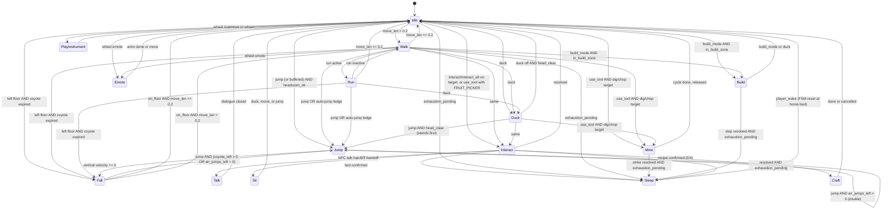
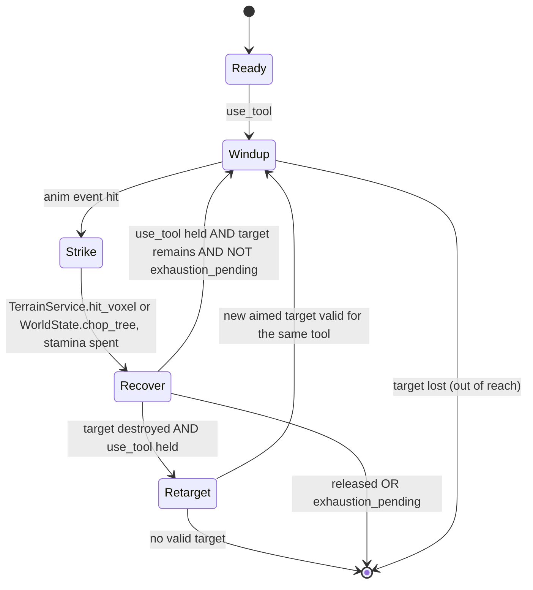
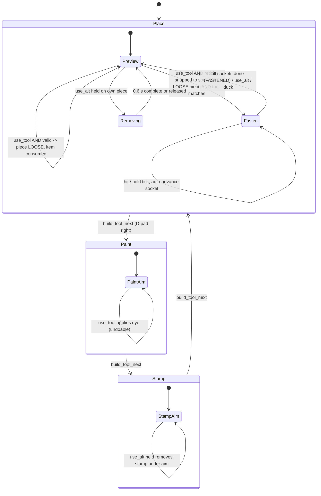
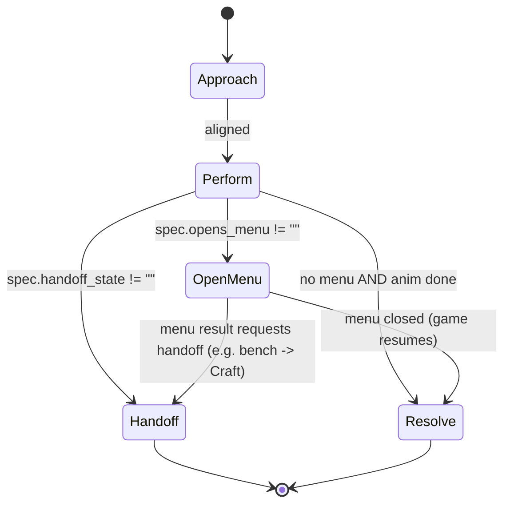
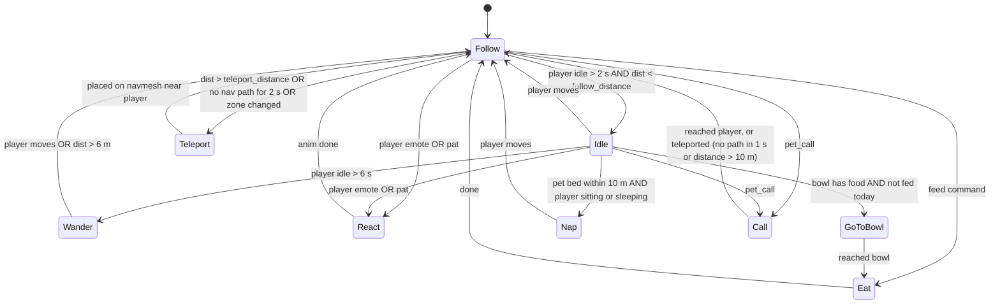
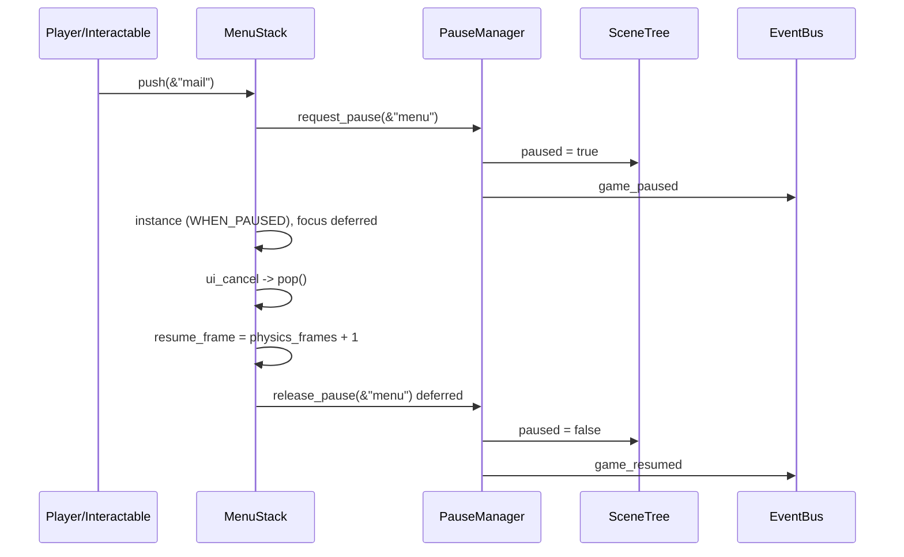
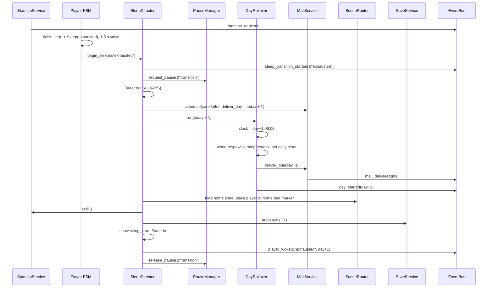

# Spec 1: Core Functional Specification

| Field | Value |
|---|---|
| Status | DRAFT rev 3.13, all decisions resolved |
| Revision | rev 1: core systems. rev 2: kid-friendly, accessibility, forgiving logic, expression systems, integration tests. rev 3: D1 to D4 resolved (dig-anywhere blocky voxels, jump and double jump, context-aware interaction with dedicated critical states, crafting flow confirmed). rev 3.1: D16 to D19 confirmed. rev 3.2: D5 to D15 resolved (farming system added, pets on day 2, keep last tool), min-spec hardware, test command note. rev 3.3: D20 to D25 resolved (macOS min spec M1 16 GB; 30 fps on min spec, 60 fps on recommended spec). rev 3.4: D26 recommended spec. rev 3.5: Phase 2B farming details (farm events, save shape, extra 10.4 rows, Home Meadow). rev 3.6: Phase 3 build lattice layers, socket attach transforms, support rule, `build` save shape (`build_rev36` replaces the per-plot list). rev 3.7: Phase 4 `jobs` save shape (ranks nested under `jobs.jobs`, contract origin_y); job sites are build zones and flattened; starting coins 150. rev 3.8: Phase 5 details (pet settles at 80% of follow_distance; never-expire mail kinds; mail prune after delivery; NPC straight steering where no navmesh is baked; generated instrument tones; care letters signed by the best friend). rev 3.9: Phase 6 (save layout with per-slot voxel directories and epochs, schema v2 with migration from v1, zone navigation baking, level town volumes, curator Y donates, static zones drop the previous terrain). rev 3.10: section 11 art assets (smooth low-poly, CC0 packs, model wiring). rev 3.11 (owner 2026-11-20): one world scale 0.75 m per KayKit unit, player 1.7 m, Quaternius free characters (11.4 to 11.7). rev 3.12: pets, crops, tools, block textures (11.8 to 11.10). rev 3.13 (owner 2026-11-21): title screen, new games start outdoors, dressed world, picture-first menus (section 12) |
| Engine | Godot 4.7 stable (4.7.2 latest patch found, 2026-08-18), GDScript |
| Physics | Jolt Physics (built-in module) |
| Voxels | Zylann Voxel Tools 1.7, GDExtension edition (MIT), released 2026-08-20, targets Godot 4.5+ |
| Renderer | Forward+ (see D13) |
| Tests | gdUnit4 v6.2.3 (latest release found, 2026-11-01) |
| Targets | Windows x86_64, Linux x86_64, macOS (x86_64 and arm64) |
| Audience | Kids and families; single player, offline |

Section map: 0 scope and decisions, 1 architecture, 2 input and automation, 3 data structures, 4 FSMs, 5 UI and pause, 6 forgiving game logic, 7 expression systems, 8 testing, 9 voxel terrain, 10 farming.

---

## 0. Scope, Constraints, and Verified Facts

### 0.1 Scope (v1)
- 3D third-person cozy life sim: tall humanoid player, outfit customizer, ducking, **jump and double jump**, foraging (apple trees), **dig-anywhere blocky voxel terrain** outside protected zones (ores, currency, geodes, buried treasure), grid building with hammering/screwing, placing dug blocks back.
- Economy: coin wallet, shops, starter cabin, house plot purchasing.
- Jobs: Builder, Tailor (Tailor also makes pet accessories).
- NPCs: dialogue, gifting, job and shop access, Museum curator.
- Mail: letters and packages with attachments, including exhaustion care packages.
- Stamina instead of health. No damage, no hazards, no fail state.
- **Farming**: till soil, plant seeds, water, grow over in-game days, harvest; sprinklers; crops feed the economy, the Tailor (cotton) and the Museum.
- Museum and Collection Book.
- Pet companion with feeding and accessories.
- Painting and stamping placed objects, interactive furniture, emote and instrument wheel.
- Gamepad-primary input with keyboard/mouse secondary; every menu pauses the game.

Out of scope for v1: multiplayer or any network feature, seasons and weather (D20, D21), smooth (Transvoxel) terrain, gravity or collapse simulation for voxels or buildings, Steam Input-specific handling, mobile/web, localization beyond key-based strings.

### 0.2 Design pillars (kid-friendly rules, apply to every system)
| ID | Rule | Enforcement |
|---|---|---|
| K1 | No fail states. Nothing the player does loses items, coins, progress, or the pet. | All commands are all-or-nothing; overflow items drop as pickups; save ordering prefers duplication over loss (9.6); tests assert no loss (8.4, 8.5) |
| K2 | No damage, no enemies, no hazards. | No health stat exists. Falls, pits and water are handled by SafeGround and Go Home (6.3) |
| K3 | Icon-first communication. Every prompt is readable without reading text. | World prompts are glyph + pictogram; labels optional (2.8) |
| K4 | Never color-only. Every color signal has a shape, icon, or pattern twin. | Colorblind palettes and patterns (2.7, 2.8) |
| K5 | Forgiving input. Generous snap and aim radii, auto-tool, auto-jump, coyote time, jump buffer, toggle instead of hold, no timing-critical inputs. | Settings defaults (5.10), 4.2.1 |
| K6 | Fair randomness. Bad-luck protection on all drop tables; unlocks never duplicate. | Pity counters and unique pools (6.4) |
| K7 | Gentle pacing. Low stamina is a nudge, not a punishment. Exhaustion is a cozy event. | 6.1, 6.2 |
| K8 | Offline and private. No accounts, telemetry, chat, or purchases. | No network code in v1 |
| K9 | The world cannot be broken. Digging never leaves authored objects floating and never traps the player for good. | Protection rules (9.3), bedrock floor and Go Home (6.3) |

### 0.3 Engine and framework facts this spec relies on
Godot facts verified against `godotengine/godot` tag `4.7-stable` class reference XML. gdUnit4 facts verified against `MikeSchulze/gdUnit4` tag `v6.2.3` source. Voxel Tools facts verified against `Zylann/godot_voxel` `master` docs (`doc/source/*.md`, `doc/source/api/*.md`) and its GitHub releases page.

| Fact | Consequence |
|---|---|
| `physics/3d/physics_engine` default `DEFAULT` "is currently equivalent to GodotPhysics3D"; Jolt is default only for projects created in 4.6+. | `project.godot` MUST set `physics/3d/physics_engine="Jolt Physics"` explicitly. |
| Desktop joypad input uses SDL3 since 4.5. `JOY_BUTTON_A`=0 is the bottom face button (Cross on DualShock). | One binding set covers XInput and DualShock; only glyphs differ. |
| `Input.get_joy_info(device)` returns `vendor_id`, `product_id`, `raw_name`; `Input.joy_connection_changed(device, connected)` exists. | Glyph set by vendor ID; disconnect auto-pauses. |
| `SceneTree.paused = true` stops 2D/3D physics globally and stops callbacks for nodes resolving to `PAUSABLE`. | Menus need `WHEN_PAUSED`/`ALWAYS`; pet, NPCs, stamina regen freeze while paused. |
| Autoloads default to `PROCESS_MODE_INHERIT` (effectively pausable). | Each autoload's mode is specified in 1.2. |
| `SceneTree.create_timer(time_sec, process_always = true, ...)` runs while paused by default. | Gameplay code passes `false` or uses `Timer` nodes. |
| `Node.create_tween()` binds to the node (`TWEEN_PAUSE_BOUND`); `SceneTree.create_tween()` is unbound. | Gameplay tweens use `Node.create_tween()`. |
| `JSON.stringify` writes all numbers as float; `JSON.parse` returns floats. | Loader casts integer fields with `int()`. |
| `ui_*` built-in actions cannot be removed; their events can be modified. | UI events are specified explicitly (2.4). |
| GridMap stores only MeshLibrary index + orientation per cell. | Custom grid for stateful pieces (1.6). |
| `Decal` is supported only in Forward+ and Mobile, not Compatibility. Mobile shows at most 8 decals per mesh resource. | Stamps use Decals and require Forward+ (D13). Cap 8 stamps per piece regardless. |
| `GeometryInstance3D.set_instance_shader_parameter()` requires `instance uniform` in the shader. | Paint uses per-instance uniforms, no material duplication (7.2). |
| `DisplayServer.tts_speak()` is implemented on Linux (X11/Wayland), macOS, Windows. `audio/general/text_to_speech` enables TTS on startup. | Optional read-aloud for letters and prompts (D14). OS voice availability not verified per distro. |
| gdUnit4: `monitor_signals(source, _auto_free := true)` **frees the source at test end by default**. | Monitoring an autoload (`EventBus`) MUST use `monitor_signals(EventBus, false)` or the autoload is freed. |
| gdUnit4: `GdUnitSceneRunner.simulate_frames()` awaits `process_frame`, not `physics_frame`. | Area3D overlap tests explicitly await `get_tree().physics_frame` (8.2). |
| gdUnit4 headless: "InputEvents are not transported by the Godot engine in headless mode". | Integration tests inject `InputFrame`s and call commands; no simulated button events (8.2). |
| gdUnit4 signal asserts: `await assert_signal(obj).wait_until(ms).is_emitted(name, args...)` and `is_not_emitted(...)`. | Used in all integration specs. |
| Voxel Tools GDExtension works with official Godot builds and regular export templates; ships Windows x86_64, Linux x86_64, macOS x86_64 and arm64. | No custom engine build; the headless test command stays valid. |
| Voxel Tools docs: the GDExtension "has gone through less testing, so it might have bugs that are not present in the Module edition"; `FastNoise2` is not included. | Plan1 starts with a spike. World generation uses Godot's built-in noise. Fallback: module edition (custom Godot 4.7.2 build). |
| `VoxelTerrain` uses a simple grid of blocks with Minecraft-like view distance; `VoxelMesherBlocky` batches per-type voxel models. | Chosen terrain node and mesher. |
| `VoxelTerrain.save_modified_blocks()` is asynchronous and returns a `VoxelSaveCompletionTracker` (`is_complete()`, `is_aborted()`, `get_remaining_tasks()`, `get_total_tasks()`). | Save waits on the tracker (9.6). |
| Streams available: `VoxelStreamSQLite` (`database_path`), `VoxelStreamRegionFiles`, `VoxelStreamScript`. | SQLite per save slot (9.6). |
| `VoxelTool` (from `get_voxel_tool()`): `get_voxel`, `set_voxel`, `raycast`, `do_box`, `do_sphere`, `is_area_editable`, `get_voxel_metadata`, `set_voxel_metadata`. | Wrapped by `IVoxelWorld` (9.1). Game-rule protection is our own layer (9.3). |
| Mesh-based voxel collision rebuilds trimesh shapes on each edit; upstream docs call this "very slow" (upstream issue 54). `VoxelBoxMover` is a fast Minecraft-like alternative with step climbing (`set_step_climbing_enabled`, `set_max_step_height`, `get_motion`). | Collision latency budget and spike; `VoxelBoxMover` fallback (9.5). |
| Upstream: "currently there is no general solution" for AI navigation on dynamic voxel terrain; navmeshes are not supported out of the box. `VoxelAStarGrid3D` (`set_terrain`, `set_region`, `find_path`, `find_path_async`) "is tuned for agents 2 voxels tall and 1 voxel wide" that "can jump 1 voxel high". | Pet uses `VoxelAStarGrid3D` on voxel ground; NPCs stay in protected areas with baked navmeshes (9.4). |

### 0.4 Resolved decisions
| ID | Decision | Applied in |
|---|---|---|
| D1 | Dig-anywhere terrain: **blocky voxels, 1.0 m**, diggable everywhere **except protected zones**, built on **Voxel Tools GDExtension** | 9, 1.3, 1.6, 2.6, 3.4, 4.3, 6.4 |
| D2 | **Jump and double jump**, both available from the start. **A = jump, X = interact, Y = secondary interact**; build mode moves to D-pad up | 1.4, 2.2, 2.3, 2.8, 4.2 |
| D3 | **Context-aware `Interact`** for most interactions; **dedicated states** for critical ones, chosen by explicit criteria C1 to C5 | 4.5 |
| D4 | Recipe chosen in a paused menu; timed `Craft` state runs in the world and is cancellable | 4.2, 4.5 |
| D16 | **Overworld digging is permanent; the Deep Mine regenerates every day** from a per-day seed, keeping ore renewable | 3.5, 6.2, 9.2 |
| D17 | **Dug blocks can be placed back**: natural blocks drop as `BLOCK` items and are placed on the 1 m grid with the Build Place tool | 2.7, 4.4, 9.3 |
| D18 | **Auto-jump onto 1-voxel ledges is on by default**; setting to disable | 4.2, 4.2.1, 5.10 |
| D19 | **Go Home button in the pause menu**: fade home at no cost and no time skip, so a child can never be stuck | 5.8, 6.3 |
| D5 | **House plots are bought with upfront coins** (no financing) | 1.8, 4.5 |
| D6 | **20 real minutes per in-game day**, 06:00 to 02:00, forced sleep at 02:00 | 6.2 |
| D7 | **3 manual save slots + autosave on every sleep** (bed, late night, exhaustion) | 3.5, 6.2, 9.6 |
| D8 | **Apple trees cannot be chopped.** Fruit trees use the FRUIT_PICKER; separate timber trees and fallen logs use the AXE | 2.6, 4.3 |
| D9 | **Add a farming system**: tilling, planting, watering, growth over days, harvesting, sprinklers. Museum "crops" are farmed crops plus foraged produce | 10, 2.6, 3, 6.2, 6.5, 8.5.1 (Suite F) |
| D10 | **Free starter cabin** with bed and mailbox, plus a small owned starter garden plot next to it | 9.2, 10.2 |
| D11 | **Pet arrives by letter on day 2** (day 1 brings a welcome letter with starter seeds) | 7.1, 10.7 |
| D12 | **Dyes are unlocks**, never consumed | 7.2 |
| D13 | **Forward+ renderer** | 0.3, 0.7, 7.2 |
| D14 | **TTS with OS voices, setting default off** | 2.8, 5.10 |
| D15 | **Keep the last tool** when no targets remain; `auto_tool_revert` setting (default off) restores the 1.0 s revert | 2.6, 8.3 A13 |
| D20 | **No seasons in v1**: every crop grows all year | 10.1 |
| D21 | **No weather in v1**: watering by can and sprinklers only | 10.1 |
| D22 | **Farming only on owned plots and the starter garden** | 10.2 |
| D23 | **Neglected crops suffer nothing**: unwatered crops do not grow that day; crops never wilt, die or rot | 10.5 |
| D24 | **macOS minimum spec: base Apple M1 with 16 GB RAM** (Apple Silicon only; Intel Macs unsupported) | 0.7 |
| D25 | **30 fps at 1920x1080, medium preset, on min spec** (Windows/Linux and macOS); **60 fps on the recommended spec** (D26) | 0.7, 9.5 |
| D26 | **Recommended spec (60 fps at 1920x1080 medium):** Windows/Linux AMD Ryzen 5 3600, 16 GB RAM, Nvidia GeForce RTX 2070; macOS Apple M2, 16 GB | 0.7 |

### 0.5 Open decisions
None. All decisions D1 to D26 are resolved (0.4).

### 0.6 Known issues and risks raised
1. **Test command.** The owner updated CLAUDE.md (2026-11-16) to `godot --headless --path . -s -d res://addons/gdUnit4/bin/GdUnitCmdTool.gd --ignoreHeadlessMode -a res://test`. Remaining risk: with `-d` and no remote debugger, a GDScript parse error drops Godot into its interactive `debug>` prompt and the run never exits (a hung CI job instead of a failure). gdUnit4 v6.2.3's own `runtest.sh` passes `--remote-debug tcp://127.0.0.1:0` for exactly this reason (comment in that script). Recommended command, to verify in plan1 P0.3 and then propose for CLAUDE.md:
   `godot --headless --path . -s -d --remote-debug tcp://127.0.0.1:0 res://addons/gdUnit4/bin/GdUnitCmdTool.gd --ignoreHeadlessMode -a res://test`
2. **Headless tests cannot drive UI via InputEvents.** Integration tests assert on signals and direct calls.
3. **gdUnit4 4.7 support is implicit.** v6.1.0 declares 4.6.x; v6.2.3 fixes a "fresh Godot 4.7 editor" issue. Smoke test first.
4. **Pause ownership.** Only `PauseManager` writes `get_tree().paused`, with ref-counted reasons.
5. **Input bleed on unpause.** Resume-frame guard (5.5).
6. **EventBus is not a transaction mechanism.** Commands (direct calls returning results) vs events (1.5).
7. **Untrusted `.tres` saves.** Saves are JSON only. The voxel SQLite file holds voxel data only and is opened only by `VoxelStreamSQLite`, never by `ResourceLoader`.
8. **Red/green placement boxes fail for the most common color-vision deficiencies.** Requested green/red stays the default palette, but every state also has an icon and pattern, and blue/orange and high-contrast palettes exist (2.7).
9. **D2 replaces the rev 2 "glowing green A / Cross" requirement.** A is now jump. Primary world prompts are X (Xbox blue X, PlayStation pink Square); secondary prompts are Y (Xbox yellow Y, PlayStation green Triangle). Menus still confirm with A, so a child presses X to talk and A to advance dialogue; the dialogue box shows the A glyph on its advance arrow to bridge this.
10. **Auto-tool can fight the player.** Without debounce, hysteresis, action locks, and manual override, tools flicker at zone borders or switch mid-swing (2.6).
11. **Day rollover must not depend on signal connection order.** Exhaustion letters must be scheduled before mail delivery runs. Rollover is an explicit ordered pipeline (6.2).
12. **Exhaustion snack farming.** Free snacks on every exhaustion invite deliberate exhaustion. Snack is limited to once per in-game day; the real cost of exhaustion is losing the rest of the day.
13. **Museum reward duplication on reload.** Rewards are recorded as granted and never re-derived into a second grant (6.5).
14. **gdUnit4 `monitor_signals` frees the monitored object by default.** Must pass `false` for autoloads.
15. **Paused state leaking between tests.** A failing test that leaves the tree paused stalls all following tests. `PauseManager.reset_for_tests()` runs in every `after_test`.
16. **Zone overlaps need physics ticks.** `simulate_frames` advances process frames; tests must await physics frames.
17. **Context reuse of buttons** (instrument notes on A/B/X/Y/shoulders/triggers, Build overrides on D-pad and shoulders). Safe only because contexts are disjoint; rebinding validation enforces it (2.5).
18. **Voxel GDExtension maturity.** Less tested than the module edition. Plan1 starts with a spike: load, dig, place, save and reload, headless test run, exported build on all three OSes. Fallback is the module edition, which needs a custom editor binary, custom export templates, and a CI change.
19. **Voxel collision rebuild latency.** Each dig rebuilds the trimesh collision of that data block. Budget: collision updated within 100 ms of an edit, and no frame over 33.3 ms (no drop below the 30 fps min-spec target, D25) while digging continuously on min-spec hardware (0.7). Fallback: `VoxelBoxMover` for player terrain collision (9.5).
20. **Navigation on editable voxels is unsolved upstream.** Pet uses `VoxelAStarGrid3D` (fits its 1x2 agent assumption) with teleport fallback; NPCs are confined to protected areas with baked navmeshes and never path across dug terrain.
21. **Headless voxel behavior is unverified** (meshing, collision, worker threads with the headless display server). All gameplay talks to terrain through `IVoxelWorld`; tests use `FakeVoxelWorld` (9.7). One real-terrain smoke suite, tagged `@voxel_real`, must pass in the spike.
22. **Two-file save consistency.** JSON state and the voxel SQLite file can diverge after a crash. Slot files change only at explicit saves through a working copy, with an epoch check (9.6). Copying the SQLite file while the stream holds it open after the save tracker completes is **unverified**; the spike confirms it or switches to a fresh `database_path` per save.
23. **Player height on a 1 m grid.** The 1.7 m standing height (rev 3.11) needs 2 free voxels; 1-voxel crawl spaces force Duck (0.9 m); jumps need headroom. Level generation and auto-jump checks use these numbers.
24. **Kids digging deep pits.** A double jump clears 2 voxels; deeper pits need stairs. Digging the voxel directly under your feet is blocked (9.3 P6), and Go Home (D19) guarantees escape.
25. **Floating trees and structures.** Support voxels under fruit trees, interactables, placed pieces and spawn points are protected (9.3 P3, P4).
26. **Farming makes soil targets ambiguous.** Aiming at grass could mean dig (shovel) or till (hoe). Rule: the selected hotbar item decides; seeds selected means till-and-plant, otherwise dig (10.4). Tilling without seeds needs a manual HOE pick on the wheel.
27. **Crops in unloaded zones.** Growth is computed in `FarmService` data at rollover, never by scene nodes, so crops grow while the player is elsewhere. Crop visuals and the wet-soil overlay are rebuilt from data on zone load.
28. **Min spec is CPU-bound.** The i7-3770 (4 cores, 8 threads, 2012, no AVX2) is far weaker relative to the GTX 1070. Voxel meshing threads, Jolt and GDScript compete for 8 hardware threads; the voxel spike and all performance budgets are measured on this CPU. A Voxel Tools GDExtension requirement for AVX2 was not found in its docs or build files, but this is unverified until the spike runs on the i7-3770.
29. **macOS min spec is a different machine class** (D24: base M1, 16 GB). Forward+ runs on Metal there (verified: `rendering/rendering_device/driver.macos` defaults to `metal` on Apple Silicon; Intel Macs fall back to Vulkan over MoltenVK and are unsupported). The M1's integrated GPU and the i7-3770 CPU are different bottlenecks, so every performance check runs on both min-spec machines.
30. **30 fps render with 60 Hz physics.** Two physics ticks per rendered frame on min spec; movement stays correct, but camera and character motion may look less smooth on high-refresh displays. Physics interpolation (`physics/common/physics_interpolation`) is evaluated in the Phase 1 manual check.

### 0.7 Target hardware (minimum spec, Windows and Linux)
| Component | Minimum |
|---|---|
| CPU | Intel Core i7-3770 (Ivy Bridge, 4 cores / 8 threads, 3.4 GHz; SSE4.2 and AVX, no AVX2) |
| RAM | 16 GB DDR3-1333 |
| GPU | Nvidia GeForce GTX 1070 (8 GB, Vulkan capable) |
| macOS (D24) | Apple M1 (base chip), 16 GB RAM; Apple Silicon only |

### 0.7.1 Recommended spec (D26, 60 fps target)
| Platform | CPU | RAM | GPU |
|---|---|---|---|
| Windows / Linux | AMD Ryzen 5 3600 | 16 GB | Nvidia GeForce RTX 2070 |
| macOS | Apple M2 (base chip) | 16 GB | integrated |

| Fact or target | Consequence |
|---|---|
| Godot 4.5 and 4.6 system requirements list an x86_64 CPU with SSE4.2 for the 64-bit editor and exports. The i7-3770 has SSE4.2. | Official x86_64 builds run on min spec. Re-check the 4.7 page when godotengine.org is reachable. |
| Forward+ uses Vulkan on Windows and Linux; the GTX 1070 supports Vulkan. | D13 Forward+ is viable on min spec. |
| Performance targets (D25): 30 fps at 1920x1080, medium preset, on both min-spec machines; 60 fps at 1920x1080 medium on both recommended-spec machines (0.7.1). | Measured in the Phase 0 spike and at every phase gate that adds heavy systems (2, 2B, 3, 5, 6). |
| Forward+ on macOS uses the Metal driver by default on Apple Silicon (4.7 `rendering/rendering_device/driver.macos`). | D13 Forward+ is viable on the M1; decals (stamps) are measured there too. |
| Voxel budget (9.5): edit-to-collision <= 100 ms, no frame > 33.3 ms while digging. | Measured on the i7-3770 and the M1. |
| Worker threads: leave at least 2 hardware threads for the main and physics threads. | Voxel Tools thread count is capped accordingly (spike confirms the setting). |

---

## 1. System Architecture and Node Hierarchy

### 1.1 Layering
```
+------------------------------------------------------------+
| Presentation   scenes/ (3D), ui/ (Controls)                |
+------------------------------------------------------------+
| Adapters       Node wrappers: Player, Pet, Interactables,  |
|                ToolAutoSelector, SnapAssist,               |
|                VoxelWorldAdapter, UI                       |
+------------------------------------------------------------+
| Services       GameSession-owned; validate commands, emit  |
|                EventBus events                             |
+------------------------------------------------------------+
| Models         RefCounted pure logic, no SceneTree access  |
+------------------------------------------------------------+
| Data           resources/*.tres (read-only definitions)    |
|                user://saves/slot_n.json                    |
|                user://saves/slot_n.voxels.sqlite           |
|                user://settings.cfg                         |
+------------------------------------------------------------+
```
Rule: Models never call `get_tree()`, never read `Input`, never emit EventBus signals, and never touch Voxel Tools classes directly (only through `IVoxelWorld`, 9.1).

### 1.2 Autoloads (order is significant)
| # | Name | process_mode | Responsibility |
|---|---|---|---|
| 1 | `EventBus` | ALWAYS | Signal declarations only |
| 2 | `Database` | ALWAYS | Loads and validates definitions (3.9) |
| 3 | `Settings` | ALWAYS | Loads/saves `user://settings.cfg`, exposes accessibility options (5.10) |
| 4 | `InputService` | ALWAYS | Device detection, glyph set, rebinding, joypad events |
| 5 | `PauseManager` | ALWAYS | Sole writer of `get_tree().paused` |
| 6 | `GameClock` | PAUSABLE | In-game day/minute; triggers `DayRollover` (6.2) |
| 7 | `SaveService` | ALWAYS | JSON and voxel DB save/load, slots, migrations (9.6) |
| 8 | `SceneRouter` | ALWAYS | Zone transitions with fade |

### 1.3 Main scene tree (`res://scenes/main.tscn`)
```
Main (Node)                                   PAUSABLE
+-- GameSession (Node)                        PAUSABLE, owns all services
|   +-- InventoryService                      backpack, hotbar, containers
|   +-- ToolBeltService                       owned tools (one active per type)
|   +-- WalletService
|   +-- EconomyService                        shops, TransactionCoordinator
|   +-- HousingService                        plots, deeds, home bed
|   +-- JobService                            Builder, Tailor contracts
|   +-- MailService                           inbox, scheduled mail
|   +-- NpcService                            friendship, schedules
|   +-- BuildService                          pieces, fastening, paint, stamps, furniture state, block placement
|   +-- TerrainService                        dig/place commands, protection rules, voxel drops (9)
|   +-- FarmService                           tilled cells, crops, watering, growth, sprinklers (10)
|   +-- WorldStateService                     fruit trees, timber trees, chests, respawns
|   +-- StaminaService                        stamina, regen, depletion edge
|   +-- SleepDirector                         ALWAYS: bed / late-night / exhaustion transitions
|   +-- DiscoveryService                      geodes, treasure chests, pity counters
|   +-- MuseumService                         donations, cases, trophies
|   +-- CollectionService                     discovered entries (Collection Book)
|   +-- PetService                            pet state, feeding, accessories
|   +-- UnlockService                         recipes, dyes, stickers, emotes, outfits
|   +-- DayRollover (RefCounted helper)       ordered day pipeline (6.2)
+-- World (Node3D)                            PAUSABLE
|   +-- WorldEnvironment, Sun
|   +-- ZoneRoot (Node3D)                     current zone
|   |   +-- <Zone: Town | Wilderness | Orchard | DeepMine | Museum | StarterCabin | Plot_N>
|   |       +-- VoxelTerrain                  VoxelMesherBlocky; stream per 9.6 (absent in STATIC zones)
|   |       +-- VoxelWorldAdapter (Node)      implements IVoxelWorld over VoxelTool
|   |       +-- ProtectionVolumes (Node3D)    ProtectionVolume AABBs (9.3)
|   |       +-- StaticTown (Node3D)           hand-built meshes inside protected volumes
|   |       +-- NavigationRegion3D            protected areas only (NPCs)
|   |       +-- FruitTrees, TimberTrees, FallenLogs
|   |       +-- Farm (Node3D)                 CropView instances, SoilOverlay (MultiMesh wet soil), Wells
|   |       +-- Interactables                 Mailbox, ShopCounter, JobBoard, Workbench,
|   |       |                                 TailorBench, Wardrobe, PetWardrobe, PlotSign,
|   |       |                                 Bed, DonationDesk, DisplayCase, TrophyPedestal,
|   |       |                                 MineEntrance
|   |       +-- Chests                        TreasureChest instances
|   |       +-- BuildGrid                     BuildGridView on owned plots / job sites
|   |       +-- NPCs, SpawnPoints
|   |       +-- SafetyVolumes                 KillPlane, DeepWater (Area3D, 6.3)
|   +-- Player (CharacterBody3D)              1.4, has a VoxelViewer child
|   +-- Pet (CharacterBody3D)                 7.1
+-- UI (CanvasLayer, layer 10)                PAUSABLE
|   +-- HUD                                   clock, stamina, wallet, hotbar, tool icon
|   +-- PromptOverlay                         world-anchored button prompts (2.8), hidden while paused
|   +-- MenuStack                             ALWAYS (5.3)
|   +-- Toasts, DeviceBanner                  ALWAYS
+-- Fader (CanvasLayer, layer 100)            ALWAYS
```

### 1.4 Player (`res://scenes/player/player.tscn`)
| Parameter | Value |
|---|---|
| Standing capsule height / radius | 1.70 m / 0.30 m (needs 2 free voxels; rev 3.11, was 2.10 m / 0.35 m) |
| Ducking capsule height | 0.90 m (fits 1-voxel crawl spaces; was 1.30 m) |
| Eye height standing / ducking | 1.55 m / 0.75 m |
| Walk / Run / Duck-walk speed | 2.2 / 5.0 / 1.2 m/s |
| Gravity | 24 m/s^2 |
| Jump | apex 1.30 m (clears a 1-voxel step), initial vertical velocity 7.9 m/s |
| Double jump | vertical velocity set (not added) to 7.6 m/s, +1.20 m; about 2.5 m total from the ground, clears 2 voxels |
| Coyote time / jump buffer | 0.12 s / 0.15 s |
| Air control | 80% of ground acceleration |
| Max fall speed | 20 m/s |
| Reach (dig, place, aim) | 4.5 m from camera and 3.0 m from player center |
| Door clearance (build pieces) | 2.40 m (3-voxel openings) |

```
Player (CharacterBody3D)
+-- CollisionStanding, CollisionDucking (CollisionShape3D)
+-- HeadClearance (ShapeCast3D)        stand-up and jump headroom
+-- JumpClearance (ShapeCast3D)        headroom above the head for jumping
+-- VoxelViewer                        drives VoxelTerrain loading (added in Phase 2)
+-- Visual/Rig/Skeleton3D
|   +-- BodyMesh, OutfitSlots (Head, Top, Bottom, Feet, Accessory)
|   +-- ToolSocket (BoneAttachment3D, right hand)
|   +-- InstrumentSocket (BoneAttachment3D)
+-- AnimationTree
+-- CameraRig/Pitch/SpringArm3D/Camera3D
+-- InteractionProbe (Area3D)          interactable candidates within 2.0 m
+-- ToolDetector (Area3D)              detects ToolTargetZone areas (2.6)
+-- AimRay (RayCast3D)                 physics targets: pieces, NPCs, props
+-- InputReader (Node)                 only node that reads Input (2.1)
+-- ToolAutoSelector (Node)            2.6
+-- SafeGroundTracker (Node)           6.3
+-- StateMachine (Node)
    +-- Idle, Walk, Run, Duck, Jump, Fall, Mine, Build, Craft, Interact,
        Talk, Sit, Sleep, Emote, PlayInstrument
```

### 1.5 Commands vs events
| Kind | Mechanism | Naming | Returns |
|---|---|---|---|
| Command | Direct call on a service via `GameSession` | imperative | `Result {ok, error: StringName, data}` |
| Event | `EventBus` signal | past tense | nothing |

Services do not reference each other, except `TransactionCoordinator` (Economy), `SleepDirector`, `DayRollover`, `MuseumService` reward granting, and `TerrainService` (needs `IVoxelWorld`, Inventory, Discovery, Build occupancy), which receive collaborators by constructor injection. Transaction rule: validate everything, then mutate, then emit.

### 1.6 Build grid and voxel lattice
- Custom grid (GridMap cannot hold per-piece state). 1.0 m structure cells, 0.5 m furniture sub-grid, 90-degree rotations. `BuildService` holds `Dictionary[Vector3i, PieceInstance]` plus footprint occupancy. Snap assist in 2.7.
- Build cells and voxels share one lattice: cell `(x, y, z)` spans `[x, x+1) x [y, y+1) x [z, z+1)` meters.
- A cell holds a voxel **or** part of a build piece footprint, never both. `TerrainService` and `BuildService` both consult the shared occupancy check.
- Storey height 3 cells (3.0 m), clearing the 1.7 m player and 2.4 m doors.
- Occupancy layers (rev 3.6): a cell holds at most one FLOOR slab, one BODY piece (furniture, stairs) and one WALL piece per face. Walls sit on a cell face and are keyed by the canonical face, so two walls on the same edge collide while a floor, a wall and a chair can share one cell. Voxels still exclude every layer.
- Snap sockets carry the attach transform: `attach_offset` (cell offset of the attaching piece's anchor) and `attach_rot`, both rotated with the providing piece. Tags in use: `floor_next`, `wall_slot`, `floor_top`, `wall_end`, `wall_top`, `roof_slot`, `wall_face`, `ground`.
- Support (rev 3.6): at least one bottom footprint cell must stand on a solid voxel, on a FASTENED `provides_support` piece in the cell below, or (for non-floor pieces) on a FASTENED floor slab in the same cell.
- Phase 3 places furniture on whole cells; the 0.5 m furniture sub-grid is deferred.

### 1.7 Physics layers
| Layer | Name | Used by |
|---|---|---|
| 1 | world | VoxelTerrain collision, static town meshes, props |
| 2 | player | Player body |
| 3 | npc | NPC bodies |
| 4 | pet | Pet body (does not collide with player, 7.1) |
| 5 | interactables | interaction areas |
| 6 | tool_zones | `ToolTargetZone` areas |
| 7 | build_pieces | placed pieces |
| 8 | pickups | dropped items |
| 9 | safety | kill plane, deep water |

### 1.8 Domain summaries
| Module | Key commands | Key events |
|---|---|---|
| Inventory | `add`, `remove`, `can_add`, `move_slot`, `split` | `inventory_changed`, `item_added(item_id, qty)` |
| ToolBelt | `grant_tool`, `has_tool(type)`, `best_tool(type)`, `equip(type)`, `unequip()` | `tool_equipped(type, item_id, source)`, `tool_unequipped(source)` |
| Wallet | `can_afford`, `credit`, `debit` | `coins_changed` |
| Economy | `try_buy`, `try_sell`, `try_buy_plot` | `item_bought`, `item_sold`, `plot_purchased` |
| Housing | `grant_deed`, `set_home_bed` | `deed_granted`, `home_changed` |
| Jobs | `accept_contract`, `submit_contract` | `contract_completed`, `job_rank_up` |
| Mail | `schedule`, `deliver_due(day)`, `claim_attachments` | `mail_delivered`, `mail_claimed` |
| Build | `try_place`, `fasten_step`, `try_remove`, `try_place_block`, `try_paint`, `try_stamp`, `undo_decor`, `toggle_furniture` | `piece_placed`, `piece_fastened`, `block_placed`, `piece_painted`, `piece_stamped`, `furniture_toggled` |
| Farm | `try_till(cell, seed_item_id = "")`, `try_plant(cell, seed_item_id)`, `try_water(cell)`, `try_harvest(cell)`, `refill_can()`, `try_place_sprinkler(cell)`, `daily_growth(day)` | `soil_tilled(soil_cell)`, `crop_planted`, `crop_watered`, `crop_grew(cell, stage)`, `crop_harvested(cell, crop_id, qty)`, `can_refilled(water)`, `sprinkler_placed(cell)`, `farm_changed(zone_id)` (views). Crop events carry the crop cell (soil + 1 up). |
| Terrain | `hit_voxel(cell, tool_type)`, `can_dig(cell) -> Result`, `can_place(cell) -> Result`, `daily_reset(day)` | `voxel_damaged(cell, hits_left)`, `voxel_dug(cell, material_id)`, `voxel_placed(cell, material_id)` |
| WorldState | `harvest_tree`, `chop_tree`, `open_chest` | `tree_harvested`, `tree_chopped`, `chest_opened` |
| Stamina | `spend(amount, reason)`, `restore(amount, reason)`, `refill()` | `stamina_changed`, `stamina_low(level)`, `stamina_depleted` |
| SleepDirector | `begin_sleep(reason)`, `go_home()` | `sleep_transition_started(reason)`, `player_woke(reason, day)`, `player_sent_home` |
| Discovery | `roll_on_voxel_dug(material_id, cell)`, `open_geode(item_id)` | `geode_found`, `chest_spawned`, `unlock_granted(kind, id)` |
| Museum | `try_donate(item_id)`, `try_donate_batch(ids)` | `item_donated`, `display_case_unlocked`, `trophy_unlocked` |
| Collection | `mark_discovered(item_id)` | `entry_discovered` |
| Pet | `adopt`, `pat`, `try_feed(item_id)`, `equip_accessory`, `remove_accessory` | `pet_fed`, `pet_happiness_changed`, `pet_accessory_changed` |
| Unlock | `grant(kind, id)`, `is_unlocked(kind, id)` | `unlock_granted` |

Economy rules: integer coins only; buy price rounded up, sell rounded down; default sell 50% of `base_value`.

---

## 2. Input and Automation

### 2.1 Abstraction rule (referenced by CLAUDE.md)
1. Gameplay and UI code reads only named actions.
2. No gameplay script references device-specific events or constants. Exceptions: `InputService`, rebinding UI.
3. Only `Player/InputReader` polls gameplay actions, producing an `InputFrame` consumed by the FSM. `InputReader.inject(frame)` is the test seam.
4. Mouse motion delta is the one raw event, read only in `InputReader`.
5. The default input map's single source of truth is `scripts/input/input_bindings.gd` (actions, contexts, events as plain dictionaries, deadzones). `scripts/tools/generate_input_map.gd` writes it into `project.godot`; a unit suite fails if they drift (implemented in Phase 1).

`InputFrame` fields: `move: Vector2`, `look: Vector2`, `look_mouse: Vector2` (mouse delta), `run_pressed`, `run_held`, `jump_pressed`, `jump_held`, `duck_pressed`, `duck_held`, `interact_pressed`, `interact_alt_pressed`, `use_pressed`, `use_held`, `use_released`, `alt_pressed`, `alt_held`, `build_toggle_pressed`, `rotate_cw_pressed`, `rotate_ccw_pressed`, `build_tool_next_pressed`, `build_tool_prev_pressed`, `hotbar_next_pressed`, `hotbar_prev_pressed`, `hotbar_select: int`, `catalog_pressed`, `undo_pressed`, `wheel_pressed`, `pet_call_pressed`, `quick_eat_pressed`, `camera_reset_pressed`, `notes_pressed: int` (bitmask of 8 notes), `frame: int`.

### 2.2 Gameplay actions
| Action | Xbox | PlayStation | Godot joypad event | KB/M | Behavior |
|---|---|---|---|---|---|
| `move_*` | Left stick | Left stick | `JOY_AXIS_LEFT_X/Y` | W/A/S/D | deadzone 0.2 |
| `look_*` | Right stick | Right stick | `JOY_AXIS_RIGHT_X/Y` | Mouse | sensitivity, invert-Y |
| `jump` | A | Cross | `JOY_BUTTON_A` | Space | jump; second press in the air = double jump |
| `duck` | B | Circle | `JOY_BUTTON_B` | C, Left Ctrl | toggle (default) or hold |
| `interact` | X | Square | `JOY_BUTTON_X` | E | primary world prompt |
| `interact_alt` | Y | Triangle | `JOY_BUTTON_Y` | F | secondary world prompt |
| `run` | L3 | L3 | `JOY_BUTTON_LEFT_STICK` | Left Shift | toggle (default) or hold |
| `use_tool` | RT | R2 | `JOY_AXIS_TRIGGER_RIGHT` (0.5) | LMB | dig, chop, pick, fasten, place (auto-selected tool) |
| `use_alt` | LT | L2 | `JOY_AXIS_TRIGGER_LEFT` (0.5) | RMB | build: remove (hold) |
| `hotbar_next` / `hotbar_prev` | RB / LB | R1 / L1 | shoulders | Wheel, ] / [ | hotbar (food, blocks, placeables, pet food) |
| `hotbar_1..8` | none | none | none | 1..8 | KB only |
| `build_mode` | D-pad up | D-pad up | `JOY_BUTTON_DPAD_UP` | B | toggle Build mode |
| `emote_wheel` | D-pad left | D-pad left | `JOY_BUTTON_DPAD_LEFT` | G | opens wheel (menu, pauses) |
| `pet_call` | D-pad right | D-pad right | `JOY_BUTTON_DPAD_RIGHT` | H | pet comes to the player (7.1) |
| `quick_eat` | D-pad down | D-pad down | `JOY_BUTTON_DPAD_DOWN` | Q | eat best food for stamina |
| `camera_reset` | R3 | R3 | `JOY_BUTTON_RIGHT_STICK` | Middle mouse | recenter |
| `open_inventory` | View | Touchpad / Create | `JOY_BUTTON_BACK`, `JOY_BUTTON_TOUCHPAD` | I | Backpack, Outfit, Pet, Collection, Jobs, Map |
| `pause_menu` | Menu | Options | `JOY_BUTTON_START` | Esc | pause menu |

There is no manual tool-cycling action in gameplay. Tools come from the ToolBelt via auto-select (2.6) or the wheel's Tools page (manual override).

### 2.3 Context overrides
Meaning changes by FSM context, never by rebinding. Contexts: `GAMEPLAY`, `AIRBORNE`, `BUILD`, `INSTRUMENT`, `UI`. Contexts are disjoint; validation in 2.5.

| Action | Build: Place | Build: Paint | Build: Stamp | PlayInstrument |
|---|---|---|---|---|
| `use_tool` (RT) | place ghost or block / fasten snapped socket | paint selected region | place stamp | note 8 |
| `use_alt` hold 0.6 s (LT) | remove piece or placed block | none | remove stamp under aim | note 7 |
| `rotate_cw/ccw` (RB / LB) | rotate ghost | cycle paint region | rotate stamp 45 deg | notes 6 / 5 |
| `build_tool_next/prev` (D-pad right / left) | next/prev Build tool (Place, Paint, Stamp) | same | same | none / reopens wheel |
| `undo` (D-pad down) | none | undo last decor op | undo last decor op | none |
| `build_mode` (D-pad up) | exit Build | exit Build | exit Build | none |
| `interact` (X) | pick piece or block type under aim | eyedropper (copy dye) | none | note 3 |
| `interact_alt` (Y) as `build_catalog` | catalog (pieces, blocks) | dye palette | sticker sheet + size | note 4 |
| `jump` (A) | jump (allowed) | jump | jump | note 1 |
| `duck` (B) | exit Build / cancel fasten | exit Build | exit Build | note 2 |
| `move` | walk | walk | walk | exits instrument |

KB/M in Build: rotate R / Shift+R or mouse wheel (read with exact matching so Shift+R does not also rotate clockwise); Build tools 1 / 2 / 3 (actions `build_tool_place`, `build_tool_paint`, `build_tool_stamp`); undo Z; catalog F; pick/eyedropper E; exit B or C. Instrument KB/M: notes on keys 1..8.

`AIRBORNE` (Jump, Fall): only `move`, `look`, `jump` (double jump), `use_tool` (single-shot dig or block place, 4.2.1) and `interact` on pickups are read.

### 2.4 UI actions (explicit events)
| Action | Gamepad | KB/M |
|---|---|---|
| `ui_accept` | A / Cross | Enter, Space |
| `ui_cancel` | B / Circle | Esc |
| `ui_up/down/left/right` | D-pad + left stick (0.5) | Arrows, W/A/S/D |
| `ui_tab_next/prev` | RB / LB | E / Q |
| `ui_page_next/prev` | RT / LT | Page Down / Page Up |
| `ui_secondary` | X / Square | Right click |
| `ui_tertiary` | Y / Triangle | R (Shift+Enter would also trigger `ui_accept`, which Controls read without exact matching) |
| `ui_wheel_select` | right or left stick direction (0.6) | Mouse direction from center |

### 2.5 Device handling and rebinding
- Active device switches on last meaningful input; emits `EventBus.input_device_changed(kind, glyph_set)`.
- Glyph set from `vendor_id`: `0x054C` PlayStation, `0x045E` Xbox, `0x057E` Nintendo (glyph-only change), else Xbox. User override.
- Mouse captured in gameplay, visible in menus or when window unfocused.
- Active pad disconnect opens Pause with `DeviceBanner`.
- Rebinds stored as plain dictionaries in `user://settings.cfg`; never serialized `InputEvent` objects.
- Conflict rule: one physical input may map to several actions only if they belong to disjoint contexts. Context table: `GAMEPLAY`, `AIRBORNE`, `BUILD`, `INSTRUMENT`, `UI`. `jump`, `pause_menu`, `ui_accept`, `ui_cancel` cannot be unbound from the gamepad. One intentional overlap: Esc is both `pause_menu` and `ui_cancel`; in menus `ui_cancel` is handled first and marks the event handled.

### 2.6 Auto-tool context switching
Tools live in the **ToolBelt**, not in inventory slots. Acquiring a `TOOL` item grants it to the belt. For each `ToolType`, the highest owned tier is the active instance.

`ToolType`: `PICKAXE, SHOVEL, AXE, FRUIT_PICKER, HOE, WATERING_CAN, HAMMER, SCREWDRIVER, PAINTBRUSH, STAMP`. Starter kit: SHOVEL, PICKAXE (tier 1), FRUIT_PICKER, HOE, WATERING_CAN.

Two target sources:
1. **Voxel targets (aim-based).** `IVoxelWorld.raycast(camera_origin, camera_forward, 4.5)` returns the first solid voxel within reach. Required tool = that material's `preferred_tool` (SHOVEL for soft materials, PICKAXE for hard), **unless a farm rule applies first** (10.4: seeds selected on farmable soil -> HOE; unwatered farmland -> WATERING_CAN; aimed water or well -> WATERING_CAN refill). A voxel failing `TerrainService.can_dig` yields no tool and a lock prompt with the reason pictogram.
2. **Zone targets (proximity-based).** `ToolTargetZone` (Area3D, layer `tool_zones`):

| Target | `required_tool` | Enter radius | Priority | Active when |
|---|---|---|---|---|
| TimberTree, FallenLog | AXE | 2.5 m | 20 | always |
| AppleTree (fruit > 0) | FRUIT_PICKER | 3.0 m | 20 | fruit > 0 |
| Loose structural piece, fastener NAILS | HAMMER | 3.0 m | 40 | Build mode, Place tool |
| Loose structural piece, fastener SCREWS | SCREWDRIVER | 3.0 m | 40 | Build mode, Place tool |
| Blueprint frame at job site (loose) | by fastener | 3.0 m | 40 | Build mode, Place tool |

PAINTBRUSH and STAMP are selected by the Build tool cycle, not by targets.

**Selection model** (`ToolSelectionModel`, pure RefCounted; `ToolAutoSelector` is the node adapter):
1. Candidates = active zones overlapping `ToolDetector`, plus the aimed voxel if within reach and diggable.
2. Best candidate: the aimed target (aimed voxel, or a zone whose target `AimRay` hits); else highest-priority zone; else nearest zone; ties by stable key order.
3. **Debounce**: a new best candidate must remain best for 0.15 s before a switch.
4. **Hysteresis**: a zone stays a candidate until distance exceeds enter radius + 0.5 m (exit-distance check, not a second shape). A voxel target keeps its tool while aim stays on the same material class, or aim is lost for less than 0.3 s.
5. **Action lock**: no switch while Mine is past `Ready`, Fasten is in progress, or in Craft, Interact, Talk, Sit, Sleep, Emote, PlayInstrument. Airborne does not lock. A pending switch is evaluated when the lock ends.
6. **Manual override**: choosing a tool on the wheel suspends auto-select until no candidates remain or 10 s pass.
7. **Missing tool**: equipment unchanged; prompt shows the required tool pictogram with a lock badge (`prompt_changed(target, &"missing_tool", tool_type)`).
8. **Tier too low** (pickaxe vs hardness): tool equips; tier-lock badge; using it shows a friendly toast, no stamina spent, voxel unchanged.
9. **No candidates**: keep the current tool (D15). If `Settings.auto_tool_revert` is on (default off), unequip to empty hands after 1.0 s with no candidates.
10. **Setting off** (`auto_tool = false`): selector inert; wheel Tools page is the only way to equip.
11. **Paused**: selector does not tick (PAUSABLE).

Emitted by ToolBelt: `tool_equipped(tool_type, item_id, &"auto" | &"manual")`, `tool_unequipped(&"auto" | &"manual")`. `ToolAutoSelector` also emits `EventBus.tool_auto_selected(tool_type, target_kind, reason)`, with `target_kind` in `&"voxel_soft" | &"voxel_hard" | &"timber" | &"fruit_tree" | &"loose_piece" | &"till" | &"water" | &"refill"` and `reason` in `&"zone_enter" | &"aim_change" | &"lock_released"`.

### 2.7 Magnetic grid and snap assist
**Ghost placement**
- AimRay hit gives a raw point; candidate cell = nearest grid cell for the piece's grid (1.0 m or 0.5 m).
- Snap sockets: each `BuildPieceDef` declares `snap_sockets: Array[SnapSocket]` (`position`, `normal`, `accepts_tags`, `provides_tags`). Walls provide `wall_end`, floors provide `floor_edge`, walls provide `wall_face` for furniture backs.
- Magnetic radius (by `Settings.snap_strength`):

| Strength | Structure radius | Furniture radius | Screw/nail reticle angle |
|---|---|---|---|
| Low | 0.30 m | 0.20 m | 4 deg |
| Normal | 0.45 m | 0.30 m | 6 deg |
| **High (default)** | 0.60 m | 0.35 m | 9 deg |

- The nearest compatible socket within radius wins; the ghost snaps to it and auto-rotates to align (walls to floor edges, furniture back to the nearest wall face, facing outward).
- Sticky snap: once snapped, the ghost stays until the raw point moves beyond 1.5x radius. Prevents stick jitter.
- If no socket is in range, fall back to plain grid cell + current manual rotation.

**Validity indicator**
| State | Default palette | Blue/Orange palette | High contrast | Always also shown |
|---|---|---|---|---|
| Valid | green translucent box + green outline | blue | white outline, solid | check icon above ghost |
| Invalid | red translucent box + red outline | orange | black/yellow diagonal stripes | X icon + reason pictogram |
| Snapped | outline pulse (off if `reduce_motion`) | same | thicker outline | magnet icon |

Invalid reasons with pictograms: `occupied`, `no_support`, `outside_plot`, `overlaps_player`, `missing_item`. Overlapping the pet is not invalid; the pet is nudged (7.1).

**Fastening mini-game (screws and nails)**
- Each fastenable piece has `fastener_sockets: Array[Marker3D]`. `fasten_steps = sockets * hits_per_socket` (nails 2 hits, screws 1 hold of 0.8 s).
- The reticle magnetically snaps to the nearest unfastened socket within the reticle angle. After a socket completes, the reticle auto-advances to the next nearest socket on the same piece, so a child never needs to re-aim.
- Hammer: each `use_tool` press drives the snapped nail one hit. Screwdriver: hold `use_tool`; progress fills; release keeps partial progress (no reset).
- `fasten_mode = HOLD` turns hammering into hold-to-progress too.
- No miss state exists. Pressing with no socket in range does nothing.

**Block placement (D17)**
- The ghost is a 1 m cube on the face of the aimed voxel or piece. Face stickiness: the ghost keeps the same face until aim leaves it by 0.3 m.
- `can_place` reasons (pictograms): `protected`, `occupied`, `inside_player`, `inside_pet`, `outside_reach`, `missing_item`.
- Placing a block that leaves fewer than 3 free voxels above where the player stands is allowed but shows a "low ceiling" pictogram.
- Build pieces can snap to the top face of solid voxels (`provides_tags = [&"ground"]`).

### 2.8 Color-coded controller prompts
`PromptOverlay` draws prompts in screen space over the focused target, positioned with `Camera3D.unproject_position()` and hidden when `Camera3D.is_position_behind()` is true or the target is occluded (AimRay line-of-sight check).

- Max 3 prompts per target: tool prompt (RT/R2/LMB) when a tool target, `interact` (X), `interact_alt` (Y). `jump` (A) is never shown as a world prompt.
- Each prompt = glyph + pictogram (e.g. speech bubble, gift, paw, chair, magnifier). Text label optional (`Settings.prompt_labels`, default on).
- Glyph colors by glyph set:

| Button | Xbox | PlayStation (classic) | Nintendo | KB/M |
|---|---|---|---|---|
| Bottom face | A green | Cross blue | B (neutral) | key cap neutral |
| Right face | B red | Circle red | A (neutral) | key cap neutral |
| Left face | X blue | Square pink | Y (neutral) | key cap neutral |
| Top face | Y yellow | Triangle green | X (neutral) | key cap neutral |
| Triggers | RT/LT white | R2/L2 white | ZR/ZL white | mouse icon |

- Glow pulse when actionable; dimmed with lock badge when not (missing tool, tier, full inventory, already fed today). `reduce_motion` replaces pulse with a static outline. High-contrast mode uses white glyph on black disc.
- Replaces text-heavy menus for common actions (X = primary, Y = secondary):

| Target | X | Y | Tool |
|---|---|---|---|
| NPC | Talk | Gift (item picker filtered to giftable) | none |
| Curator NPC | Talk | Donate (donation menu) | none |
| Pet | Pat | Feed if pet food owned and not fed today, else Dress Up | none |
| Apple tree | Pick | none | FRUIT_PICKER |
| Farmable soil, seeds selected | none | none | HOE (till and plant in one action) |
| Empty farmland, seeds selected | none | none | seed icon (plant) |
| Crop or farmland not watered today | none | none | WATERING_CAN |
| Ripe crop | Harvest | none | none |
| Well or water | Refill can | none | WATERING_CAN |
| Diggable voxel | none | none | SHOVEL or PICKAXE (material icon) |
| Non-diggable voxel | none | none | lock pictogram with reason (no glyph) |
| Treasure chest | Open | none | none |
| Chair/sofa | Sit | none | none |
| Bed | Sleep | Set as Home (if owned plot bed) | none |
| Lamp/radio/toggle | Toggle | none | none |
| Mailbox | Open mail (badge with unread count) | none | none |
| Mine entrance | Enter Deep Mine | none | none |
| Shop / Job board / Bench | Open | none | none |

- Read-aloud: if `Settings.tts_enabled`, focusing a new target speaks the primary prompt verb once.

---

## 3. Data Structures

Conventions: `StringName` ids, lowercase snake_case, never renamed after ship. Prefixes: `item_`, `recipe_`, `piece_`, `outfit_`, `npc_`, `job_`, `contract_`, `plot_`, `mail_tpl_`, `shop_`, `dye_`, `sticker_`, `emote_`, `pet_`, `petacc_`, `case_`, `trophy_`, `loot_`, `mat_` (voxel materials), `zone_`, `prot_`. Display text is a translation key. Definitions are `Resource` subclasses (typed classes under `res://scripts/data/`), authored as JSON in `res://resources/data/*.json` and built by the `Database` autoload at boot (implemented in Phase 2; CLAUDE.md allows Resource scripts or JSON, and JSON keeps content reviewable in diffs). Read-only at runtime. Runtime state is plain data serialized to JSON.

### 3.1 Item definition (`ItemDef`)
| Field | Type | Rule |
|---|---|---|
| `id` | StringName | `item_` prefix |
| `name_key`, `desc_key` | String | translation keys |
| `category` | enum | `RESOURCE, BLOCK, SEED, MINERAL, FABRIC, PRODUCE, FOOD, PET_FOOD, TOOL, BUILD_PIECE, FURNITURE, OUTFIT, PET_ACCESSORY, GEODE, KEY_ITEM` |
| `icon` | Texture2D | 128x128, must read clearly at 48 px |
| `max_stack` | int | 1..999; 1 if `has_instance_data` |
| `base_value` | int | coins >= 0 |
| `sellable`, `giftable` | bool | `KEY_ITEM` not sellable |
| `tags` | Array[StringName] | e.g. `&"snack"`, `&"ore"` |
| `has_instance_data` | bool | dyed outfits/accessories |
| `tool` | ToolData | if TOOL |
| `block` | BlockData | if BLOCK: `material_id: StringName` (the `VoxelMaterialDef` it places) |
| `seed` | SeedData | if SEED: `crop_id: StringName` |
| `food` | FoodData | if FOOD or PET_FOOD: `stamina_restore: int`, `pet_happiness: int` |
| `build_piece` | BuildPieceDef | if BUILD_PIECE/FURNITURE |
| `outfit` | OutfitDef | if OUTFIT |
| `pet_accessory` | PetAccessoryDef | if PET_ACCESSORY |
| `geode` | GeodeDef | if GEODE |
| `collection` | CollectionEntryDef | if donatable (3.7) |
| `world_scene`, `display_scene` | PackedScene | pickup visual; museum display visual |

`ToolData`: `tool_type: ToolType` (2.6), `tier: int (1..4)`, `power: int`, `strike_interval_sec: float`, `stamina_cost: int`. No durability (K1).

Item stack: `{ "item_id": "item_iron_ore", "qty": 12 }`, `{ "item_id": "item_shirt_linen", "qty": 1, "data": { "dye": "dye_moss" } }`. Stacks with non-empty `data` never merge. Dye is stored as a `dye_id`, never a raw color.

### 3.2 Recipe definition (`RecipeDef`)
| Field | Type | Rule |
|---|---|---|
| `id` | StringName | `recipe_` |
| `station` | enum | `HAND, WORKBENCH, TAILOR_BENCH` |
| `inputs` | Array[ItemAmount] | 1..6, resolvable, no duplicates |
| `outputs` | Array[ItemAmount] | 1..3 |
| `coin_cost` | int | default 0 |
| `craft_time_sec` | float | 0 = instant (D4) |
| `required_job`, `required_rank` | StringName, int | optional |
| `unlock` | enum | `DEFAULT, JOB_RANK, MAIL, PURCHASE, BLUEPRINT` |
| `category_key` | String | menu grouping |
| `xp_reward` | int | job XP |

`BLUEPRINT` recipes are unlocked by treasure chests (6.4). Tailor recipes include pet accessories (`petacc_*` outputs). `try_craft` is all-or-nothing.

### 3.3 Mail schema
`MailTemplateDef`: `id`, `sender_id`, `subject_key`, `body_key`, `kind: {LETTER, PACKAGE, JOB_OFFER, RECEIPT, CATALOG_ORDER, CARE_PACKAGE, REWARD}`, `attachments: Array[MailAttachmentDef]`, `expires_after_days`, `pool_id: StringName` (templates sharing a pool are picked by seeded RNG for variety), `illustration: Texture2D` (letters are picture-first for pre-readers).

Runtime message:
```json
{
  "id": "m_000142",
  "template_id": "mail_tpl_care_neighbor_02",
  "sender_id": "npc_hilde",
  "kind": "CARE_PACKAGE",
  "params": { "reason": "exhausted" },
  "sent_day": 14,
  "deliver_day": 15,
  "expires_day": 0,
  "attachments": [ { "type": "item", "item_id": "item_honey_bun", "qty": 1 } ],
  "read": false,
  "claimed": false,
  "archived": false
}
```
Attachment types: `item`, `coins`, `unlock_recipe`, `unlock_dye`, `unlock_sticker`, `unlock_emote`, `contract`, `pet_adoption`.

Rules:
- Ids are monotonic from `next_mail_seq` (deterministic).
- Never-expire kinds (rev 3.8): CARE_PACKAGE, PACKAGE, RECEIPT, REWARD, CATALOG_ORDER. Others expire after `expires_after_days`; expired unclaimed attachments move to `mail.lost_and_found` (claimable all-or-nothing at the mailbox). The inbox is pruned to 60 after each delivery, removing only archived and claimed messages.
- `deliver_due(day)` moves scheduled messages with `deliver_day <= day` into the inbox; idempotent.
- Claim is all-or-nothing; full inventory leaves attachments in place with a "make room" pictogram.
- `CARE_PACKAGE` and `REWARD` never expire (`expires_day = 0`). Other expired packages go to Lost and Found, never deleted.
- Inbox cap 100; prune only archived and claimed.

### 3.4 Other definitions
| Resource | Key fields |
|---|---|
| `OutfitDef` | `id`, `slot {HEAD, TOP, BOTTOM, FEET, ACCESSORY}`, `mesh`, `dyeable`, `default_dye_id`, `hide_body_regions`, `unlock` |
| `BuildPieceDef` | `id`, `scene`, `footprint: Array[Vector3i]`, `grid {STRUCTURE_1M, FURNITURE_0_5M}`, `fastener {NONE, NAILS, SCREWS}`, `fastener_sockets` (node paths in scene), `hits_per_socket`, `requires_support`, `provides_support`, `snap_sockets: Array[SnapSocket]`, `paint_regions: Array[PaintRegionDef]` (max 3), `stampable: bool`, `interactions: Array[FurnitureInteractionDef]` |
| `SnapSocket` | `position: Vector3`, `normal: Vector3`, `provides_tags`, `accepts_tags` |
| `PaintRegionDef` | `region_id {PRIMARY, SECONDARY, TRIM}`, `shader_param: StringName` (instance uniform name), `default_dye_id` |
| `FurnitureInteractionDef` | `kind {SIT, SLEEP, TOGGLE, PET_BED, FEED_BOWL, STORAGE, INSTRUMENT}`, `seat_markers: Array[NodePath]`, `toggle_states: int` (2 = on/off), `toggle_target: NodePath`, `stamina_regen_per_sec: float` (SIT), `instrument_id` (INSTRUMENT) |
| `VoxelMaterialDef` | `id` (`mat_dirt`, `mat_grass`, `mat_farmland`, `mat_stone`, `mat_copper_ore`, `mat_geode_rock`, `mat_chest_block`, `mat_bedrock`, ...), `voxel_id: int` (model index in the `VoxelBlockyLibrary`), `hardness_tier: int`, `hits: int` (with the preferred tool), `wrong_tool_hits_multiplier: int` (default 2), `preferred_tool {SHOVEL, PICKAXE}`, `drop: LootTableDef` (natural blocks drop their own `BLOCK` item), `discovery: DiscoveryTableDef` (optional), `special {NONE, GEODE, CHEST, BEDROCK}`, `placeable: bool`, `stamina_cost: int` |
| `ProtectionVolume` (authored node, data in `ProtectionVolumeDef`) | `id` (`prot_*`), `aabb_cells: AABB` (grid aligned), `reason {TOWN, BUILDING, MUSEUM, ROAD, JOB_SITE, SPAWN}`, `allows_place: bool` |
| `TerrainZoneDef` | `id` (`zone_*`), `kind {OVERWORLD, DEEP_MINE, STATIC}`, `generator_script`, `seed_mode {FIXED, PER_DAY}`, `bounds_cells: AABB` (bedrock at `min.y`), `persist_edits: bool`, `stream_db_key` |
| `JumpConfig` | gravity, jump and double-jump velocities, coyote, buffer, air control, max fall speed (1.4) |
| `CropDef` | see 10.3 |
| `FarmConfig` | see 10.3 |
| `LootTableDef` | `entries: Array[{item_id or "coins", min, max, weight}]`, `rolls`, `guaranteed` |
| `DiscoveryTableDef` | `geode_chance_pct`, `geode_item_ids` (weighted), `chest_chance_pct`, `chest_table: TreasureTableDef`, `geode_pity: int`, `chest_pity: int` |
| `TreasureTableDef` | `entries: Array[{kind {BLUEPRINT, DYE, STICKER, COINS, ITEM}, id_pool: Array[StringName], weight, coins_min, coins_max}]` |
| `GeodeDef` | `contents: Array[{item_id, weight}]` (minerals), `undiscovered_bias_pct` (default 200) |
| `FruitTreeDef` | `id`, `fruit_item_id`, `fruit_min/max`, `regrow_days`, `destructible = false` |
| `TimberTreeDef` | `id`, `max_hp`, `loot`, `respawn_days` |
| `DyeDef` | `id`, `name_key` (spoken/labelled name, required for accessibility), `color: Color`, `pattern_tex: Texture2D` (optional, for high-contrast) |
| `StickerDef` | `id`, `name_key`, `texture`, `rarity {COMMON, RARE, SPECIAL}` |
| `EmoteDef` | `id`, `icon`, `anim`, `duration_sec`, `pet_reaction: StringName`, `npc_reaction: StringName` |
| `InstrumentDef` | `id`, `icon`, `mesh`, `notes: Array[AudioStream]` (8, major scale), `anim_idle`, `anim_play` |
| `PetSpeciesDef` | `id` (`pet_dog`, `pet_cat`), `scene`, `walk_speed`, `run_speed`, `follow_distance`, `teleport_distance`, `accessory_bones: {HEAD, NECK, BODY: StringName}`, `favorite_food_tags` |
| `PetAccessoryDef` | `slot {HEAD, NECK, BODY}`, `meshes: Dictionary[StringName, Mesh]` (per species id), `dyeable`, `default_dye_id` |
| `NpcDef` | `id`, `name_key`, `scene`, `dialogue`, `gift_prefs`, `shop_id`, `job_id`, `schedule`, `is_curator: bool` |
| `JobDef`, `ContractDef`, `BlueprintDef`, `PlotDef`, `ShopDef` | as rev 1: ranks, contracts (BUILD_BLUEPRINT, DELIVER_ITEMS, CRAFT_ITEMS), blueprint pieces must be fastened, plot bounds and price, shop multipliers and stock |
| `StaminaConfig` | see 6.1 |
| `MuseumDef` | see 3.7 |

### 3.5 Save file schema (`user://saves/slot_<n>.json`)
```json
{
  "schema_version": 1,
  "game_version": "0.1.0",
  "saved_at_unix": 1763164800,
  "slot": 1,
  "rng": { "seed": 918273, "counters": { "loot": 412, "discovery": 77, "mail_pool": 9 } },
  "voxel": { "db_file": "slot_1.voxels.sqlite", "epoch": 37, "zones_with_edits": ["zone_wilderness", "zone_plot_03"] },
  "terrain": { "damaged": { "zone_wilderness": { "12,4,-7": 1 } }, "deep_mine": { "generated_day": 14 } },
  "meta": { "player_name": "Robin", "day": 14, "coins": 1340, "playtime_sec": 18342 },
  "clock": { "day": 14, "minute": 545 },
  "player": {
    "zone_id": "zone_town", "position": [12.5, 0.0, -4.0], "yaw": 1.57, "ducking": false,
    "stamina": 82, "max_stamina_bonus": 10,
    "home": { "zone_id": "zone_starter_cabin", "bed_key": "zone_starter_cabin/bed_01" },
    "outfit": {
      "HEAD": null,
      "TOP": { "item_id": "item_shirt_linen", "data": { "dye": "dye_moss" } },
      "BOTTOM": { "item_id": "item_trousers_denim", "data": {} },
      "FEET": { "item_id": "item_boots_leather", "data": {} },
      "ACCESSORY": null
    },
    "hotbar_index": 2
  },
  "exhaustion": { "last_snack_day": 13, "count_total": 3 },
  "toolbelt": { "PICKAXE": "item_pickaxe_copper", "SHOVEL": "item_shovel_basic", "FRUIT_PICKER": "item_picker_basic", "HAMMER": "item_hammer_basic" },
  "inventory": {
    "backpack": [ { "item_id": "item_apple", "qty": 6 }, null ],
    "hotbar_refs": [0, 3, null, null, null, null, null, null],
    "containers": { "chest_plot_03_a": [ null ] }
  },
  "wallet": { "coins": 1340 },
  "unlocks": {
    "recipes": ["recipe_fence_pine"], "outfits": ["outfit_shirt_linen"],
    "dyes": ["dye_moss", "dye_sky"], "stickers": ["sticker_star"], "emotes": ["emote_wave", "emote_dance"],
    "instruments": ["inst_flute"]
  },
  "housing": { "owned_plots": ["plot_03"] },
  "build_rev36": { "pieces": { "p0001": { "piece_id": "piece_wall", "zone": "zone_home_meadow", "cell": [-8, 0, 14], "rot": 3, "state": "LOOSE", "fasten": [2, 1, 0, 0], "toggle": 0 } }, "next_uid": 2, "placed_blocks": { "zone_home_meadow/-10,0,12": "mat_dirt" } },
  "build": {
    "plot_03": [
      {
        "piece_id": "piece_wall_pine", "cell": [2, 0, 5], "rot": 1,
        "fasten": 8, "fasten_max": 8, "state": 0,
        "paint": { "PRIMARY": "dye_sky", "TRIM": "dye_cream" },
        "stamps": [ { "sticker_id": "sticker_star", "pos": [0.1, 1.2, 0.05], "normal": [0, 0, 1], "rot_deg": 45, "size": "M" } ]
      }
    ]
  },
  "world": {
    "trees": { "zone_orchard/tree_004": { "fruit": 0, "regrow_day": 17 } },
    "timber": { "zone_wilderness/timber_012": { "chopped": true, "respawn_day": 18 } },
    "chests": { "zone_wilderness/chest_0003": { "cell": [4, 2, 9], "table": "loot_chest_overworld", "opened": false } }
  },
  "discovery": { "pity": { "geode": 3, "chest": 11 } },
  "farm": {
    "tilled": { "zone_home_meadow": ["2,0,3", "3,0,3"] },
    "crops": { "zone_home_meadow/2,1,3": { "crop_id": "crop_carrot", "growth_days": 2, "planted_day": 12, "harvests": 0 } },
    "wet": { "zone_home_meadow/2,0,3": 14 },
    "sprinklers": ["zone_home_meadow/4,1,3"],
    "watering_can": { "water": 14 }
  },
  "museum": {
    "donated": { "item_quartz": 9, "item_cotton_cloth": 12 },
    "cases_unlocked": ["case_minerals_common"],
    "trophies_unlocked": ["trophy_first_donation"],
    "rewards_granted": ["trophy_first_donation"]
  },
  "collection": { "discovered": ["item_quartz", "item_cotton_cloth", "item_apple"] },
  "pets": [
    {
      "pet_uid": "pet_0001", "species_id": "pet_dog", "name": "Biscuit", "color_variant": 2,
      "happiness": 74, "fed_day": 14, "pat_day": 14,
      "accessories": { "HEAD": { "item_id": "petacc_beanie", "data": { "dye": "dye_sky" } }, "NECK": null, "BODY": null }
    }
  ],
  "jobs": { "jobs": { "job_builder": { "rank": 2, "xp": 340 }, "job_tailor": { "rank": 0, "xp": 0 } }, "active_contracts": [ { "contract_id": "contract_builder_shed", "accepted_day": 12, "deadline_day": 15, "progress": 0, "origin_y": 5 } ], "completed_contracts": [] },
  "mail": { "next_mail_seq": 143, "inbox": [], "scheduled": [] },
  "npcs": { "npc_hilde": { "friendship": 220, "met": true, "gifted_day": 14, "flags": [] } },
  "shops": { "shop_general": { "stock_day": 14, "remaining": {} } }
}
```
Rules:
- JSON only; never load Resources from `user://`.
- Atomic write: `.tmp`, then rotate to `.bak`, then rename. Load falls back to `.bak` on parse or structural validation failure.
- Integer fields are cast with `int()` on load and rejected if non-integral. Museum `donated` values (days) are integers.
- Unknown content ids are dropped with a warning and a one-time notice; never crash.
- Content-level sanitization (does not fail the load): duplicate entries removed, `museum.donated` keys added to `collection.discovered` if missing, chests whose zone no longer exists dropped.
- Structural failures (wrong JSON type for a section) fail the load and trigger `.bak` fallback.
- Settings, including accessibility options, live in `user://settings.cfg`, shared across slots.
- Save is refused while `PauseManager.has_reason(&"transition")`, except the autosave step inside SleepDirector which runs at a defined point (6.2).
- Voxel content lives in `slot_<n>.voxels.sqlite`, not in JSON. `voxel.epoch` must match the DB epoch file (9.6).
- `terrain.damaged` holds partially hit voxels (`"x,y,z": hits_taken`) and is cleared at day rollover.
- Chests store their cell. Deep Mine voxels and chests are not saved (D16); items obtained there persist in inventory as usual.
- Placed natural blocks are voxels in the DB, not entries in `build`.

### 3.6 Pet runtime state
See `pets[]` in 3.5. Rules: `happiness` int 0..100 with floor 40 (K1/K7: never sad beyond "sleepy"); `fed_day` and `pat_day` gate once-per-day bonuses; `accessories` per slot hold an item stack (instance data allowed for dye).

### 3.7 Museum and collection definitions
`CollectionEntryDef` (embedded in `ItemDef.collection`):
| Field | Type | Rule |
|---|---|---|
| `category` | enum | `MINERAL, FABRIC, PRODUCE` |
| `set_id` | StringName | display grouping (e.g. `set_gems`) |
| `case_id` | StringName | display case that shows it |
| `hint_key` | String | silhouette hint for undiscovered entry |
| `sort_order` | int | book ordering |

Collection key is the `item_id`. Instance data (e.g. dye on a fabric) is ignored: a dyed and an undyed cotton cloth are the same entry. `PRODUCE` covers farmed crops (10) and foraged produce (apples, berries, mushrooms, flowers).

`MuseumDef` (`res://resources/museum/museum.tres`):
- `cases: Array[DisplayCaseDef]`: `id`, `category`, `unlock_rule {COUNT, SET_COMPLETE}`, `count`, `set_id`, `scene`, `slot_markers` (one per entry it displays).
- `trophies: Array[TrophyDef]`: `id`, `condition {TOTAL_COUNT, CATEGORY_COUNT, SET_COMPLETE, ALL_COMPLETE}`, `category`, `set_id`, `count`, `statue_scene`, `pedestal_key`, `reward: RewardDef`.
- `RewardDef`: `max_stamina_bonus: int`, `coins: int`, `unlocks: Array[{kind, id}]`, `mail_template_id` (reward delivered as a `REWARD` letter so it is never lost).

Display cases exist from the start as locked silhouettes; unlocking reveals the case; donated entries appear inside unlocked cases. Entries donated before their case unlocks are shown as soon as it unlocks.

### 3.8 Settings schema (`user://settings.cfg`, ConfigFile)
Sections: `[input]` (rebinds as plain dicts, `run_mode`, `duck_mode`, `fasten_mode`, `jump_auto`, `sensitivity`, `invert_y`, `glyph_override`), `[assist]` (`auto_tool`, `auto_tool_revert`, `snap_strength`, `go_home_confirm`), `[accessibility]` (`color_palette {DEFAULT, BLUE_ORANGE, HIGH_CONTRAST}`, `prompt_labels`, `text_scale {1.0, 1.25, 1.5}`, `reduce_motion`, `tts_enabled`, `tts_rate`), `[audio]`, `[video]`.

### 3.9 Static data validation (`Database` boot check and unit test)
- Unique ids and prefixes; all references resolve.
- `max_stack == 1` when `has_instance_data`.
- Every `BUILD_PIECE` with `fastener != NONE` has at least one fastener socket.
- Every `paint_regions[].shader_param` exists as an instance uniform in the piece shader.
- Every donatable item has a `case_id` that exists; every case's `count` is reachable by available entries; every trophy condition is satisfiable.
- Every `DiscoveryTableDef` pool is non-empty; every unlock id in treasure pools exists.
- Every `PetAccessoryDef` has a mesh for every species, or the item is flagged species-specific.
- Every `DyeDef` has a `name_key`.
- Every SEED item references an existing `CropDef`; every `CropDef` has a seed item, a harvest item with a `collection` entry (`PRODUCE`), and stage meshes matching `stages`; regrow stage < final stage.
- At least one `mail_tpl_care_*` template exists with a `CARE_PACKAGE` kind and one without a snack for repeat exhaustion.
- Every `VoxelMaterialDef.voxel_id` exists in the `VoxelBlockyLibrary` and is unique; every library model used by generation has a `VoxelMaterialDef`.
- Every placeable material has a `BLOCK` item and vice versa.
- `special = CHEST` materials have a `discovery.chest_table`; `special = GEODE` materials drop a GEODE item; exactly one `special = BEDROCK` material exists and is not diggable.
- Every `TerrainZoneDef` with `persist_edits = true` has a `stream_db_key`; `DEEP_MINE` zones have `persist_edits = false`.
- Every authored interactable, fruit tree, timber tree and spawn marker in a voxel zone lies inside a protection volume or gets runtime support protection (9.3 P3).
- `JumpConfig`: computed apex clears 1 voxel (jump) and 2 voxels (double jump) for the player capsule.

---

## 4. FSM State Diagrams

### 4.1 Framework
- `StateMachine` + `State` nodes (`enter(msg)`, `exit()`, `handle_input(frame) -> StringName`, `physics_update(delta) -> StringName`).
- Transition rules live in a pure `PlayerTransitionTable` mapping `(state, InputFrame, PlayerContext) -> next_state`, unit-tested without a scene.
- `PlayerContext`: `move_len`, `is_ducking`, `head_clear`, `in_build_zone`, `focused_target_kind`, `equipped_tool_type`, `tool_target_kind`, `tool_tier_ok`, `stamina`, `exhaustion_pending`, `seat_available`, `on_floor`, `vertical_velocity`, `coyote_left`, `jump_buffer_left`, `air_jumps_left`, `headroom_ok`, `ledge_ahead`, `aimed_voxel_material`, `aimed_voxel_dig_result`.
- Every transition emits `EventBus.player_state_changed(from, to)`.
- Paused tree: FSM does not tick; there is no Paused state.
- **Global rule**: `exhaustion_pending` is checked after the current state's step resolves; if true, the next state is `Sleep` with reason `&"exhausted"` from any grounded state. While airborne it waits for landing.

### 4.2 Player FSM (top level)


Transition table (first match wins):
| From | Condition | To | Side effects |
|---|---|---|---|
| any grounded | `exhaustion_pending` after current step | Sleep(exhausted) | input ignored, yawn 1.5 s, then SleepDirector |
| Jump/Fall | `exhaustion_pending` | stay until landing | then Sleep(exhausted) |
| locomotion | `interact_pressed`/`interact_alt_pressed` on target | Interact | face target (4.5) |
| Idle/Walk/Duck | `use_pressed`, tool FRUIT_PICKER, tree with fruit | Interact (FORAGE) | same as X on tree |
| Idle/Walk/Duck | `use_pressed`, aimed voxel diggable, tier ok | Mine | lock yaw to voxel |
| Idle/Walk/Duck | `use_pressed`, AXE, timber target in range | Mine | lock yaw |
| Idle/Walk/Duck | `use_pressed`, tier too low | stay | friendly toast, no stamina spent |
| Idle/Walk/Duck | `use_pressed`, aimed voxel not diggable | stay | reason pictogram toast, no stamina |
| Run | `use_pressed` or `interact_pressed` | Walk, then re-evaluate next frame | |
| Idle/Walk/Run | `jump_pressed` or buffered, `headroom_ok` | Jump | `vy = 7.9`; `air_jumps_left = 1` |
| Idle/Walk/Run | `jump_pressed`, not `headroom_ok` | stay | bump pictogram over head |
| Walk/Run | `ledge_ahead`, `Settings.jump_auto`, moving toward ledge for 0.3 s | Jump | auto-jump, same as manual |
| Duck | `jump_pressed`, `head_clear` | Jump | collider to standing first |
| Duck | `jump_pressed`, not `head_clear` | Duck | low ceiling pictogram |
| Jump | `jump_pressed`, `air_jumps_left > 0` | Jump | `vy = 7.6` (set, not added); `air_jumps_left = 0`; sparkle VFX |
| Jump | `vy <= 0` | Fall | |
| Jump/Fall | ceiling hit | Fall | `vy = 0` |
| grounded | left floor without jumping | stay for `coyote_time`, then Fall | `air_jumps_left = 1` (walking off a ledge keeps the double jump) |
| Fall | `jump_pressed`, `coyote_left > 0` | Jump | counts as a ground jump |
| Fall | `jump_pressed`, `air_jumps_left > 0` | Jump | double jump |
| Fall | `jump_pressed`, none left | Fall | buffered 0.15 s for landing |
| Fall | landed, buffered jump | Jump | |
| Fall | landed, fall height > 4 m | Idle/Walk | 0.2 s soft-land anim, no damage |
| Jump/Fall | entered KillPlane/DeepWater | SafeGround return (6.3) | |
| Idle/Walk | `build_toggle_pressed`, in build zone | Build | show grid |
| Idle/Walk | `build_toggle_pressed`, not in build zone | stay | pictogram toast (house + X) |
| Idle/Walk/Run | duck on | Duck | collider swap, lower camera |
| Duck | duck off, `head_clear` | Idle/Walk | |
| Duck | duck off, not `head_clear` | Duck | "low ceiling" pictogram |
| Walk | run active, `move_len > 0.2` | Run | |
| Run | `move_len <= 0.2` | Idle | run toggle resets |
| Build | `build_toggle_pressed` or `duck_pressed` | Idle | hide grid, free ghost |
| Idle/Walk | wheel closed with emote | Emote | pet/NPC reaction (7.4) |
| Idle | wheel closed with instrument | PlayInstrument | instrument in hand |
| Interact | handoff Talk / Sit / Sleep / Craft | that state | 4.5 |
| Sit | `duck_pressed`, `move_len > 0.5`, or `jump_pressed` | Idle | stand; the jump press does not also jump (resume guard) |
| Craft | timer elapsed | Idle | `try_craft` commit |
| Craft | move or duck | Idle | cancelled, nothing consumed |

Invariants (unit-tested): Run never active while ducking; leaving Duck requires head clear; at most one air jump per airtime, reset only on landing; no jump without headroom; Mine, Interact, Build, Talk, Sit, Craft, Emote, PlayInstrument are never entered while airborne; exactly one state active; Sleep entered once per depletion; no stamina spent in Jump, Fall, Sit, Talk, Emote, PlayInstrument, Build Paint/Stamp, Craft.

Duck mechanics: on enter, disable `CollisionStanding`, enable `CollisionDucking`, tween SpringArm length and camera height. `head_clear = not HeadClearance.is_colliding()` using the standing capsule offset upward.

#### 4.2.1 Airborne details
- Jump height is fixed (releasing A does not cut the jump), for predictability (K5).
- Auto-jump (ledge probes: physics ray and shape queries from `PlayerController`): the cell in front at foot level is solid, the cell above it is free, and 3 cells above the step top are free. Disabled while ducking, in Build Fasten, or within 0.5 s after a manual jump.
- Air actions: `use_tool` while airborne performs one dig strike or one block placement without entering Mine or Build (single-shot, no hold-repeat). This supports pillar building: jump, place a block below. Placing into the player's own cell is allowed only when the capsule bottom is above that cell's top.
- Landing never damages, stuns beyond 0.2 s, or costs stamina.

### 4.3 Mine sub-FSM (dig voxels, chop timber)

- Hits per voxel = `material.hits`, times `wrong_tool_hits_multiplier` with the non-preferred tool (auto-tool normally prevents this).
- Final hit: `TerrainService` re-checks `can_dig`, sets the voxel to air via `IVoxelWorld.set_voxel`, adds drops (overflow drops as pickups at the voxel center), calls `DiscoveryService.roll_on_voxel_dug`, emits `voxel_dug`.
- Holding `use_tool` keeps digging the next aimed voxel (Minecraft-like), re-checking protection each time.
- The strike that reaches 0 stamina still lands (K1).
- Timber: `chop_tree` reduces tree HP; at 0, loot drops and the tree respawns after `respawn_days`. Apple trees are never chop targets (D8).

### 4.4 Build sub-FSM

- Catalog (Y) opens a menu and pauses; returns to the same sub-state.
- Paint and Stamp only target pieces on plots the player owns (never job-site blueprint pieces before contract completion).
- Removing a painted/stamped piece returns the piece item; decor data is discarded (stickers and dyes are unlocks, nothing is lost).

Rev 3 changes to Build:
- Build tool cycling is on D-pad right/left; rotation is on RB/LB (2.3).
- The Place catalog has a **Blocks** tab (D17). `BuildService.try_place_block(cell, material_id)` checks `TerrainService.can_place(cell)` and the shared occupancy, consumes 1 BLOCK item, then calls `IVoxelWorld.set_voxel`.
- Removing a placed block with `use_alt` in Build returns the item instantly, only inside owned plots; elsewhere blocks are dug normally.
- Jump and airborne placement are allowed in Build.

### 4.5 Interaction model (D3)
**Criteria for a dedicated state.** An interaction gets its own FSM state if any of these hold:
| ID | Criterion |
|---|---|
| C1 | Open-ended: lasts until the player chooses to leave |
| C2 | Remaps input (own context) |
| C3 | Changes the camera rig, collider, or ownership of the player transform (snaps to a marker) |
| C4 | Guards a multi-step transaction that must not be interrupted (time skip, save, zone load) |
| C5 | Has its own sub-FSM with 3+ states or a cancellable timer |

**Classification**
| Interaction | C1 | C2 | C3 | C4 | C5 | Result |
|---|---|---|---|---|---|---|
| Dig voxels / chop timber | | | | | x | `Mine` |
| Build: place, fasten, paint, stamp, blocks | x | x | | | x | `Build` |
| Timed crafting (D4) | | | | | x | `Craft` |
| Talk to NPC | x | | x | | x | **`Talk`** |
| Sit on furniture | x | | x | | | **`Sit`** |
| Sleep (bed, late night, exhaustion) | | | x | x | | **`Sleep`** |
| Play instrument | x | x | | | | `PlayInstrument` |
| Emote | | | | | | thin `Emote` state (deliberate exception: locks the 1.5 to 3 s animation so pet and NPC reactions play out) |
| Forage apple tree, pickup, toggle lamp/radio, open chest, pet pat/feed | | | | | | context `Interact` |
| Farming: till, plant, water, refill, harvest | | | | | | context `Interact` (single-shot tool or X actions; water repeats while RT is held, like hold-to-dig) |
| Mailbox, shop, job board, benches, wardrobe, pet wardrobe, plot sign, donation desk, gift, set home | | | | | | context `Interact` (each opens a menu that owns its flow) |
| Enter Deep Mine | | | | x | | context `Interact`, handing off to `SceneRouter` (its transition pause covers C4) |

**Context-aware `Interact`** (parameterized by `InteractionSpec`):
- `InteractionSpec`: `kind`, `anim`, `duration_sec`, `opens_menu`, `stamina_cost`, `handoff_state` (empty, `&"talk"`, `&"sit"`, `&"sleep"`, `&"craft"`).
- Target resolution: candidates from `InteractionProbe`; an `AimRay` hit wins outright; otherwise highest `score = facing_dot * 2 - distance / 2.0 + kind_priority` (`PICKUP` 3; `NPC`, `PET`, `CHEST` 2; others 1). Ties by stable key.
- The focused target exposes `primary_spec` (X) and `secondary_spec` (Y), shown by PromptOverlay (2.8).
- Flow: `Approach (turn <= 0.3 s) -> Perform (anim) -> OpenMenu (optional) -> Resolve`, or `Handoff` to a dedicated state.



| Kind | Perform | Menu | Resolve / Handoff |
|---|---|---|---|
| FORAGE | pick anim 1.2 s | none | fruit added (overflow drops), stamina -1, regrow timer |
| TILL | hoe swing 0.5 s | none | `FarmService.try_till`, then `try_plant` with the selected seed; stamina -1 |
| PLANT | kneel 0.4 s | none | `FarmService.try_plant` |
| WATER | pour 0.4 s, repeats while held | none | `FarmService.try_water` on the aimed cell, then the next aimed unwatered cell |
| REFILL | dip 0.6 s | none | `FarmService.refill_can` |
| HARVEST | pull 0.6 s | none | `FarmService.try_harvest` (overflow drops) |
| PICKUP | bend 0.4 s | none | item added |
| TOGGLE | press 0.3 s | none | `BuildService.toggle_furniture` |
| CHEST | open 1.0 s | `chest_reveal` | treasure granted (6.4) |
| PET_PAT | pat anim | none | happiness + (once-per-day bonus) |
| PET_FEED | feed anim | none | `PetService.try_feed` |
| PET_DRESS | none | `pet_wardrobe` | accessories applied on confirm |
| GIFT | none | `gift_picker` | NpcService gift rules |
| DONATE | none | `donation` | 6.5 |
| MAILBOX, SHOP, JOB_BOARD, WARDROBE, PLOT_SIGN | none | respective menu | menu commands |
| WORKBENCH, TAILOR_BENCH | none | `crafting` | Handoff to `Craft` if a timed recipe was confirmed |
| SET_HOME | none | `confirm` | `HousingService.set_home_bed` |
| TALK | none | none | Handoff to `Talk` |
| SIT | none | none | Handoff to `Sit` |
| BED | none | `confirm` (moon pictogram) | Handoff to `Sleep(bed)` |
| MINE_ENTRANCE | none | `mine_entrance_confirm` | `SceneRouter` to Deep Mine |

**`Talk` state**: the NPC pauses its schedule and turns to the player; the camera blends to a two-shot (0.3 s); then the `dialogue` menu is pushed (pauses). On close the camera blends back, the NPC resumes, and the FSM returns to Idle.

**`Sit` state**: snap to the nearest free seat marker; body collider disabled while seated; stamina regen per `stamina_regen_per_sec`; pet may Nap. Exit on duck, move > 0.5 or jump; stand at the marker's exit point, validated free of voxels and pieces (try the opposite side, then the nearest free floor cell).

**`Sleep` state** (`reason in {&"exhausted", &"bed", &"late_night"}`): plays yawn (exhausted) or lie-down (bed); calls `SleepDirector.begin_sleep(reason)`; input ignored; on `player_woke` the FSM resets to Idle at the home bed.

### 4.6 Pet AI FSM

Pathing per 9.4.

### 4.7 Dialogue, mail, donation menus
- Dialogue: `Greeting -> Choices -> {Chat, JobTalk, Shop} -> Choices -> End`. Gift is the Y world prompt (fewer menu layers). Advance shows the A glyph.
- Mail: `InboxList -> Reading -> Claim -> InboxList`. Letters show illustration first, text second; TTS reads body if enabled.
- Donation: `List (only not-yet-donated collectibles in inventory, plus a "Donate all new" button) -> Confirm (icon grid) -> Result (case/trophy celebration if any) -> List`. A second tab "Geodes" opens geodes one at a time with a crack animation.

### 4.8 Emote/instrument wheel FSM (menu, paused)
Opened with D-pad left. `Open -> Hover(slot by stick direction) -> Commit (release D-pad left, or A) -> Close`. `ui_cancel` or neutral stick on release closes with no action. Pages via `ui_tab_next/prev`: Emotes, Instruments, Tools (manual override, 2.6).

---

## 5. UI and Game Pause Flow

### 5.1 Principles
1. Every menu is pushed onto `MenuStack`.
2. Only `PauseManager` writes `get_tree().paused`.
3. Each menu has one `initial_focus` and restores focus on return.
4. Focus graph has no unreachable controls (debug validator).
5. Icon-first layouts: every list item shows an icon; text sits beside, never instead.

### 5.2 PauseManager
```
request_pause(reason: StringName)
release_pause(reason: StringName)
has_reason(reason) -> bool
is_paused() -> bool
reset_for_tests()                     # releases all reasons, unpauses; called in after_test
```
Reasons: `&"menu"`, `&"transition"`, `&"focus_lost"`, `&"device_lost"`. Emits `EventBus.game_paused` / `game_resumed` and `pause_changed(paused, reasons)` only on 0 <-> 1 edges. This is the global pause signal CLAUDE.md requires.

### 5.3 MenuStack
`push(menu_id, args)`, `pop()`, `pop_to(menu_id)`, `close_all()`, `top()`, `is_open()`.
- Push on empty stack: `request_pause(&"menu")`, mouse visible, `menu_opened(menu_id)`.
- Menus instance with `PROCESS_MODE_WHEN_PAUSED`; `initial_focus.grab_focus.call_deferred()`.
- Pop to empty: restore mouse, `menu_closed`, set `resume_frame`, `release_pause.call_deferred(&"menu")`.
- `push` is refused while `PauseManager.has_reason(&"transition")`.

Global keys (`MenuStack._unhandled_input`, ALWAYS):
| Input | Stack empty | Stack non-empty |
|---|---|---|
| `pause_menu` | push `pause_menu` | `close_all()` |
| `ui_cancel` | ignored | `top.on_cancel()` (default `pop()`) |
| `open_inventory` | push `inventory` | pop if top is `inventory` |
| `emote_wheel` | handled by Player via InputFrame (state-gated) | ignored |

### 5.4 Flow


### 5.5 Resume input guard
`InputReader` drops `*_pressed` flags for physics frames `<= resume_frame` and requires a release for any action held at resume. Axes pass through. This also suppresses a jump on the A press that closed a menu, and runs after `player_woke` and `player_sent_home`. Also applies after `player_woke`.

### 5.6 Automatic pause triggers
| Trigger | Behavior |
|---|---|
| Window focus lost | push `pause_menu` if stack empty |
| Active pad disconnected | push `pause_menu`, `request_pause(&"device_lost")`, banner; release on any input from a connected device |
| Zone transition / sleep transition | `request_pause(&"transition")` for the whole fade-load-fade; menus refused meanwhile |

### 5.7 Process mode matrix
| Node | Mode | Note |
|---|---|---|
| Main, World, GameSession, Player, Pet, NPCs, GameClock | PAUSABLE | stamina regen and pet AI freeze |
| HUD | PAUSABLE | visible, frozen |
| PromptOverlay | PAUSABLE | also hidden on `game_paused` so prompts never sit over menus |
| MenuStack | ALWAYS | |
| Menu instances | WHEN_PAUSED | |
| OutfitCustomizer / PetWardrobe preview SubViewports | WHEN_PAUSED (inherited) | turntable animation without physics |
| Donation and Chest reveal celebration animations | WHEN_PAUSED (inherited) | |
| Toasts, DeviceBanner, Fader | ALWAYS | |
| `VoxelTerrain`, `VoxelViewer` | PAUSABLE (inherited) | no streaming or edits while paused; in-flight meshing finishes |
| SaveService voxel save wait | ALWAYS | polls `VoxelSaveCompletionTracker.is_complete()` each frame |
| SleepDirector | ALWAYS (exception under GameSession) | its sequence runs while the `&"transition"` pause is held; awaits only `Fader` and `SceneRouter` signals |

Timer rules: gameplay timers `create_timer(t, false)` or `Timer` nodes; tweens via `Node.create_tween()`.

### 5.8 Menu inventory
| menu_id | Opened by | initial_focus | Notes |
|---|---|---|---|
| `pause_menu` | Start, focus loss, device loss | Resume | Resume, Go Home (D19), Save, Load, Settings, Quit |
| `go_home_confirm` | Go Home | Yes (non-destructive) | skippable via `go_home_confirm` setting |
| `mine_entrance_confirm` | Mine entrance X | Enter | sun + pickaxe pictogram: "resets every morning" |
| `settings` | pause | first control | tabs: Controls, Assist, Accessibility, Audio, Video |
| `rebind_capture` | settings | n/a | hold `ui_cancel` 1 s to abort |
| `inventory` | View/Touchpad | first slot | tabs: Backpack, Outfit, Pet, Collection Book, Jobs, Map |
| `collection_book` | inventory tab, curator dialogue | first entry of first page | pages per category; silhouette / icon / icon + ribbon; hint on focus |
| `outfit_customizer` | Wardrobe | HEAD | preview, dye palette by name + swatch |
| `pet_wardrobe` | pet Y, PetWardrobe furniture | HEAD slot | preview pet, accessories, dye |
| `crafting` | benches | first craftable | D4 |
| `shop`, `job_board`, `mail`, `dialogue`, `house_purchase`, `save_load`, `confirm` | as rev 1 | as rev 1 | |
| `gift_picker` | NPC Y | first giftable | heart icons show known preferences |
| `donation` | curator Y, DonationDesk | first donatable | 4.7 |
| `chest_reveal` | chest open | Continue | shows unlock card with pictogram |
| `build_catalog` | Y in Build | last used | pieces / dyes / stickers by Build tool |
| `wheel` | D-pad left | center | 4.8; radial focus by stick angle |
| `sleep_card` | SleepDirector | none (auto-advance) | "Good morning" card with day number and letter pictogram |

### 5.9 Focus rules
As rev 1: `FOCUS_ALL` on interactive controls, explicit neighbors in grids, mouse hover moves focus, focus recovery on `gui_focus_changed(null)`, `ScrollContainer.follow_focus = true`. Wheel uses angle-to-slot mapping instead of neighbors.

### 5.10 Accessibility defaults
| Setting | Default | Range |
|---|---|---|
| `run_mode`, `duck_mode` | toggle | toggle / hold |
| `fasten_mode` | press (hammer) | press / hold |
| `auto_tool` | on | on / off |
| `auto_tool_revert` | off (D15) | on / off |
| `snap_strength` | High | Low / Normal / High |
| `color_palette` | DEFAULT (green/red) | DEFAULT / BLUE_ORANGE / HIGH_CONTRAST |
| `prompt_labels` | on | on / off |
| `text_scale` | 1.25 | 1.0 / 1.25 / 1.5 |
| `reduce_motion` | off | on / off |
| `tts_enabled` | off | on / off (D14) |
| `jump_auto` | on | on / off (D18) |
| `go_home_confirm` | on | on / off |
| Hold durations (remove, abort) | 0.6 s / 1.0 s | 0.4 to 1.5 s |

---

## 6. Forgiving Game Logic

### 6.1 Stamina (replaces health)
`StaminaConfig.tres`:
| Parameter | Default |
|---|---|
| `base_max` | 100 |
| `max_bonus_cap` | 50 (from trophies) |
| Costs | dig soft voxel 1 per hit, dig hard voxel 2 per hit, chop 2 per hit, hammer hit 1, screw complete 1, forage 1, till 1; planting, watering, harvesting, walking, running, jumping, double jumping, ducking, placing, painting, stamping, crafting, talking: 0 |
| Regen while sitting | 1 per 2 s |
| Food | `FoodData.stamina_restore` |
| Low thresholds | 25% (yawn anim, HUD pulse), 10% (stronger hint, `quick_eat` prompt if food owned) |
| Wake value | full (`max`) |

`StaminaModel` (pure):
- `spend(amount, reason) -> {spent, depleted_now}`: clamps at 0, never negative. If `current > 0` and `amount > current`, the action is still allowed and lands (K1). `depleted_now` is true only on the transition `> 0 -> 0` (edge-triggered).
- At `current == 0`, `spend` returns `{spent: 0, depleted_now: false}`; costed actions are blocked, but exhaustion is already pending so this state is transient.
- `restore`, `refill` clamp to `max = base_max + max_stamina_bonus`.

`StaminaService` emits `stamina_changed(old, new, reason)`, `stamina_low(level)` once per threshold crossing per day, and `stamina_depleted()` on the edge, then sets `PlayerContext.exhaustion_pending = true`.

No movement penalty at low stamina. No fall damage exists.

### 6.2 Exhaustion and sleep transition
`SleepDirector.begin_sleep(reason)`, `reason in {&"exhausted", &"bed", &"late_night"}`. Single code path for all three.

Exhaustion trigger rules:
- `stamina_depleted` -> the FSM enters `Sleep(exhausted)` once the current strike/step resolves (after landing if airborne) -> `begin_sleep(&"exhausted")`.
- Depletion in the Deep Mine wakes the player at home as usual; the Deep Mine regenerates at rollover (D16).
- If a zone transition is in progress, exhaustion is deferred until it completes. Only one sleep runs at a time; duplicate calls are ignored and logged.
- Menus cannot be open (stamina is only spent during unpaused gameplay).

Sequence:


Care letter rules:
- Template from pool `pool_care_exhausted`, sender = a befriended NPC (highest friendship; fallback `npc_neighbor`), chosen by seeded RNG.
- Snack attachment (`item` tagged `&"snack"`, qty 1) unless a snack already arrived on the day the player collapsed (`exhaustion.last_snack_day == current_day`); when given, set `last_snack_day = new_day`. Otherwise use a no-snack template from `pool_care_exhausted_repeat`. (The earlier wording compared against `new_day`, which is always different because every exhaustion advances the day; corrected in Phase 2.)
- `CARE_PACKAGE` never expires.
- `reason == &"bed"`: no care letter. `reason == &"late_night"` (02:00): care letter without snack, gentle "time for bed" text.
- Mailbox badge on the HUD shows unread count on wake; prompt over mailbox glows.

`DayRollover` is an explicit ordered list called by `GameClock` and `SleepDirector`. It never relies on signal connection order:
1. Set clock (day, 06:00).
2. `WorldStateService.respawn_due(day)`.
3. `TerrainService.daily_reset(day)` (clear `terrain.damaged`; set the Deep Mine seed for `day`).
4. `FarmService.daily_growth(day)` (sprinklers water first, then every crop watered on `day - 1` grows one day; 10.5).
5. `EconomyService.restock(day)`.
6. `PetService.daily_reset(day)` (fed/pat flags evaluated, happiness drift toward 60, floor 40).
7. `MailService.deliver_due(day)`.
8. Emit `EventBus.day_started(day)`.

No loss guarantees (K1): inventory, wallet, tools, placed pieces (loose ones stay loose), pet, and contracts are unchanged by exhaustion, except the added snack. Contracts with deadlines are not failed by exhaustion; deadlines extend by one day if the deadline was today.

### 6.3 Zero hazards (SafeGround)
- `SafeGroundTracker` records the player's last safe position every 0.5 s when `is_on_floor()` and standing on layer `world` or `build_pieces`, not inside a safety volume.
- `KillPlane` (below each zone) and `DeepWater` areas: on player entry, quick fade (0.4 s, `&"transition"` pause), place at last safe position, no cost, no message beyond a soft pictogram.
- Shallow water is walkable decoration. No drowning, no fall damage, no hostile creatures, no hot surfaces.
- The pet uses the same rule (teleports to the player).
- Safe positions are recorded only where 3 free voxels sit above the floor, so a return never lands the player in a tunnel they cannot stand in.
- Every voxel zone has an undiggable bedrock layer at `bounds_cells.min.y`; nobody can dig out of the world.
- **Go Home** (D19): pause-menu button. `SleepDirector.go_home()`: transition pause, fade, load home zone, place at home bed, fade in. No time skip, no stamina change, no cost. Emits `player_sent_home`.
- Stuck hint: if the player gives move input for 20 s without moving more than 0.5 m and is enclosed (all 4 horizontal neighbors and the cell above blocked), a gentle prompt suggests Go Home.

### 6.4 Non-violent discovery (geodes and treasure chests)
Triggered by `DiscoveryService.roll_on_voxel_dug(material_id, cell)` whenever `TerrainService` removes a voxel. Seeded RNG stream `discovery`.

Sources:
1. **Geode rock** (`special = GEODE`): generated in hard stone layers; digging it drops a GEODE item. **Pity**: after `geode_pity` hard voxels dug without a geode, the next hard voxel also drops one. `pity.geode` resets on any geode.
2. **Buried treasure** (`special = CHEST`): generated in pockets (overworld: rare, persists until opened; Deep Mine: per day). Digging the chest block, or any voxel face-adjacent to it, converts that block into a `TreasureChest` entity in its cell, so a child sees a chest appear instead of breaking it. The chest persists in `world.chests` until opened. **Pity**: after `chest_pity` voxels dug in voxel zones without revealing a chest, a `TreasureChest` spawns in the nearest free cell next to the next dug voxel. `pity.chest` resets on any reveal.

Chest open (Interact CHEST):
- Draw one entry from `TreasureTableDef` by weight. For unlock kinds (`BLUEPRINT`, `DYE`, `STICKER`), pick only from ids **not yet unlocked**. If the pool is exhausted, re-draw among unlock kinds with remaining ids; if all are exhausted, grant coins (K6: no duplicates, never empty).
- Grant via `UnlockService.grant(kind, id)` and show `chest_reveal`.
- Chest removed from `world.chests` only after the grant succeeds.

Geode open (donation menu Geodes tab, free):
- Content drawn from `GeodeDef.contents`, with undiscovered entries weighted by `undiscovered_bias_pct` (default 2x).
- Result goes to inventory (or stays as unopened geode if full: open is refused with "make room", geode not consumed).

Unlock effects: `BLUEPRINT` unlocks a `recipe_*` with `unlock = BLUEPRINT`; `DYE` adds to dye palette; `STICKER` adds to sticker sheet and the Collection Book sticker page.

### 6.5 Town Museum and Collection Book
**Discovery tracking**: `CollectionService` listens to `item_added` and marks collectible item ids discovered (`entry_discovered(item_id)` once per id).

**Donation command** `MuseumService.try_donate(item_id) -> Result`:
1. `item_id` has a `collection` entry, else `&"not_collectible"`.
2. Not already donated, else `&"already_donated"`. **Checked before any inventory change.**
3. Inventory has at least 1 of `item_id` (any instance data), else `&"not_in_inventory"`.
4. Remove exactly 1 (prefer stacks without instance data), set `donated[item_id] = current_day`, ensure discovered.
5. Evaluate cases and trophies (below).
6. Emit `item_donated(item_id, category)`, then any `display_case_unlocked(case_id)` and `trophy_unlocked(trophy_id)`.

State updates are synchronous within the call, so a second call in the same frame sees `already_donated`. UI also disables the confirm button after the first press.

`try_donate_batch(ids)`: dedupes `ids` first, then calls `try_donate` for each; returns per-id results. Partial success is allowed (each donation is independent and atomic).

**Case unlock**: when a case's rule becomes satisfied and `case_id` not in `cases_unlocked`, add and emit once.

**Trophies and rewards**:
- When a trophy condition becomes satisfied and `trophy_id` not in `trophies_unlocked`: add it, emit `trophy_unlocked`, then grant reward if `trophy_id` not in `rewards_granted`: schedule a `REWARD` letter with coins/unlocks for next morning, apply `max_stamina_bonus` immediately (capped), add to `rewards_granted`.
- `rewards_granted` is the single guard against double rewards.

**Load reconcile** (after sanitization in 3.5):
- Re-evaluate all case and trophy conditions against `donated`.
- Newly satisfied (e.g. content added in an update): unlock and reward exactly once, following the rules above.
- Already recorded: no events, no rewards. Loading never re-emits `item_donated`.

**Museum zone**: display cases instantiate `display_scene` for donated entries at `slot_markers`; trophy statues appear on pedestals. Rebuilt from state on zone load. The Museum is a STATIC zone (no voxels).

---

## 7. Kid-Friendly Expression Systems

### 7.1 Pet care and customization
**Adoption**: a letter scheduled at new-game creation with `deliver_day = 2` (`pet_adoption` attachment) opens a species and name picker (dog or cat, 3 color variants, name from preset list or on-screen keyboard). Day 1 brings the welcome letter with starter seeds instead (10.7). D11.
- The pet never tramples crops and never digs farmland.

**Node**:
```
Pet (CharacterBody3D, layer pet, mask world|build_pieces)
+-- CollisionShape3D
+-- NavigationAgent3D            target = point behind player at follow_distance
+-- Visual/Rig/Skeleton3D
|   +-- BoneAttachment3D HEAD, NECK, BODY  (names from PetSpeciesDef.accessory_bones)
|       +-- MeshInstance3D (accessory mesh for this species)
+-- AnimationTree
+-- PetBrain (Node)              FSM in 4.6, logic in pure PetBrainModel
```
- Player and pet never block each other (player mask excludes `pet`; pet mask excludes `player`).
- Follow target is recomputed at 5 Hz; speed scales between walk and run with distance. The pet settles at 80% of `follow_distance` (rev 3.8) so the Idle condition `dist < follow_distance` can be met.
- Teleport on: distance > `teleport_distance` (20 m), no path for 2 s, or zone change (spawn next to player after load).
- Build overlap: if a placed piece's footprint covers the pet, the pet is moved to the nearest free navmesh point (`NavigationServer3D` closest point query).
- Navigation per 9.4: `VoxelAStarGrid3D` on voxel ground (the pet fits its 1x2 agent assumption and hops 1 voxel), navmesh in STATIC zones, teleport fallback. `pet_call` (D-pad right) makes the pet come to the player.

**Feeding** (`PetService.try_feed(item_id)`):
- Item must be `PET_FOOD` (or `FOOD` tagged favorite) and in inventory, else error, nothing removed.
- Consumes 1, `happiness += food.pet_happiness` (favorite x2), clamps 100.
- First feed of the day sets `fed_day`; later feeds still accepted (K7), half effect.
- **Feed bowl** furniture: placing pet food into the bowl (STORAGE-like, 1 slot) lets the pet self-feed once per day during `DayRollover`.
- No starvation or neglect: happiness drifts toward 60 daily and never below 40. Happiness only affects animations, hearts, and a once-daily "pet found something" gift (small item) at >= 80.

**Accessories**:
- Slots HEAD (hats, bows), NECK (collars, scarves), BODY (sweaters). Items are `PET_ACCESSORY` crafted at the TailorBench (Tailor recipes, `required_job = job_tailor`) or bought.
- `equip_accessory(slot, stack)` moves the item from inventory to the pet slot (swap returns the old one to inventory; refused with "make room" if full).
- Dye applies via instance shader parameter, same as outfits.
- Species without a mesh for an accessory cannot equip it (validated, UI greys it out with icon).

### 7.2 Painting and stamping
**Paint** (Build mode, Paint tool):
- Target: owned, placed piece with `paint_regions`. RB/LB cycle the active region; the region gets an outline highlight. Voxels are not paintable in v1.
- `use_tool` applies the selected dye: `BuildService.try_paint(piece_key, region_id, dye_id)` stores `paint[region] = dye_id` and calls `set_instance_shader_parameter(region.shader_param, dye.color)` on the piece's GeometryInstance3D nodes.
- Dyes are unlocks, never consumed (D12). Eyedropper (`interact`) copies a region's dye.
- High-contrast palette: dye swatches in the palette show `pattern_tex` and name.

**Stamp** (Build mode, Stamp tool):
- Target: `stampable` piece surface hit by AimRay. Places a `Decal` child at the hit point, oriented to the hit normal, rotation in 45-degree steps, size S/M/L (0.25/0.5/1.0 m).
- Max 8 stamps per piece (Mobile-renderer limit observed as general cap). The 9th is refused with a pictogram.
- `use_alt` hold removes the stamp nearest the aim point.
- Stamps stored in local piece space (`pos`, `normal`, `rot_deg`, `size`).

**Undo**: per-session ring buffer of the last 20 decor operations (paint, stamp place, stamp remove). `undo` reverts the latest; cleared on zone change. Not saved.

### 7.3 Furniture interaction
| Kind | Behavior |
|---|---|
| SIT | Interact snaps player to the nearest free seat marker (`seat_available`), plays sit anim, enters `Sit`; stamina regen applies; pet may Nap nearby |
| SLEEP | Bed: `begin_sleep(&"bed")` after pictogram confirm; X sets Home (owned plot beds) |
| TOGGLE | Cycles `state` through `toggle_states` (e.g. lamp on/off, radio station 0..2); `state` saved per piece |
| PET_BED | Pet Nap target |
| FEED_BOWL | 1-slot pet food storage, daily self-feed |
| STORAGE | Opens container menu |
| INSTRUMENT | Piano/drum furniture enters `PlayInstrument` with that instrument |

Furniture (`fastener = NONE`) is usable as soon as placed. Structural pieces only count as support and for blueprints once FASTENED.

### 7.4 Emote and instrument wheel
- D-pad left opens `wheel` (menu, pauses). 8 slots per page; pages Emotes, Instruments, Tools.
- v1 emotes: wave, dance, cheer, clap, heart, sleepy, laugh, point. Unlocked defaults: wave, dance, cheer; others via friendship letters and chests.
- Emote state: plays `EmoteDef.anim` (1.5 to 3 s); pet within 8 m runs `React`; NPCs within 6 m play `npc_reaction`; first wave to each NPC per day gives +1 friendship.
- Instruments (flute, drum, ukulele): `PlayInstrument` state; 8 note actions (`note_1..8`) on A, B, X, Y, LB, RB, LT, RT (KB 1..8) per 2.3; each press plays a note `AudioStreamPlayer3D` (polyphony 4); no score, no fail.
- Wheel Tools page lists owned tools for manual override (2.6 rule 6).

---

## 8. Testing

### 8.1 Unit test coverage (`res://test/unit/`)
| Component | Focus |
|---|---|
| `InventoryModel` | add/remove/merge/split, overflow, instance-data stacks |
| `WalletModel`, `TransactionCoordinator` | all-or-nothing with failure injection |
| `PlayerTransitionTable` | 4.2 table and invariants, including airborne rules: headroom, coyote, buffer, one air jump, reset on landing, auto-jump conditions, no action states while airborne, Sleep waits for landing |
| `JumpModel` | apex heights clear 1 and 2 voxels for configured gravity and velocities |
| `InteractionResolver` | target scoring, aim override, X/Y spec mapping, handoff to Talk/Sit/Sleep/Craft |
| `TerrainRules` | protection P1 to P7 (9.3), bedrock, shared occupancy with build pieces |
| `VoxelDigModel` | hits per material and tool, wrong-tool multiplier, drops, partial damage reset at rollover |
| `BlockPlacementModel` | occupancy against voxels, pieces, player, pet; owned-plot instant removal |
| `FakeVoxelWorld` | DDA raycast correctness (the fake itself is tested) |
| Mine/Build/Interact/Pet sub-FSM tables | pure transitions |
| `ToolSelectionModel` | priority, aim preference, debounce, hysteresis, locks, override, missing tool, revert |
| `SnapAssistModel` | socket choice by radius per strength, sticky snap, auto-rotation, validity reasons |
| `StaminaModel` | clamp, edge-triggered depletion, last action lands, thresholds once per day |
| `DayRollover` | step order with spies |
| `DiscoveryModel` | geode pity on hard voxels, chest reveal on adjacency, chest pity, unique unlock pools, exhausted-pool fallback to coins, seeded determinism |
| `MuseumModel` | guards, batch dedupe, case and trophy evaluation, reward guard |
| `PetBrainModel`, feeding rules | follow/teleport thresholds, happiness floor, daily flags |
| `MailboxModel` | delivery idempotence, claim all-or-nothing, never-expire kinds |
| Save round-trip and sanitization | int casting, `.bak` fallback, migrations, unknown ids, voxel epoch match and mismatch fallback, save ordering (9.6) with a fake stream |
| `Database` integrity | 3.9 |
| `InputReader` resume guard | synthetic frames |
| Pause-safety lint | grep for `create_timer(` without `false`, `get_tree().create_tween(` |

### 8.2 Integration test infrastructure (`res://test/integration/`)
Mandatory conventions for every integration suite:
1. Fixture scenes under `res://test/integration/scenes/`, loaded with `scene_runner(path)`.
2. A fresh `GameSession` per test with a fixed RNG seed (`GameSession.new_for_tests(seed)`) and content from `res://test/fixtures/resources/` where the real content would make the test fragile.
3. `before_test`: `PauseManager.reset_for_tests()`, `GameClock.set_time(day, minute)`. `after_test`: `PauseManager.reset_for_tests()` again, free the session.
4. Signals on autoloads: `monitor_signals(EventBus, false)`. Passing the default `true` frees `EventBus`.
5. Ordered-signal checks use a `SignalRecorder` helper (connects to listed EventBus signals, records `[name, args, physics_frame]`), disconnected in `after_test`.
6. Physics-dependent steps (Area3D overlaps) await physics frames via helper `await_physics_frames(n)` (loops `await get_tree().physics_frame`). `simulate_frames` alone is not sufficient. Physics tick fixed at 60 Hz; 0.15 s = 9 frames, 1.0 s = 60 frames.
7. No InputEvents. Player input is injected with `InputReader.inject(frame)`; movement into zones is done by setting `global_position` and awaiting physics frames.
8. Every await has a timeout: `await assert_signal(EventBus).wait_until(2000).is_emitted(...)`.
9. Headless run with the command in 0.6 item 1 must exit 0.
10. Terrain in integration suites is a `FakeVoxelWorld` (a `Dictionary[Vector3i, int]` with a data-based DDA raycast) injected into `TerrainService` and `ToolAutoSelector`. Standard suites contain no `VoxelTerrain` node.
11. Real-terrain smoke suite `test/integration/test_voxel_smoke.gd`, tagged `@voxel_real`: a 32x32x32 `VoxelTerrain` with `VoxelStreamSQLite` under `user://test_tmp/`; dig, place, save (await tracker), reload, compare. Must pass headless in the plan1 spike; if it cannot run headless it moves to a windowed CI job and this spec is updated.

### 8.3 Suite A: auto-tool selection (`test/integration/test_auto_tool_selection.gd`)
Fixture `auto_tool_fixture.tscn` with `FakeVoxelWorld`: flat `mat_dirt` floor at y = 0; a 3x3 `mat_stone` patch at x 5..7, z -1..1; one tier-3 `mat_stone_hard` voxel at (0,1,-6); a protection volume over x -2..2, z 8..10 containing a `mat_dirt` voxel at (0,1,9); AppleTree with fruit at (-6,1,0); TimberTree at (-6,1,6); owned plot with a LOOSE nailed wall at (3,1,6) and a LOOSE screwed shelf at (5,1,6). ToolBelt: SHOVEL, PICKAXE tier 1, AXE, FRUIT_PICKER, HAMMER, SCREWDRIVER. Aim is set with `ToolAutoSelector.set_aim_for_tests(origin, direction)`; movement by setting `global_position` and awaiting physics frames.

| # | Case | Steps | Assertions |
|---|---|---|---|
| A1 | Aim at stone | aim at (5,0,0) from 3 m | `tool_auto_selected(PICKAXE, &"voxel_hard", &"aim_change")` once; equipped PICKAXE |
| A2 | Aim at dirt | aim at (0,0,2) | SHOVEL with `&"voxel_soft"` |
| A3 | Out of reach | aim at stone from 6 m | no emission |
| A4 | Protected voxel | aim at (0,1,9) | no equip; `prompt_changed(target, &"protected", ...)` |
| A5 | Fruit tree zone | move to (-4,1,0), no aim target | FRUIT_PICKER with `&"zone_enter"` |
| A6 | Tree without fruit | set fruit 0, re-enter | no emission |
| A7 | Timber zone | move near timber | AXE |
| A8 | Hammer in Build | inject `build_toggle_pressed`, move near nailed wall | HAMMER |
| A9 | Screwdriver by fastener | move near screwed shelf | SCREWDRIVER |
| A10 | Loose-piece zones ignored outside Build | exit Build, stay near wall | no HAMMER emission |
| A11 | Aim beats zone | stand in fruit-tree zone, aim at dirt | SHOVEL |
| A12 | Zone priority, then distance | stand in AXE and FRUIT_PICKER overlap with no aim; then test equal-priority zones | priority decides first; nearer zone decides on equal priority |
| A13 | No candidates, keep tool (D15) | remove aim and leave zones; await 120 physics frames; then set `auto_tool_revert = true`, repeat with 59 then 2 more frames | default: tool still equipped, no `tool_unequipped`; with revert on: no `tool_unequipped` at frame 59, `tool_unequipped(&"auto")` by frame 61 |
| A14 | Debounce | alternate aim between stone and dirt every 4 frames for 24 frames | at most one `tool_auto_selected` |
| A15 | Voxel aim hysteresis | aim leaves stone for 10 frames, then returns | no switch, no unequip |
| A16 | Action lock | start Mine on stone, change aim to dirt during Windup | no switch until Mine exits; then SHOVEL with `&"lock_released"` |
| A17 | Airborne does not lock | inject `jump_pressed`, change aim from stone to dirt in the air | switch happens while airborne |
| A18 | Manual override | select AXE via the wheel command, aim at stone | no auto switch for 600 frames or until no candidates |
| A19 | Missing tool | remove PICKAXE, aim at stone | no equip; `missing_tool` prompt |
| A20 | Tier too low | aim at the tier-3 voxel | PICKAXE equipped; tier-lock badge; a strike spends 0 stamina and leaves the voxel |
| A21 | Setting off | `Settings.auto_tool = false` | no emission |
| A22 | Paused | `request_pause(&"menu")`, change aim and position, await 30 frames | nothing while paused; emission after release |

### 8.4 Suite B: stamina zero-state recovery (`test/integration/test_stamina_exhaustion.gd`)
Fixture `exhaustion_fixture.tscn`: Wilderness zone with a `FakeVoxelWorld` `mat_stone` floor (`hits = 2`); starter cabin zone registered with `SceneRouter` (bed marker `bed_01`, mailbox); player with PICKAXE; inventory with 3 known items; wallet 500; day 5, 14:00; NPC `npc_hilde` friendship 100.

| # | Case | Steps | Assertions |
|---|---|---|---|
| B1 | Edge-triggered depletion | stamina = 1; `spend(2, &"mine")` | stamina == 0 (not negative); `stamina_depleted` emitted exactly once; second `spend` emits nothing |
| B2 | Last action lands | stamina = 2, two strikes on one stone voxel (cost 2 each) | second strike lands with stamina 0 clamped: voxel removed, `voxel_dug` emitted, drop added; then FSM enters `Sleep` with reason `&"exhausted"` |
| B3 | Signal order | B2 then await `player_woke` (timeout 5000) | recorder order: `stamina_depleted`, `player_state_changed(_, &"sleep")`, `sleep_transition_started(&"exhausted")`, `game_paused`, `mail_delivered`, `day_started(6)`, `player_woke(&"exhausted", 6)`, `game_resumed` |
| B4 | Wake state | after B3 | clock day 6, minute 360; current zone == starter cabin; player within 0.1 m of `bed_01` marker; stamina == max; FSM state Idle; `PauseManager.is_paused() == false` and no reasons held |
| B5 | Care letter with snack | after B3 | inbox has exactly 1 new message: kind `CARE_PACKAGE`, `deliver_day == 6`, sender `npc_hilde`, `expires_day == 0`, one `item` attachment with `&"snack"` tag, qty 1, `claimed == false`; `exhaustion.last_snack_day == 6` |
| B6 | Claim | `claim_attachments(id)` | inventory +1 snack; second claim returns error, inventory unchanged |
| B7 | Repeat same day, no snack | on day 6 set stamina 1, deplete again | second flow completes; new letter from repeat pool has no `item` attachment; day 7 |
| B8 | No loss | compare before/after | inventory equal except claimed snack; wallet unchanged; toolbelt unchanged; pet state unchanged except daily reset |
| B9 | Deferred during transition | start a zone transition, deplete stamina mid-transition | exactly one `sleep_transition_started`, emitted after `zone_loaded` |
| B10 | Duplicate begin_sleep ignored | call `begin_sleep(&"exhausted")` twice | one sequence, one letter |
| B11 | Owned home bed | grant plot, `set_home_bed(plot bed)`, deplete | wakes at plot bed marker |
| B12 | Autosave content | read autosave JSON after wake | `player.stamina == max`, care message present in `mail.inbox`, `exhaustion.last_snack_day == 6`, all ints are `TYPE_INT` after load |
| B13 | Contract deadline extension | active contract with deadline day 5 at depletion | deadline becomes day 6; contract not failed |
| B14 | Depletion while airborne | stamina 1, jump, air-dig a stone voxel (cost 2) | `stamina_depleted` emitted; FSM stays Jump/Fall until landing; `sleep_transition_started` after `on_floor` |
| B15 | Partial damage reset | one hit on a `hits = 3` voxel, then exhaust | after wake `terrain.damaged` is empty; voxel still present |
| B16 | Deep Mine wake | exhaust inside a Deep Mine fixture zone | wake at home bed; Deep Mine seed day == 6 |
| B17 | Go Home is not exhaustion | call `go_home()` | `player_sent_home` emitted; no day change; no care letter; stamina unchanged |

### 8.5 Suite C: museum collection (`test/integration/test_museum_collection.gd`)
Fixture `museum_fixture.tscn`: Museum zone with one case `case_test_minerals` (COUNT 2, MINERAL), one trophy `trophy_test_first` (TOTAL_COUNT 1, reward `max_stamina_bonus 10`, coins 50), donation desk; test resources with collectibles `item_quartz` (MINERAL), `item_amethyst` (MINERAL), `item_cotton_cloth` (FABRIC, dyeable), `item_apple` (PRODUCE), non-collectible `item_plank_pine`.

| # | Case | Steps | Assertions |
|---|---|---|---|
| C1 | First donation | inventory quartz x2; `try_donate(&"item_quartz")` | ok; quartz qty 1; `item_donated(&"item_quartz", MINERAL)` emitted once; `is_donated` true; `trophy_unlocked(&"trophy_test_first")` emitted once; max stamina +10; one `REWARD` letter scheduled |
| C2 | Duplicate guard | `try_donate(&"item_quartz")` again | error `&"already_donated"`; quartz qty still 1; `item_donated` not emitted (`is_not_emitted`); donated count unchanged |
| C3 | Same-frame double call | two calls in one frame on a fresh item | first ok, second `&"already_donated"`; exactly 1 removed |
| C4 | Batch with duplicates | `try_donate_batch([amethyst, amethyst, apple])` | amethyst and apple donated once each; result lists amethyst once |
| C5 | Instance data ignored | donate dyed cotton cloth, then undyed | first ok, second `&"already_donated"` |
| C6 | Prefer plain stack | inventory dyed + undyed cloth, donate | the undyed stack is removed |
| C7 | Not collectible | `try_donate(&"item_plank_pine")` | `&"not_collectible"`; nothing changed |
| C8 | Not owned | donate collectible not in inventory | `&"not_in_inventory"`; nothing changed |
| C9 | Case unlock once | donate second mineral | `display_case_unlocked(&"case_test_minerals")` emitted once; case scene in fixture shows 2 display instances at slot markers |
| C10 | Serialization round-trip | save to JSON, load into fresh session | `donated`, `discovered`, `cases_unlocked`, `trophies_unlocked`, `rewards_granted` equal; every `donated` value `typeof == TYPE_INT` |
| C11 | Load emits nothing, rewards once | monitor during load | no `item_donated`, `trophy_unlocked`, or `display_case_unlocked`; no new REWARD letter; max stamina bonus unchanged |
| C12 | Sanitization | load fixture JSON with duplicate ids in `discovered`, a donated id missing from `discovered`, an unknown id `item_removed_thing` | duplicates removed; donated id added to discovered; unknown id dropped with warning; load succeeds |
| C13 | Structural failure | `museum.donated` as an array in primary save, valid `.bak` | load falls back to `.bak`; notice flagged |
| C14 | Reconcile new content | load a save whose donations satisfy a trophy not present when saved | trophy unlocked once, reward letter scheduled once; save and reload again yields no second reward |
| C15 | Discovery tracking | `InventoryService.add(&"item_apple", 1)` on fresh session | `entry_discovered(&"item_apple")` once; adding again emits nothing |
| C16 | Mineral from voxel ore | dig a `mat_quartz_ore` voxel in `FakeVoxelWorld` | `item_quartz` added; `entry_discovered(&"item_quartz")` once; donatable |
| C17 | Geode-sourced mineral | open a geode on a fixed seed with undiscovered bias | result is an undiscovered mineral; discovered once |

### 8.5.1 Suite F: farming (`test/integration/test_farming.gd`)
Fixture `farming_fixture.tscn` with `FakeVoxelWorld`: owned starter garden plot (8x8) of `mat_grass` on `mat_dirt`; a protection volume next to it; a well; player with HOE, WATERING_CAN (capacity 20), SHOVEL; inventory with 5 `seed_carrot` and 2 `seed_strawberry`; one `piece_sprinkler` available; day 3, 08:00.

| # | Case | Steps | Assertions |
|---|---|---|---|
| F1 | Till and plant | select carrot seeds, aim grass in plot, inject `use_pressed` | `soil_tilled` then `crop_planted`; voxel is `mat_farmland`; 1 seed consumed; stamina -1 |
| F2 | Till refused outside farmable area | same outside the plot and inside the protection volume | refused with `&"not_farmable"` / `&"protected"`; nothing consumed; no stamina |
| F3 | No seed selected digs | deselect seeds, aim grass | SHOVEL equipped; digging proceeds; no till |
| F4 | Water | aim the crop with the can | `crop_watered`; can water 19; watering the same crop again today does not spend water |
| F5 | Growth at rollover | run `DayRollover` to day 4 | watered crop `growth_days` +1; `crop_grew` emitted if a stage boundary is crossed |
| F6 | Unwatered does not grow and never dies | skip watering, roll over 5 days | stage unchanged; crop still present; no wilt state |
| F7 | Harvest ripe crop | grow carrot to final stage, X | `crop_harvested(cell, crop_carrot, qty)`; produce in inventory; cell becomes empty farmland; seed return follows the seeded RNG |
| F8 | Regrow crop | harvest ripe strawberry | crop returns to `regrow_stage`; `harvests` +1 |
| F9 | Refill | aim the well with an empty can | can full; `target_kind = &"refill"` |
| F10 | Sprinkler | place sprinkler; roll over without watering | its 8 neighbor crops count as watered and grow |
| F11 | Unloaded zone grows | leave the garden zone, roll over, return | growth applied; crop views rebuilt at correct stages |
| F12 | Protection while planted | try to dig the farmland under a crop; try to place a block on the crop cell | `&"supports_object"`; `&"occupied"` |
| F13 | Auto-tool farm rules | aim grass with seeds, farmland unwatered, ripe crop, well | HOE, WATERING_CAN, no tool (X Harvest prompt), WATERING_CAN refill |
| F14 | Exhaustion while farming | stamina 1, till | tilled and planted; then Sleep(exhausted); the crop watered before depletion grows at the wake rollover |
| F15 | Collection and museum | harvest a carrot on a fresh session | `entry_discovered(&"item_carrot")` once; donatable as PRODUCE |
| F16 | Serialization | `to_dict`/`from_dict` round-trip of `farm` | equal; all ints are `TYPE_INT` after a JSON string round-trip |

### 8.6 Definition of done
For any task: unit and integration suites pass in a headless run (command in 0.6 item 1) with exit code 0, and `_docs/PROGRESS.md` is updated per CLAUDE.md. `@voxel_real` is required only after the plan1 spike passes.

---

## 9. Voxel Terrain

### 9.1 Technology
- Zylann Voxel Tools **GDExtension** 1.7 in `res://addons/zylann.voxel/`, official Godot 4.7.x, regular export templates.
- `VoxelTerrain` with `VoxelMesherBlocky` and a `VoxelBlockyLibrary` (one model per `VoxelMaterialDef`). Data block size and view distance (start at 96 m) are tuned in the spike.
- Generation: `VoxelGeneratorScript` using Godot's built-in noise (FastNoise2 is not in the GDExtension). Layers: grass/dirt surface, stone, hard stone, ore veins, geode rock pockets, chest pockets, bedrock floor.
- `VoxelViewer` on the Player drives loading.
- `IVoxelWorld` interface, the only way gameplay touches terrain:
  `get_voxel(cell) -> int`, `set_voxel(cell, voxel_id)`, `raycast(origin, dir, max_dist) -> {hit, cell, prev_cell, voxel_id}`, `is_loaded(cell) -> bool`, `flush() -> Signal` (emitted when saved).
  - Real: `VoxelWorldAdapter` wraps `VoxelTerrain.get_voxel_tool()` (`get_voxel`, `set_voxel`, `raycast`, `is_area_editable` for `is_loaded`) and `save_modified_blocks()`.
  - Fake: `FakeVoxelWorld` for tests (9.7).

### 9.2 Zones
| Kind | Terrain | Edits persist | Notes |
|---|---|---|---|
| OVERWORLD (Wilderness, Orchard, Home Meadow, Plots, town outskirts) | VoxelTerrain, fixed seed | yes (slot DB) | ore sparse and finite; buildings and roads covered by protection volumes; Home Meadow holds the protected starter cabin and the owned starter garden plot |
| DEEP_MINE | VoxelTerrain, seed = hash(save_seed, day) | no (memory only, discarded at rollover) | renewable ore, geodes, chests; 3-voxel main tunnels, 2-voxel crawlspaces (Duck) to treasure pockets |
| STATIC (Town core, Museum, Starter Cabin interior) | hand-built meshes, no VoxelTerrain | n/a | baked navmesh for NPCs |

### 9.3 Protection rules
`TerrainService.can_dig(cell)` and `can_place(cell)` evaluate in order; the first failure returns its reason.
| ID | Rule | Reason |
|---|---|---|
| P1 | Cell inside a `ProtectionVolume` (dig always refused; place refused unless `allows_place`) | `&"protected"` |
| P2 | Cell is bedrock or below `bounds_cells.min.y` | `&"bedrock"` |
| P3 | Cell supports a fruit tree, timber tree, interactable, NPC spawn, pet bed or planted crop: the cell directly below the object's base and its 8 horizontal neighbors (for crops: the farmland cell only) | `&"supports_object"` |
| P4 | Cell is directly below any build-piece footprint cell | `&"supports_building"` |
| P5 | Cell is inside an active job-site blueprint area | `&"job_site"` |
| P6 | Dig: the cell directly under the player's feet. Place: a cell inside the player or pet capsule | `&"under_player"`, `&"inside_player"`, `&"inside_pet"` |
| P7 | Cell not loaded | `&"not_loaded"` (silent) |

Protection volumes are authored in zone scenes; P3 to P5 are computed at runtime from current objects. There is no gravity or collapse simulation; these rules guarantee nothing authored floats.

### 9.4 Navigation
- NPCs: only in STATIC zones and protected volumes, on baked `NavigationRegion3D`. NPC schedules never target unprotected voxel cells.
- Baking (rev 3.9, `ZoneNavigation`): when a zone has loaded, it bakes a navmesh from its static colliders (layers world and build_pieces) plus the top faces of voxel columns. STATIC zones bake their bounds; overworld zones bake the bounding box of their TOWN protection volumes, after that area is meshed. TOWN volumes are generated level at one shared height so the town is walkable. Agent radius 0.5 m (a multiple of the 0.25 m cell), height 2.0 m, climb 0.5 m. NPCs follow `NavigationAgent3D`; the pet uses the navmesh in STATIC zones and `VoxelAStarGrid3D` on voxel ground.
- Pet on voxel ground: `VoxelAStarGrid3D` (`set_terrain`, `set_region`, `find_path_async`) over a 32x16x32 region centered on the player, re-centered after the player moves 8 m.
- Pet in STATIC zones: navmesh.
- Fallback: no path within 1 s, distance > 20 m, or zone change -> teleport to a free standing cell next to the player.

### 9.5 Collision
- Default: `VoxelTerrain` mesh-based collision on layer `world`; the player is a Jolt `CharacterBody3D`.
- Budget (verified in the spike): edit-to-collision <= 100 ms; no frame > 33.3 ms during continuous digging on both min-spec machines (0.7).
- Edge safety: when a dug voxel supports the player's capsule edge (straight down is blocked by P6), the player gets a temporary support until the rebuild finishes or 0.2 s pass.
- Fallback if the budget fails: player terrain collision via `VoxelBoxMover` (`get_motion`, step climbing for auto-jump), Jolt for everything else. This is a plan-level switch; the airborne FSM then reads floor state from the mover.

### 9.6 Persistence
- Overworld terrains use `VoxelStreamSQLite` with `database_path` pointing to a **working copy**: `user://saves/work/slot_<n>.voxels.sqlite`.
- Load slot: copy `slot_<n>.voxels.sqlite` to the working copy (empty for a new game), then attach the stream.
- Save:
  1. Call `save_modified_blocks()` on each overworld terrain and wait for `VoxelSaveCompletionTracker.is_complete()` (10 s timeout; on `is_aborted()` or timeout the save fails with a friendly toast and nothing is written).
  2. Increment `voxel.epoch`; copy the working DB to `slot_<n>.voxels.sqlite.tmp`; write the epoch to `slot_<n>.voxels.epoch.tmp`.
  3. Write JSON (`.tmp`, rotate `.bak`, rename). Then rotate the DB and epoch `.bak` files and rename their `.tmp` files.
  - With this order, a crash between the JSON and DB renames leaves new JSON with the old DB: dug voxels reappear while their drops are already in the inventory (harmless duplication). The reverse order would lose items (K1), so it is not used.
- Load: if JSON `voxel.epoch` differs from the DB epoch file, use the newest consistent pair (the `.bak` pair) and show a gentle notice.
- **Unverified**: whether the SQLite file can be safely copied while the stream holds it open after the tracker completes. The spike must confirm it; fallback is pointing `database_path` at a fresh file per save, or detaching the stream during the copy.
- Deep Mine: no stream; regenerated from the day seed on entry.
- Layout (rev 3.9): `<saves>/slot_<n>.json` (+ `.bak`, `.tmp`) and `<saves>/slot_<n>.voxels/` (+ `.bak/`, `.tmp/`) holding one `<stream_db_key>.sqlite` per overworld zone and `voxels.epoch`. Working copies live in `<saves>/work/`; a zone flushes its terrain into its working DB before it unloads. Slot 0 is the autosave, slots 1 to 3 are manual. A missing epoch file reads as epoch 0.
- Zone changes freeze the player (body kept in the physics space) and switch the session to an empty voxel world before the old zone is freed, so nothing reads a freed `VoxelTerrain`; STATIC zones entered after an overworld zone also start from an empty world.

### 9.7 Test seams
- `IVoxelWorld` with `FakeVoxelWorld` (dictionary + DDA raycast) for unit and integration tests.
- `TerrainService.new(world: IVoxelWorld, inventory, discovery, occupancy, rules)` constructor injection.
- `@voxel_real` smoke suite (8.2 item 11).

---

## 10. Farming (D9)

### 10.1 Loop
Till soil with the HOE, plant seeds, water with the WATERING_CAN (or sprinklers), crops grow one day per watered day at rollover, harvest with X when ripe. Produce sells, cooks into food later, feeds the Tailor (cotton) and is donated to the Museum. No seasons (D20), no weather (D21), no crop death (D23).

### 10.2 Where
- Farmable cells (D22): top-exposed `mat_grass` or `mat_dirt` inside an owned plot or the starter garden plot (`plot_starter_garden`, 8x8, owned from the start next to the starter cabin), with at least 2 free cells above and not inside a protection volume.
- Tilling sets the voxel to `mat_farmland` (dug normally with the SHOVEL; drops a dirt BLOCK). Farmland never reverts on its own.
- Wetness is not a voxel edit: a per-zone `SoilOverlay` (MultiMesh) darkens watered cells, rebuilt from `FarmService` data.
- Wetness is stored per soil cell as the day watered (`farm.wet`), so empty farmland can be watered too; the crop stage is derived from `growth_days` and not saved.
- Home Meadow (`zone_home_meadow`, generated overworld) holds the protected starter cabin exterior, the well and the starter garden. `OverworldGenerator` flattens every plot of the zone (plus a 1-cell border) to the natural height at its center. Zone graph: cabin interior <-> Home Meadow <-> Wilderness.

### 10.3 Data
| Resource | Key fields |
|---|---|
| `CropDef` | `id` (`crop_*`), `seed_item_id`, `harvest_item_id` (PRODUCE with collection entry), `stages: int` (3 to 5), `days_per_stage: Array[int]`, `regrow_stage: int` (-1 = single harvest), `yield_min/max`, `seed_return_pct`, `stage_meshes: Array[Mesh]`, `ripe_glow: bool` |
| `FarmConfig` | `can_capacity` (20), `can_refill_sources` (well, water voxels), `sprinkler_radius` (1 = 3x3 minus center), `till_stamina` (1) |
| Sprinkler | `BuildPieceDef` `piece_sprinkler` (furniture grid, `fastener = NONE`) with `farm_effect = SPRINKLER`; unlocked by shop purchase or blueprint chest |

v1 crops: carrot (3 stages, 3 days), sunflower (4 stages, 4 days), pumpkin (5 stages, 6 days), cotton (4 stages, 5 days; harvest feeds Tailor fabric recipes), strawberry (regrow), tomato (regrow).

### 10.4 Tool rules (extends 2.6)
Evaluated before the plain voxel rule, for the aimed cell within reach:
| Aimed target | Hotbar selection | Tool / action | `target_kind` |
|---|---|---|---|
| Farmable soil | SEED | HOE: till then plant in one action | `&"till"` |
| Empty farmland | SEED | no tool: plant | `&"plant"` |
| Farmland or crop not watered today | any | WATERING_CAN | `&"water"` |
| Well, water voxel | any | WATERING_CAN refill (X or RT) | `&"refill"` |
| Ripe crop | any | no tool; X Harvest | none |
| Farmable soil | not SEED | normal voxel rule (SHOVEL dig) | `&"voxel_soft"` |
| Grass or dirt that is not farmable (outside owned plots, protected, < 2 free cells) | SEED | no tool; blocked prompt with the reason (`not_farmable`, `protected`, `no_room`), never a dig | blocked |
| Farmable soil | not SEED, HOE equipped (manual pick) | HOE: till only | `&"till"` |
| Empty farmland or owned plot surface | sprinkler item | no tool; place sprinkler on the cell above (Phase 2B minimal command; Phase 3 Build mode takes over) | `&"place_sprinkler"` |
| Watered farmland with a growing crop | any | normal voxel rule (blocked `supports_object`) | blocked |
Tilling without seeds: choose HOE on the wheel Tools page (manual override, 2.6 rule 6). An empty can on an unwatered target shows the can with an empty badge and a refill hint.

### 10.5 Growth rules (`FarmModel`, pure)
- A crop grows one day at rollover to `day` if `watered_day == day - 1` or a sprinkler covers it. Planting and watering on the same day counts.
- `growth_days` maps to `stage` through `days_per_stage`. Final stage = ripe (glow when `ripe_glow`, prompt X Harvest).
- Unwatered crops keep their stage. Crops never wilt, die or rot. Ripe crops stay ripe indefinitely.
- Harvest: yield rolled with the seeded `loot` stream; seed returned with `seed_return_pct`; single-harvest crops leave empty farmland; regrow crops go to `regrow_stage`.
- Watering an already-watered crop today is a no-op and spends no water.
- All growth is computed in data at rollover for every zone, loaded or not.

### 10.6 Interactions with other systems
- Protection: farmland under a planted crop is protected (9.3 P3); crop cells count as occupied for blocks and build pieces.
- Pet: never tramples or digs crops.
- Economy (Phase 4 plan): seeds in the general store; produce sells at `base_value`; cotton is a Tailor input.
- Museum: crops are `PRODUCE` collection entries.
- Stamina: till 1; plant, water, harvest 0.
- Exhaustion: no farm state is lost; the wake rollover applies growth for crops watered the day before.

### 10.7 New-game farming kit
- Starter ToolBelt includes HOE and WATERING_CAN (full).
- Day 1 welcome letter (`mail_tpl_welcome`, never expires): 5 carrot seeds, 3 sunflower seeds, and a picture guide (till, plant, water, wait).
- Day 2: the pet adoption letter (D11).

---

## 11. Art Assets (owner decision 2026-11-19: smooth low-poly)

### 11.1 Direction and sources
- Style: smooth stylised low-poly with flat gradient-atlas colouring, not blocky characters. Voxel terrain stays blocky.
- Only CC0 packs are used, so the shipped game needs no attribution (credits are still given in `CREDITS.md`).

| Pack | Author | Use | Source |
|---|---|---|---|
| KayKit Furniture Bits 1.0 | Kay Lousberg | furniture pieces | github.com/KayKit-Game-Assets/KayKit-Furniture-Bits-1.0 |
| KayKit Restaurant Bits 1.0 | Kay Lousberg | kitchen pieces, shop counters, benches, produce props | github.com/KayKit-Game-Assets/KayKit-Restaurant-Bits-1.0 |
| Quaternius Universal Base Characters, Modular Character Outfits, Universal Animation Library | Quaternius | player, NPCs, outfits, animations (planned) | quaternius.com |
| Quaternius Animated Animals, Crops Pack | Quaternius | dog and cat, crop stages (planned) | quaternius.com |
| Kenney Survival Kit, Voxel Pack | Kenney | tool models, block textures (planned) | kenney.nl |

### 11.2 Layout and provenance
- `res://assets/third_party/<author>/<pack>/`: the glTF files, their `.bin` buffers and the pack texture, plus the pack's `LICENSE.txt` and a `SOURCE.md` (URL, version, commit or download date).
- Only the glTF variant is vendored (no FBX/OBJ duplicates, no editor plugins). Godot's `.import` files are committed so CI and other machines import identically.
- Downloads are checked before vendoring: every glTF may reference only its own `.bin` and the pack texture (no paths, no URLs, no extensions).

### 11.3 Wiring models to content
- `BuildPieceDef.model`: `{"scene": res path, "yaw_deg": 0|90|180|270}`. The placeholder `parts` stay authoritative for collision and for the default fit box; when a model exists the part meshes are not built. Seat heights and seat parts follow the fitted model (KayKit seats are 0.5 model units high, so seat y = 0.5 x fit scale).
- `ModelFit`: the model is turned by `yaw_deg`, scaled uniformly to fit inside the box spanned by the piece's parts, set on the floor (min y = 0) and centred in that box. Unrotated furniture faces +z with its back toward -z (spec 1.6 sockets); `yaw_deg` corrects each source model to that convention.
- `ItemDef.world_model`: a res path used by pickups, museum displays and ripe crops; items without one keep the coloured box.
- `MenuStation.model`: optional res path for counters and benches.
- Paint and dye on textured models: the piece shader samples the model's albedo texture. Unpainted regions show the texture unchanged; painted regions keep the texture's shading and take the dye colour (`mix(tex, luma(tex) * dye, painted)`). Models are a single PRIMARY paint region; pieces with a model list only PRIMARY.
- Scale: superseded by 11.4 (one world scale).
- Pickups use a 0.3 m cube, display cases 0.3 m, ripe crops 0.45 m on top of the crop box; stations fit their `size`.
- Structural pieces (floor, walls, doors, windows, roof, fence, stairs) keep placeholder geometry until a pack with matching 1 x 3 m wall modules is chosen.

### 11.4 World scale (owner decision 2026-11-20)
- Every KayKit furniture and station model is shown at one scale: **0.75 m per KayKit unit** (`ModelFit.WORLD_SCALE`). A KayKit 2-unit tile is 1.5 m. Seats sit at 0.375 m, counters and tables at 0.75 m, the fridge at 1.9 m.
- Pieces place the model at that scale, centred in the footprint, floor at the footprint bottom (or at `model.box` bottom for wall-mounted pieces). The footprint is the smallest set of cells that leaves at most 0.2 m of model overhang per side; larger models take more cells (kitchen modules 2 x 2, so a row of counters has 0.5 m gaps; owner review).
- Collision parts follow the scaled model. Seats sit on the seat top (0.5 model units x 0.75).
- Stations with a model take their collider size from the scaled model.
- Small props (pickups, display items, ripe produce) are fitted into a cube as before; they are not furniture.
- Player and NPC characters are scaled to 1.7 m (1.4).

### 11.5 Characters (owner decision 2026-11-20: Quaternius free tier)
Sources, all CC0, Standard (free) editions only:
- Universal Base Characters: Superhero male and female (only these bodies are free), hairstyles rigged to the head bone, eyes and eyebrows.
- Modular Character Outfits - Fantasy: Peasant and Ranger outfits, male and female, as modular parts (Body, Arms, Legs, Feet, Ranger Hood and Pauldrons) on the Regular-proportion body. The parts include the exposed skin of that body; they have no head.
- Universal Animation Library 1 and 2: 86 clips on the same 65-bone humanoid rig (rotation tracks plus pelvis position), so clips retarget to either body by bone name.
Composition (`CharacterRig`):
- The skeleton comes from the outfit pack (Regular proportions), so outfit parts fit.
- The head is cut from the Superhero body by skin weights: triangles whose three vertices are dominated by the `Head` or `neck_01` bones. The rest of the Superhero body is never shown (its proportions clip through the outfits). Eyes and eyebrows come from the same file.
- Hair is a separate head-bone mesh; worn pieces with `HAIR` in `hide_body_regions` hide it.
- Body type MALE or FEMALE picks the matching parts. Skin is the packs' "Dark" tone (the only Regular skin texture in the free tier).
- Base layer: every slot without a worn piece shows a base part (TOP Peasant Body and Arms in the alternate texture, BOTTOM Peasant Legs, FEET Peasant Feet), so the body is never bare.
- Character height is scaled to 1.7 m. The rig is turned to face -Z (Godot forward).

### 11.6 Outfit parts
- `OutfitDef.parts`: `{"MALE": [res paths], "FEMALE": [res paths]}` and optional `texture` (an alternate base-colour texture of the same pack). Pieces without parts keep a coloured placeholder box attached to the slot's bone (HEAD: `Head`, ACCESSORY: `neck_01`).
- Dye: the cloth surface (not the skin surface) gets its albedo multiplied by the dye colour (lightened 30% toward white so dark dyes do not go black).
- Mapping (free tier): cotton shirt = Peasant Body and Arms; raincoat = Ranger Body and Arms; overalls = Ranger Legs; rain boots = Ranger Feet; new ranger hood (HEAD, hides HAIR) and pauldron (ACCESSORY) items at the tailor; straw hat and scarf stay placeholders.
- The player's body type and hair come from `PlayerConfig` (default FEMALE, `Hair_SimpleParted`) until a character creator exists (owner review). NPCs set `appearance` in `npcs.json` (body, hair, outfit item ids).

### 11.7 Animation
- One merged `AnimationLibrary` (UAL1 + UAL2, loaded once). Godot's importer strips the `_Loop` suffix and marks those clips looping.
- `CharacterAnimModel` (pure) maps a player state, plus tool, emote or interaction kind, to a clip: idle `Idle`, walk `Walk`, run `Jog_Fwd`, duck `Crouch_Idle` or `Crouch_Fwd`, jump `Jump_Start` then `Jump`, fall `Jump`, mine by tool (pickaxe and shovel `TreeChopping`, hoe `Farm_PlantSeed`, watering can `Farm_Watering`, picker `Farm_Harvest`), interact `Interact` (chest `Chest_Open`, eat `Consume`), sleep `LayToIdle` held on its first frame, build `Fixing_Kneeling` while fastening otherwise locomotion, sit `Sitting_Enter` then `Sitting_Idle`, craft `Fixing_Kneeling`, talk `Idle_Talking`, emotes (wave `Interact`, dance `Dance`, cheer `Yes`, clap `Idle_FoldArms`, heart `Idle_Talking`, sleepy `Idle_No`, laugh `Idle_Talking`, point `Interact`), play instrument `Idle_Lantern`. The free tier has no wave, pickaxe or sleeping clip; these are the closest substitutes (owner review).
- Clips cross-fade over 0.15 s. Gameplay timing never waits on a clip.
- Vendored textures are downscaled to at most 1024 px (Lanczos) to keep the repository small; `SOURCE.md` records it.

### 11.8 Pets (PA3)
- Source: Quaternius "Animal Pack Vol.2" (CC0, OpenGameArt): Dog and Cat, FBX, with `Idle` and `Walking` clips. Godot imports FBX directly.
- The FBX materials carry no colour (every material is grey). Colours are applied by material name: the coat (`Dog`, `Grey`) takes the species colour variant; the cat's `White` and `Pink` stay white and pink.
- `PetSpeciesDef.model`, `model_yaw_deg` (90: the models face +X) and `anim_idle`, `anim_walk`. The model is fitted into the species `size` box (11.3 fit rule). The visual turns to face the pet's velocity.
- Accessory bones are the model's bones: HEAD `Bone.003`, NECK `Bone.002`, BODY `Bone.001` for both species.
- Clip: walk when the pet moves faster than 0.3 m/s, otherwise idle; walk speed scales with velocity / walk_speed.

### 11.9 Crops (PA3)
- Source: Quaternius "Nature Crops Pack" (CC0, OpenGameArt): per crop growth models `_1` to `_4` (`_4` is the grown plant), the harvested produce `_Crop`, and for some a `_Harvested` plant. FBX.
- `CropDef.models`: `{"stages": [_1, _2, _3], "ripe": _4, "height": metres}`. Stage i of n growth stages shows stage model `floor(i * 3 / n)`; ripe shows `_4`. All models of a crop use one scale: the ripe model fitted to 0.9 x height x 0.9, so growth reads as growth.
- The `_Crop` produce models are the `world_model` (11.3) of strawberry (BushBerries), pumpkin and sunflower (Flowers); carrot and tomato keep the KayKit produce.
- Mapping: carrot, tomato, pumpkin to their models; strawberry to `BushBerries`; sunflower to `Flower`. Cotton has no model and keeps the placeholder box.
- A ripe crop with models gets a soft emission overlay in its crop colour (spec 10.3 glow); the produce prop of 11.3 is not added on top of a crop model.

### 11.10 Tools in hand and block textures (PA4)
- Source: Kenney "Survival Kit" (CC0, itch.io, glTF): `tool-pickaxe`, `tool-shovel`, `tool-axe`, `tool-hoe`, `tool-hammer` and their `-upgraded` variants, one shared `colormap.png`.
- Tool items set `world_model` (11.3): tier 1 the plain model, tier 2 and up the upgraded one. The watering can, fruit picker and screwdriver have no model and show nothing in hand (owner review).
- The equipped tool hangs on a `BoneAttachment3D` on the character's `hand_r` bone, scaled to 0.6 m long, and is hidden when the equipped tool has no model.
- Source: Kenney "Voxel Pack" (CC0, OpenGameArt): 128 px block tiles. `VoxelMaterialDef.tiles`: `{"top", "side", "bottom"}` file names (side used for missing entries), an optional `top_tint` that recolours the top tile and the green fringe of the side tile, keeping their brightness pattern (grass: the pack's mint green becomes meadow green #6aa84f), and an optional `tint` multiplied into all faces. `VoxelLibraryBuilder` packs each material's three tiles into a 3 x 1 atlas texture at load (nearest filtering) and sets the cube's tiles; materials without tiles keep their flat colour.
- Mapping: grass grass_top / dirt_grass / dirt; dirt dirt; sand sand; clay redsand; stone stone; hard stone greystone; copper ore stone_browniron; iron ore stone_iron; quartz ore stone_silver; geode rock greystone_ruby; chest block wood; bedrock rock tinted dark; farmland dirt tinted dark.

---

## 12. First Play: Title Screen, Start Location, Dressed World, Picture-First Menus (owner request 2026-11-21)

Players are young children who cannot read well yet. Everything a child must choose is a picture first; words are a small caption under the picture.

### 12.1 Title screen
- The game boots into a title screen, not straight into a session. No `GameSession` exists until the child picks Play.
- Backdrop: a small 3D vista (the player character waving next to a KayKit house, a tree, the dog), the camera slowly circling. `reduce_motion` stops the circling.
- Big picture tiles in one row, gamepad focus left to right, A chooses, mouse click chooses:
  - **Play** (green, play arrow): continues the most recent save if one exists, otherwise starts a new game. One tile, so the child never has to choose between "new" and "continue".
  - **New** (blue, plus): only shown when a save exists; asks a yes/no confirm with pictures (check and cross).
  - **Settings** (purple, gear): the settings menu.
  - **Quit** (red, power): desktop only; asks a yes/no confirm.
- Initial focus is Play. Starting fades to black, builds the session, loads the zone, fades in.
- The pause menu gets a "Title" tile (home icon) that saves to the autosave slot and returns to the title.

### 12.2 Start location
- A new game starts outdoors in Home Meadow at `spawn_new_game`, in front of the cabin, facing the town, so the first frame shows the textured world, the cabin, the town and the player from behind. Sleeping and waking still use the cabin bed (unchanged).
- Every spawn marker sets the player's facing (marker rotation), and the camera starts behind the player, so the camera never starts inside a wall.

### 12.3 Dressed world
Source: KayKit Medieval Hexagon Pack 1.0 (CC0, GitHub), same toy style and texture atlas as the furniture. World objects keep their gameplay colliders and interactions; only the visual changes. Models are fitted (11.3 fit rule) to a per-object size, not the furniture world scale, because the hex pack is tabletop scale.
| Object | Model |
|---|---|
| Cabin exterior (BuildingShell) | `building_home_A_blue`, collider from the fitted model |
| Town buildings (decor) | market (general store), lumbermill (builder supply), home B (tailor), church (museum, its door is the museum entrance), tavern, windmill |
| Well | `building_well` |
| Mine entrance | `building_mine` |
| Zone doors (cabin, wilderness path, museum) | a glowing door mat plus a picture sign (Kenney Survival Kit signpost); no box panel |
| Timber tree / stump / fallen log | `tree_single_A` or `_B`; chopped: `tree_single_A_cut`; log: `resource_lumber` |
| Apple tree | Quaternius crops `Apple_4` with fruit, `Apple_Harvested` without |
| Treasure chest | Kenney Survival Kit `chest` |
| Mailbox, job board, plot sign | Kenney Survival Kit `signpost-single`, `signpost` |
| Sprinkler | KayKit hex `bucket_water` |
| Cabin bed | KayKit `bed_double_A` |
| Museum pedestal / display case | KayKit `table_small` / `cabinet_medium` |
- `DecorProp` (new): a non-interactive model with an optional box collider, placed in zone scenes: trees, rocks, fences, barrels, crates, sacks, wheelbarrow, flags. Decor sits inside protected volumes so it is never undermined by digging.
- In a zone with a town, the spawn area, building pads and farm plots are flattened to the town height, so the village is one level; elsewhere building pads are level at their own centre height.
- Scene files must set a script's properties after its `script =` line; properties written before it are dropped on load (a test guards every zone scene).
- Static rooms (cabin, museum) get textured floors and walls (Voxel Pack wood planks and bricks, world-space triplanar UVs at 1 m) and KayKit furniture as decor.

### 12.4 Picture-first menus
- One `Theme` built in code by `KidTheme`: the engine's default font emboldened at 26 px (text_scale multiplies), rounded panels (radius 32), big rounded buttons (at least 84 px tall), rounded tabs, focused control: a thick orange outline plus a gentle 6% grow (off with `reduce_motion`), colour coded by meaning (green go, red stop or back, blue choose, yellow money, purple settings). `Accessibility` merges it into the engine default theme, because menus, the title and the HUD live in CanvasLayers that the root window's theme does not reach (found 2026-11-21: the earlier text-scale theme never reached any menu).
- `MenuBase.add_row` and `add_tile` take an icon: a Kenney Game Icons picture, an item picture, or a colour swatch. Icons sit left of a short caption; captions are optional extras, never the only cue.
- Item pictures (`ItemIcons`): rendered once from the item's model (world model, piece model, crop ripe model, tool model, first outfit part) or the block tile for block items, in an offscreen viewport at 128 px, cached for the session. Items without any art (structural pieces, some materials) get a rounded tile in the item colour. Captions are short ("Wall door", "Carrot seeds").
- Pause menu: a 3 x 2 grid of picture tiles (Play, Home, Save, Load, Settings, Title); Quit lives on the title screen.
- Confirm dialogs: two big tiles, check (green) and cross (red); the question also has a picture where one exists.
- HUD: picture counters (coin icon and number, sun or moon clock face for the day time, stamina as a bar with a heart icon) instead of text lines; the debug overlay is hidden unless toggled (F3) in debug builds and never shown in release builds.
- Spoken labels: when `tts_enabled` is on, focusing a tile speaks its caption (existing TTS setting, default off, D14).
