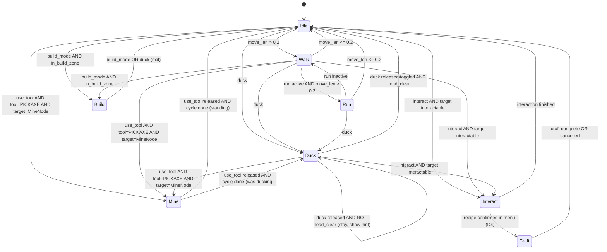
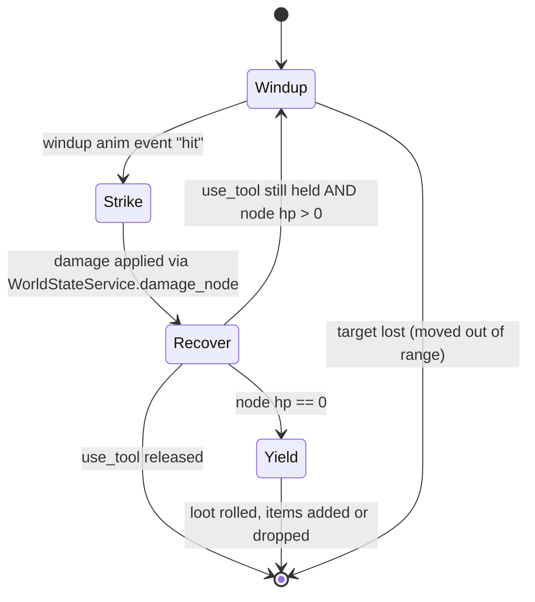
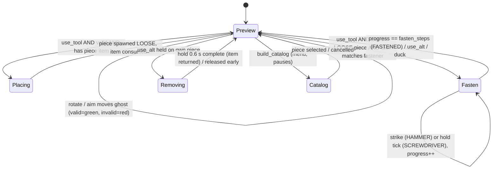
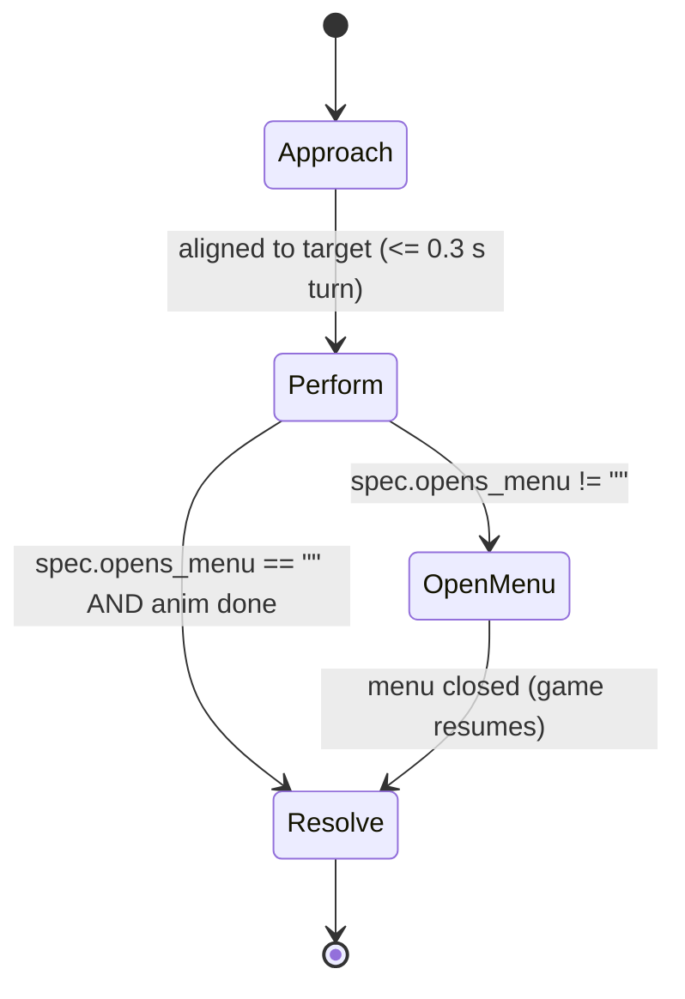
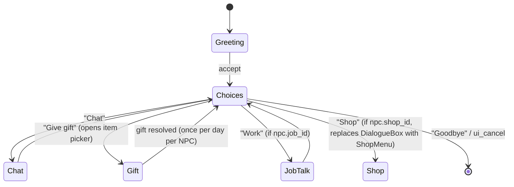
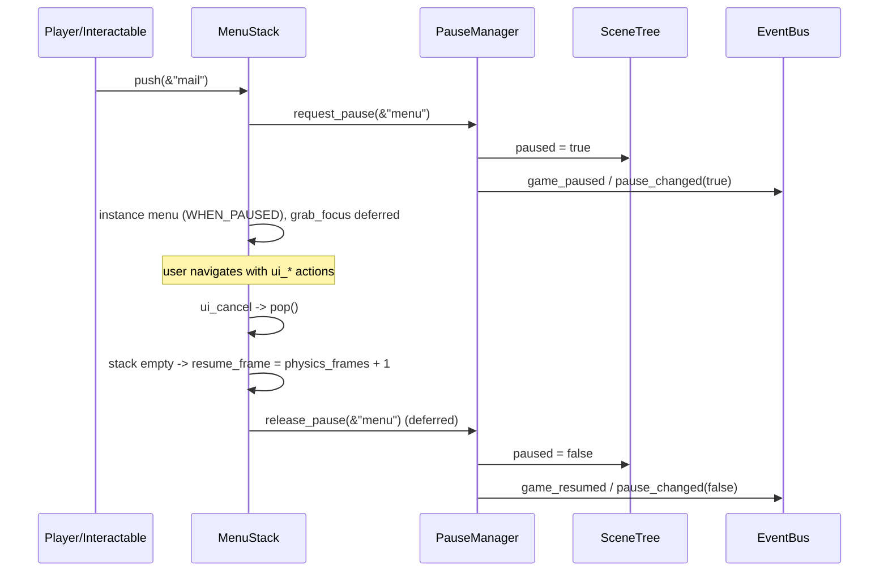

# Spec 1: Core Functional Specification

| Field | Value |
|---|---|
| Status | DRAFT, pending review of Section 0.3 (Open Decisions) |
| Engine | Godot 4.7 stable (4.7.2 latest patch found, 2026-08-18), GDScript |
| Physics | Jolt Physics (built-in module) |
| Tests | gdUnit4 v6.2.3 (latest release found, 2026-11-01) |
| Targets | Windows, Linux, macOS desktop |
| Supersedes | none |

---

## 0. Scope, Constraints, and Verified Facts

### 0.1 Scope (v1)
- 3D third-person cozy life sim: tall humanoid player, outfit customizer, ducking, foraging (apple trees), mining (resources and currency), grid building with hammering/screwing.
- Economy: coin wallet, shops, house plot purchasing.
- Jobs: Builder, Tailor.
- NPCs: dialogue, gifting, job and shop access.
- Mail: letters and packages with attachments.
- Gamepad-primary input with keyboard/mouse secondary; every menu pauses the game.

Out of scope for v1: multiplayer, procedural voxel terrain (see D1), Steam Input-specific handling, mobile/web, localization beyond key-based strings (strings are authored as translation keys from day one so localization is additive).

### 0.2 Engine facts this spec relies on (verified against `godotengine/godot` tag `4.7-stable` docs XML)
| Fact | Consequence for this spec |
|---|---|
| `physics/3d/physics_engine` default is `DEFAULT`, which "is currently equivalent to GodotPhysics3D". Jolt is the default only for projects *created* in 4.6+. | `project.godot` MUST set `physics/3d/physics_engine="Jolt Physics"` explicitly. Do not rely on `DEFAULT`. |
| Desktop joypad input uses SDL3 since 4.5. `JOY_BUTTON_A`=0 is the bottom face button (Cross on DualShock). | One binding set covers XInput and DualShock. Only glyphs differ. |
| `Input.get_joy_info(device)` returns `vendor_id`, `product_id`, `raw_name`, and `xinput_index` (Windows). `Input.joy_connection_changed(device, connected)` exists. | Glyph selection by vendor ID; disconnect auto-pauses (Section 5.6). |
| `SceneTree.paused = true` stops 2D/3D physics globally and stops `_process`/`_physics_process`/`_input` for nodes whose `process_mode` resolves to `PAUSABLE`. | Menus and services that must run while paused need `PROCESS_MODE_ALWAYS` or `PROCESS_MODE_WHEN_PAUSED`. |
| Autoloads are children of `/root` and default to `PROCESS_MODE_INHERIT` (effectively pausable). | Each autoload's process mode is specified explicitly in Section 1.2. |
| `SceneTree.create_timer(time_sec, process_always = true, ...)`: **defaults to running while paused**. | Gameplay code MUST pass `process_always = false` or use a `Timer` node. Lint rule in plan. |
| `Node.create_tween()` binds to the node and uses `TWEEN_PAUSE_BOUND` by default. `SceneTree.create_tween()` is unbound. | Gameplay tweens MUST use `Node.create_tween()`. |
| `JSON.stringify` converts all numbers to float; `JSON.parse` returns floats. | Save loader MUST cast integer fields back with `int()` and validate (Section 3.5). |
| `ui_*` built-in actions cannot be removed, but their events can be modified. | We re-specify their events explicitly (Section 2.4) rather than trusting defaults. |
| GridMap stores only MeshLibrary item indices + orientation per cell. | GridMap is unsuitable for build pieces that carry per-instance state (fastening progress). See Section 1.6. |

### 0.3 Open Decisions (need owner confirmation before plan1)
| ID | Question | Proposed default in this spec | Alternative |
|---|---|---|---|
| D1 | Mining model: discrete resource nodes, or destructible voxel terrain? | **Discrete resource nodes** on a 1 m mine grid. Fraction of the cost; deterministic save state. | Voxel terrain (Minecraft-like dig anywhere). Requires chunk meshing, large saves, navmesh rebuilds. Roughly an order of magnitude more work. |
| D2 | Jump? Not in the scope list or the CLAUDE.md FSM state list. | **No jump in v1.** Terrain uses ramps/stairs; build pieces include stairs. Button reserved. | Add `Jump`/`Fall` states. Changes level design and build validation (reachability). |
| D3 | Is `Forage`/`Talk` a separate FSM state? CLAUDE.md lists Idle, Walk, Run, Duck, Mine, Build, Craft only. | Add one generic **`Interact`** state (forage, talk, mailbox, shop, bench) parameterized by an `InteractionSpec`. | Separate `Forage` and `Talk` states. More states, duplicated logic. |
| D4 | Crafting duration vs "menus MUST pause". A crafting menu that pauses the tree cannot also run a craft timer. | Recipe is chosen in a paused menu; on confirm the menu closes and the timed **`Craft`** state runs in-world (unpaused, cancellable). | Instant crafting (no timer). |
| D5 | House purchase: upfront only, or financing? | **Upfront** coin payment in v1. | Mortgage with daily payments by mail (adds bills, debt state). |
| D6 | In-game day length. | **20 real minutes** per in-game day, 06:00 to 02:00, forced sleep at 02:00. | Any value; affects mail delivery and node respawn pacing. |
| D7 | Save model. | **3 manual slots + 1 autosave** (on sleep). Save only from pause menu or bed. | Save anywhere / continuous autosave. |

### 0.4 Known issues and risks raised
1. **CLAUDE.md test command is wrong for gdUnit4 v6.2.3.** `addons/gdUnit4/bin/GdUnitCmdLine.gd` does not exist; the entry script is `res://addons/gdUnit4/bin/GdUnitCmdTool.gd`. In headless mode the runner exits with `RETURN_ERROR_HEADLESS_NOT_SUPPORTED` unless `--ignoreHeadlessMode` is passed, and it needs `-a <dir>` to select tests. Proposed command (to be confirmed in plan1 by running it):
   `godot --headless --path . -s -d res://addons/gdUnit4/bin/GdUnitCmdTool.gd --ignoreHeadlessMode -a res://test`
   CLAUDE.md should be updated once verified.
2. **Headless tests cannot drive UI with InputEvents.** gdUnit4's own warning: "Godot 'InputEvents' are not transported by the Godot engine in headless mode." Consequence: integration tests in `res://test/integration/` must assert on signals and on direct method calls (e.g. `MenuStack.push()`), not on simulated button presses. Input-simulation tests, if any, need a windowed run (e.g. xvfb on Linux CI) and are tagged separately.
3. **gdUnit4 has no explicit "supports Godot 4.7" statement.** v6.1.0 declares 4.6.x compatibility; v6.2.3 contains a fix for "a fresh Godot 4.7 editor" and CI runs on 4.8 dev. Treat as compatible-in-practice; plan1 task 1 is a smoke test.
4. **Pause flag ownership.** Menus setting `get_tree().paused` directly breaks with nested menus (closing an inner dialog unpauses while the outer menu is open). Section 5 routes all pause changes through a ref-counted `PauseManager`.
5. **Input bleed on unpause.** The A press that closes a dialog can be read as `interact` by the player in the same frame and reopen the dialog. Section 5.5 specifies a resume-frame guard.
6. **EventBus is not a transaction mechanism.** Signals cannot return values or roll back. "Buy house" (debit wallet + grant deed + mail receipt) needs an atomic coordinator. Section 1.5 separates *commands* (direct calls, return a result) from *events* (EventBus, past tense, fire-and-forget). This refines, not violates, the CLAUDE.md isolation rule.
7. **Untrusted `.tres` saves.** Loading Resources from `user://` can instantiate embedded scripts. Save games MUST be JSON (Section 3.5). Resources are used for read-only, shipped definitions only.

---

## 1. System Architecture and Node Hierarchy

### 1.1 Layering
```
+------------------------------------------------------------+
| Presentation   scenes/ (3D), ui/ (Controls)                |
|   reads models via signals, sends commands to services     |
+------------------------------------------------------------+
| Adapters       Node wrappers: Player, Interactables, UI    |
|   translate input actions / physics into commands          |
+------------------------------------------------------------+
| Services       GameSession-owned: Inventory, Wallet,       |
|                Economy, Jobs, Mail, Housing, Npc, Build    |
|   own state, validate commands, emit EventBus events       |
+------------------------------------------------------------+
| Models         RefCounted pure logic (no SceneTree access) |
|   InventoryModel, WalletModel, MailboxModel, ... FSM core  |
+------------------------------------------------------------+
| Data           resources/*.tres (definitions, read-only)   |
|                user://saves/*.json (state)                 |
+------------------------------------------------------------+
```
Rule: Models never call `get_tree()`, never touch `Input`, never emit EventBus signals. Services wrap models and emit. This keeps every model unit-testable in `res://test/unit/` without a scene.

### 1.2 Autoloads (registration order is significant)
| # | Name | Script | process_mode | Responsibility |
|---|---|---|---|---|
| 1 | `EventBus` | `res://scripts/autoload/event_bus.gd` | ALWAYS | Signal declarations only. No state, no logic. |
| 2 | `Database` | `res://scripts/autoload/database.gd` | ALWAYS | Loads and indexes all definition Resources by `id`. Validates on boot (Section 3.8). |
| 3 | `InputService` | `res://scripts/autoload/input_service.gd` | ALWAYS | Active device detection, glyph set, rebinding load/save, joypad connect events. |
| 4 | `PauseManager` | `res://scripts/autoload/pause_manager.gd` | ALWAYS | Sole writer of `get_tree().paused`. Ref-counted pause reasons. |
| 5 | `GameClock` | `res://scripts/autoload/game_clock.gd` | PAUSABLE (explicit) | In-game day/minute. Emits `day_started`, `time_changed`. |
| 6 | `SaveService` | `res://scripts/autoload/save_service.gd` | ALWAYS | Serialize/deserialize `GameSession`; slot management; migrations. |
| 7 | `SceneRouter` | `res://scripts/autoload/scene_router.gd` | ALWAYS | Zone transitions with fade; owns loading screen. |

Domain services are **not** autoloads. They live under `GameSession` so a test or a new game can construct a fresh session without global leftovers.

### 1.3 Main scene tree (`res://scenes/main.tscn`)
```
Main (Node)                                   process_mode: PAUSABLE
+-- GameSession (Node)                        PAUSABLE
|   +-- InventoryService (Node)
|   +-- WalletService (Node)
|   +-- EconomyService (Node)                 shop pricing, TransactionCoordinator
|   +-- HousingService (Node)                 plots, deeds
|   +-- JobService (Node)                     contracts, ranks
|   +-- MailService (Node)                    inbox, scheduled deliveries
|   +-- NpcService (Node)                     friendship, flags, schedules
|   +-- BuildService (Node)                   placed pieces registry, validation
|   +-- WorldStateService (Node)              resource nodes, trees, respawn timers
+-- World (Node3D)                            PAUSABLE
|   +-- WorldEnvironment
|   +-- Sun (DirectionalLight3D)              driven by GameClock
|   +-- ZoneRoot (Node3D)                     current zone instanced by SceneRouter
|   |   +-- <Zone: Town | Orchard | Mine | Plot_N> (Node3D)
|   |       +-- Terrain (StaticBody3D / MeshInstance3D)
|   |       +-- NavigationRegion3D
|   |       +-- ResourceNodes (Node3D)        MineNode instances
|   |       +-- AppleTrees (Node3D)           AppleTree instances
|   |       +-- Interactables (Node3D)        Mailbox, ShopCounter, JobBoard,
|   |       |                                 Workbench, TailorBench, Wardrobe,
|   |       |                                 PlotSign, Bed
|   |       +-- BuildGrid (Node3D)            BuildGridView, only on owned plots
|   |       +-- NPCs (Node3D)                 Npc instances
|   |       +-- SpawnPoints (Node3D)          Marker3D per entry id
|   +-- Player (CharacterBody3D)              see 1.4
+-- UI (CanvasLayer, layer 10)                PAUSABLE
|   +-- HUD (Control)                         PAUSABLE: clock, wallet, hotbar,
|   |                                         interaction prompt, build ghost info
|   +-- MenuStack (Control)                   ALWAYS: owns all menus (Section 5)
|   |   +-- (menus instanced on push, children set WHEN_PAUSED)
|   +-- Toasts (Control)                      ALWAYS: "Mail arrived", "+12 coins"
|   +-- DeviceBanner (Control)                ALWAYS: "Controller disconnected"
+-- Fader (CanvasLayer, layer 100)            ALWAYS: scene transition fades
```

### 1.4 Player (`res://scenes/player/player.tscn`)
Tall humanoid. Reference dimensions (tunable in `PlayerConfig.tres`):

| Parameter | Value |
|---|---|
| Standing capsule height / radius | 2.10 m / 0.35 m |
| Ducking capsule height | 1.30 m |
| Eye height standing / ducking | 1.95 m / 1.15 m |
| Walk / Run / Duck-walk speed | 2.2 / 5.0 / 1.2 m/s |
| Standard door clearance (build pieces) | 2.40 m |
| Mine tunnel clearance | 1.50 m (forces Duck) |

Ducking is load-bearing gameplay: mine tunnels and some orchard/attic spaces are below standing height.

```
Player (CharacterBody3D)  script: player.gd
+-- CollisionStanding (CollisionShape3D, CapsuleShape3D h=2.10)
+-- CollisionDucking (CollisionShape3D, CapsuleShape3D h=1.30, disabled)
+-- HeadClearance (ShapeCast3D)        tests standing volume before un-duck
+-- Visual (Node3D)                    yaw-rotated toward move direction
|   +-- Rig (Node3D, imported glTF)
|       +-- Skeleton3D
|           +-- BodyMesh (MeshInstance3D)
|           +-- OutfitSlots (Node3D)
|           |   +-- Head, Top, Bottom, Feet, Accessory (MeshInstance3D each,
|           |       skeleton -> ../.., same bone names as base rig)
|           +-- ToolSocket (BoneAttachment3D, right hand)
+-- AnimationTree                      locomotion BlendSpace1D + action OneShots
+-- CameraRig (Node3D)                 yaw
|   +-- Pitch (Node3D)
|       +-- SpringArm3D (length 4.0 standing, 2.5 ducking)
|           +-- Camera3D
+-- InteractionProbe (Area3D)          candidates within 2.0 m
+-- AimRay (RayCast3D)                 from camera, picks target among candidates
+-- InputReader (Node)                 the ONLY node that reads Input (Section 2.1)
+-- StateMachine (Node)                script: state_machine.gd
    +-- Idle, Walk, Run, Duck, Mine, Build, Craft, Interact (Node, each a State)
```

Outfit rule: all outfit meshes are skinned to the base rig's bone names. Swapping an outfit replaces `MeshInstance3D.mesh` on the slot; no skeleton changes. Body-hiding (e.g. long sleeves) uses a per-outfit `hide_body_regions` mask applied as a shader parameter on `BodyMesh` to avoid clipping.

### 1.5 Module isolation: commands vs events
| Kind | Mechanism | Naming | Returns | Example |
|---|---|---|---|---|
| Command | Direct method call on a service resolved via `GameSession` | imperative verb | `Result` (`ok: bool`, `error: StringName`, `data`) | `economy.try_buy_plot(&"plot_03")` |
| Event | `EventBus` signal | past tense | nothing | `EventBus.plot_purchased(plot_id, price)` |

- Services MUST NOT hold references to other services, with one exception: `EconomyService.TransactionCoordinator` receives Inventory, Wallet, and Housing through constructor injection (duck-typed interfaces) to perform atomic multi-module operations.
- Transaction rule: validate all preconditions first, then mutate, then emit events. No mutation occurs if any precondition fails. Unit-tested with failure injection.
- UI never mutates models; it calls commands and re-renders on events.

### 1.6 Build grid
| Option | Pros | Cons |
|---|---|---|
| GridMap | Fast batched rendering and collision; editor painting | Cell stores only item index + orientation; no per-piece state (fastening, owner, durability); no per-piece scripts |
| **Custom grid (chosen)** | Per-piece state and scenes; easy serialization; validation hooks | Must manage instancing; use MultiMesh for high-count static decor if profiling shows need |

- Grid: 1.0 m cells for structure, 0.5 m sub-grid for furniture. Y levels at 1.0 m (floors at 0.0, 3.0 m per storey to clear the 2.4 m door rule plus ceiling).
- Rotation: 90-degree steps.
- Cell key: `Vector3i`. `BuildService` holds `Dictionary[Vector3i, PieceInstance]` plus a footprint occupancy map for multi-cell pieces.
- Placement validity: inside owned plot bounds, footprint cells free, support rule satisfied (piece has `requires_support` and a supporting piece or terrain below/adjacent), not intersecting the player capsule.

### 1.7 Domain summaries
| Module | Owns | Key commands | Key events |
|---|---|---|---|
| Inventory | Backpack (24 slots), hotbar (8 slots, references backpack), storage chests per house | `add`, `remove`, `can_add`, `move_slot`, `split` | `inventory_changed(container_id)` |
| Wallet | Coins (int64, >= 0) | `can_afford`, `credit`, `debit` | `coins_changed(old, new, reason)` |
| Economy | Shop catalogs, buy/sell pricing, TransactionCoordinator | `try_buy`, `try_sell`, `try_buy_plot` | `item_bought`, `item_sold`, `plot_purchased` |
| Housing | Plot ownership, deed, house storage | `grant_deed` (coordinator only) | `deed_granted` |
| Jobs | Ranks/XP per job, active contracts | `accept_contract`, `submit_contract`, `abandon_contract` | `contract_accepted`, `contract_completed`, `job_rank_up` |
| Mail | Inbox, scheduled mail | `schedule`, `mark_read`, `claim_attachments`, `archive` | `mail_delivered`, `mail_claimed` |
| Npc | Friendship, met flags, daily gift flags, schedule position | `talk`, `give_gift` | `friendship_changed`, `npc_flag_set` |
| Build | Placed pieces, fastening state | `try_place`, `fasten_step`, `try_remove` | `piece_placed`, `piece_fastened`, `piece_removed` |
| WorldState | Mine node HP/depletion, tree fruit state, respawn days | `damage_node`, `harvest_tree` | `node_depleted`, `tree_harvested` |

Economy rules (v1, tunable in `EconomyConfig.tres`):
- All currency is `int` coins. No floats anywhere in currency math.
- Shop buy price = `item.base_value * shop.buy_multiplier_pct / 100`, rounded up.
- Sell price = `item.base_value * shop.sell_multiplier_pct / 100`, rounded down. Default sell 50%.
- Mining currency: ore is sold for coins; `gem_*` nodes additionally drop coins directly via loot table (`coins` entry).
- Job pay credited on contract submission; receipt mailed.

---

## 2. Input Action Map

### 2.1 Abstraction rule (referenced by CLAUDE.md)
1. Gameplay and UI code reads **only** named actions via `Input.is_action_*`, `Input.get_action_strength`, `Input.get_vector`, or `InputEvent.is_action*`.
2. No gameplay script may reference `InputEventJoypadButton`, `InputEventKey`, `JOY_BUTTON_*`, `KEY_*`, or `MOUSE_BUTTON_*`. Exceptions: `InputService` (device detection, rebinding) and the rebinding UI.
3. Only `Player/InputReader` polls gameplay actions. It produces an `InputFrame` value object consumed by the FSM. This makes the FSM testable by feeding synthetic `InputFrame`s.
4. Camera look reads `look_*` actions for gamepad and `InputEventMouseMotion.relative` for mouse. Mouse motion is the one permitted raw event, handled only in `InputReader`, because it is a delta, not an action.

`InputFrame` fields: `move: Vector2`, `look: Vector2`, `run_held: bool`, `duck_pressed: bool`, `duck_held: bool`, `interact_pressed: bool`, `use_pressed: bool`, `use_held: bool`, `use_released: bool`, `alt_pressed: bool`, `alt_held: bool`, `build_toggle_pressed: bool`, `rotate_cw_pressed: bool`, `rotate_ccw_pressed: bool`, `tool_next_pressed: bool`, `tool_prev_pressed: bool`, `hotbar_select: int` (-1 if none), `frame: int`.

### 2.2 Gameplay actions
Glyph columns: Xbox (XInput) / PlayStation (DualShock/DualSense). Godot event column is what goes into `project.godot`.

| Action | Xbox | PlayStation | Godot joypad event | KB/M | Behavior |
|---|---|---|---|---|---|
| `move_left/right/forward/back` | Left stick | Left stick | `JOY_AXIS_LEFT_X/Y` +/- | A/D/W/S | `Input.get_vector`, deadzone 0.2 |
| `look_left/right/up/down` | Right stick | Right stick | `JOY_AXIS_RIGHT_X/Y` +/- | Mouse motion | Sensitivity and invert-Y in settings |
| `run` | L3 (click) | L3 | `JOY_BUTTON_LEFT_STICK` | Left Shift | Toggle on gamepad (default), hold on KB/M. Setting selects toggle/hold per device |
| `duck` | B | Circle | `JOY_BUTTON_B` | C, Left Ctrl | Toggle (default) or hold, setting |
| `interact` | A | Cross | `JOY_BUTTON_A` | E | Context action on focused target |
| `use_tool` | RT | R2 | `JOY_AXIS_TRIGGER_RIGHT` + (threshold 0.5) | LMB | Mine / hammer / screw / place |
| `use_alt` | LT | L2 | `JOY_AXIS_TRIGGER_LEFT` + (0.5) | RMB | Build: remove (hold). Mine: none |
| `tool_next` | RB | R1 | `JOY_BUTTON_RIGHT_SHOULDER` | Mouse wheel down, ] | Hotbar next |
| `tool_prev` | LB | L1 | `JOY_BUTTON_LEFT_SHOULDER` | Mouse wheel up, [ | Hotbar previous |
| `hotbar_1..8` | none | none | none | 1..8 | KB convenience only |
| `build_mode` | Y | Triangle | `JOY_BUTTON_Y` | B | Toggle Build mode |
| `rotate_cw` | D-pad right | D-pad right | `JOY_BUTTON_DPAD_RIGHT` | R | Build: rotate ghost +90 |
| `rotate_ccw` | D-pad left | D-pad left | `JOY_BUTTON_DPAD_LEFT` | Shift+R / F | Build: rotate ghost -90 |
| `build_catalog` | X | Square | `JOY_BUTTON_X` | Tab (in build mode) | Opens build catalog menu (pauses) |
| `quick_eat` | D-pad down | D-pad down | `JOY_BUTTON_DPAD_DOWN` | Q | Eat selected food |
| `camera_reset` | R3 | R3 | `JOY_BUTTON_RIGHT_STICK` | Middle mouse | Recenter camera behind player |
| `open_inventory` | View/Back | Touchpad / Share | `JOY_BUTTON_BACK`, `JOY_BUTTON_TOUCHPAD` | I | Inventory/outfit/journal tabs (pauses) |
| `pause_menu` | Menu/Start | Options | `JOY_BUTTON_START` | Esc | Pause menu (pauses) |
| `jump` | reserved | reserved | unbound | unbound | Reserved pending D2 |

Notes:
- `duck` on B conflicts with nothing in gameplay because `ui_cancel` is only read while paused by menus. Verified safe only if the resume guard in 5.5 is implemented.
- Triggers are bound as axis events so analog strength is available (used for nothing in v1 beyond threshold, but keeps rebinding consistent).

### 2.3 Build-mode overrides
Build mode reuses the same actions; meaning changes by FSM state, not by rebinding.

| Action | Build: Browse/Preview | Build: Fasten |
|---|---|---|
| `use_tool` | Place ghost (loose piece) | Hammer: each press = 1 strike. Screwdriver: hold advances progress |
| `use_alt` (hold 0.6 s) | Remove targeted piece (returns item) | Cancel fastening |
| `rotate_cw/ccw` | Rotate ghost | none |
| `interact` | Select piece under aim as current | none |
| `build_mode` / `duck` | Exit Build mode | Cancel fastening |

Accessibility: setting `fasten_mode = HOLD` turns hammering into hold-to-progress, same as screwing.

### 2.4 UI actions (explicit events, do not rely on defaults)
| Action | Gamepad | KB/M |
|---|---|---|
| `ui_accept` | A / Cross | Enter, Space |
| `ui_cancel` | B / Circle | Esc |
| `ui_up/down/left/right` | D-pad + left stick (axis events, deadzone 0.5) | Arrow keys, W/A/S/D |
| `ui_focus_next` / `ui_focus_prev` | none | Tab / Shift+Tab |
| `ui_tab_next` (custom) | RB / R1 | E |
| `ui_tab_prev` (custom) | LB / L1 | Q |
| `ui_page_next/prev` (custom) | RT / LT | Page Down / Page Up |
| `ui_secondary` (custom) | X / Square | Right click on focused item |
| `ui_tertiary` (custom) | Y / Triangle | Shift+Enter |
| `pause_menu` | Start / Options | Esc (handled: closes all if any menu open, see 5.3) |

Contextual hint bar at the bottom of every menu shows glyphs for the active device.

### 2.5 Device handling (`InputService`)
- Active device kind (`KEYBOARD_MOUSE` or `GAMEPAD`) switches on the last meaningful input event: key, mouse button, mouse motion > 4 px; joypad button, joypad axis beyond 0.5. Emits `EventBus.input_device_changed(kind, glyph_set)`.
- Glyph set from `Input.get_joy_info(device).vendor_id`: `0x054C` Sony -> PlayStation; `0x045E` Microsoft -> Xbox; `0x057E` Nintendo -> Nintendo (A/B swap shown in glyphs only, bindings unchanged); else Xbox. User override in settings.
- Mouse mode: `MOUSE_MODE_CAPTURED` in gameplay, `MOUSE_MODE_VISIBLE` when any menu is open or when the window loses focus.
- `Input.joy_connection_changed(device, false)` for the active pad while in gameplay -> open Pause menu with `DeviceBanner` visible (Section 5.6).
- Rebinding persisted in `user://settings.cfg` (ConfigFile) as plain dictionaries, never serialized `InputEvent` objects:
  `{"action": "interact", "events": [{"type": "joy_button", "index": 0}, {"type": "key", "physical_keycode": 69}]}`
  Applied with `InputMap.action_erase_events` + `InputMap.action_add_event`. Reset-to-defaults reloads from `ProjectSettings`.
- Rebinding validation: a physical input may map to multiple actions only if the actions are in disjoint contexts (see conflict table in plan1). `pause_menu` and `ui_accept`/`ui_cancel` cannot be unbound from gamepad.

---

## 3. Data Structures

Conventions:
- IDs are `StringName`, lowercase snake_case, globally unique per type, never renamed after ship (saves reference them). Prefixes: `item_`, `recipe_`, `piece_`, `outfit_`, `npc_`, `job_`, `contract_`, `plot_`, `mail_tpl_`, `shop_`.
- Display text is a translation key, e.g. `"ITEM_APPLE_NAME"`.
- Definitions are `Resource` subclasses with `class_name`, stored under `res://resources/<type>/`. Read-only at runtime.
- Runtime state is plain Dictionaries/value objects serialized to JSON.

### 3.1 Item definition (`ItemDef extends Resource`, `res://resources/items/*.tres`)
| Field | Type | Required | Rule |
|---|---|---|---|
| `id` | StringName | yes | unique, `item_` prefix |
| `name_key` | String | yes | translation key |
| `desc_key` | String | yes | translation key |
| `category` | enum `ItemCategory` | yes | `RESOURCE, FOOD, TOOL, BUILD_PIECE, FURNITURE, OUTFIT, FABRIC, KEY_ITEM` |
| `icon` | Texture2D | yes | 128x128 |
| `max_stack` | int | yes | 1..999; must be 1 if `has_instance_data` |
| `base_value` | int | yes | >= 0 coins |
| `sellable` | bool | yes | `KEY_ITEM` must be false |
| `giftable` | bool | yes | |
| `tags` | Array[StringName] | no | e.g. `&"ore"`, `&"fruit"`, `&"fabric_cotton"` |
| `has_instance_data` | bool | yes | true for tools with durability, dyed outfits |
| `tool` | ToolData | if TOOL | see below |
| `food` | FoodData | if FOOD | `energy_restore: int` |
| `build_piece` | BuildPieceDef | if BUILD_PIECE/FURNITURE | see 3.6 |
| `outfit` | OutfitDef | if OUTFIT | see 3.6 |
| `world_scene` | PackedScene | no | dropped/pickup visual |

`ToolData`: `tool_type: enum {PICKAXE, HAMMER, SCREWDRIVER, BASKET}`, `tier: int (1..4)`, `power: int` (damage per strike), `strike_interval_sec: float`, `max_durability: int` (0 = unbreakable; v1 default 0, see note).

Note: durability is in the schema but defaulted off for v1 (cozy tone). Toggle is a design decision, not a code change.

Item stack (runtime, in inventory and saves):
```json
{ "item_id": "item_iron_ore", "qty": 12 }
{ "item_id": "item_pickaxe_copper", "qty": 1, "data": { "durability": 87 } }
{ "item_id": "item_shirt_linen", "qty": 1, "data": { "dye": "#7FA36B" } }
```
Stacks with non-empty `data` never merge.

### 3.2 Recipe definition (`RecipeDef extends Resource`, `res://resources/recipes/*.tres`)
| Field | Type | Required | Rule |
|---|---|---|---|
| `id` | StringName | yes | `recipe_` prefix |
| `station` | enum `Station` | yes | `HAND, WORKBENCH, TAILOR_BENCH` |
| `inputs` | Array[ItemAmount] | yes | 1..6 entries, ids resolvable, qty >= 1, no duplicate ids |
| `outputs` | Array[ItemAmount] | yes | 1..3 entries |
| `coin_cost` | int | no | default 0 |
| `craft_time_sec` | float | yes | 0 = instant; real seconds in `Craft` state (D4) |
| `required_job` | StringName | no | `job_builder`, `job_tailor`, or empty |
| `required_rank` | int | no | default 0 |
| `unlock` | enum `UnlockKind` | yes | `DEFAULT, JOB_RANK, MAIL, PURCHASE` |
| `category_key` | String | yes | menu grouping |
| `xp_reward` | int | no | XP to `required_job` on craft |

`ItemAmount extends Resource`: `item_id: StringName`, `qty: int`.

Craft command semantics (`try_craft(recipe_id, count)`): validate unlock, rank, station proximity, inputs present, coins, output space (simulate add after remove); then remove inputs, debit coins, add outputs, emit `item_crafted(recipe_id, count)`. All-or-nothing.

### 3.3 Mail schema
Two layers: a template (definition) and a message (runtime state).

`MailTemplateDef extends Resource` (`res://resources/mail/*.tres`): `id`, `sender_id` (`npc_*` or `&"system"`), `subject_key`, `body_key`, `kind: enum {LETTER, PACKAGE, JOB_OFFER, RECEIPT, CATALOG_ORDER}`, `attachments: Array[MailAttachmentDef]`, `expires_after_days: int` (0 = never).

Runtime message (saved):
```json
{
  "id": "m_000142",
  "template_id": "mail_tpl_builder_contract_offer",
  "sender_id": "npc_hilde",
  "kind": "JOB_OFFER",
  "subject_key": "MAIL_BUILDER_OFFER_SUBJ",
  "body_key": "MAIL_BUILDER_OFFER_BODY",
  "params": { "contract_id": "contract_fence_town_01", "pay": 120 },
  "sent_day": 14,
  "deliver_day": 15,
  "expires_day": 22,
  "attachments": [
    { "type": "item", "item_id": "item_plank_pine", "qty": 20 },
    { "type": "coins", "amount": 50 },
    { "type": "unlock_recipe", "recipe_id": "recipe_fence_pine" },
    { "type": "contract", "contract_id": "contract_fence_town_01" }
  ],
  "read": false,
  "claimed": false,
  "archived": false
}
```
Rules:
- Message `id` is monotonic per save (`"m_%06d"` from `next_mail_seq`). No random UUIDs, so tests are deterministic.
- `GameClock.day_started(day)` -> `MailService` moves every scheduled message with `deliver_day <= day` into the inbox, then emits `mail_delivered(ids)`. Delivery is idempotent.
- Claim is **all-or-nothing**: if inventory cannot hold all item attachments, nothing is claimed and the UI shows "Not enough space". Coins, unlocks and contracts always fit; they are still only granted together with items.
- Expired unclaimed packages return items to a "Lost and Found" NPC shop, never silently deleted.
- Inbox cap 100 messages; oldest archived+claimed are pruned first. Never prune unclaimed.
- Catalog orders: purchase debits coins now, schedules a `CATALOG_ORDER` package for next day.

### 3.4 Other definitions (summary)
| Resource | Key fields |
|---|---|
| `OutfitDef` | `id`, `slot: enum {HEAD, TOP, BOTTOM, FEET, ACCESSORY}`, `mesh: Mesh`, `dyeable: bool`, `default_dye: Color`, `hide_body_regions: int (bitmask)`, `unlock: UnlockKind` |
| `BuildPieceDef` | `id`, `scene: PackedScene`, `footprint: Array[Vector3i]` (relative cells at rotation 0), `grid: enum {STRUCTURE_1M, FURNITURE_0_5M}`, `fastener: enum {NONE, NAILS, SCREWS}`, `fasten_steps: int`, `requires_support: bool`, `provides_support: bool`, `snap_tags: Array[StringName]` |
| `MineNodeDef` | `id`, `scene`, `hardness_tier: int`, `max_hp: int`, `loot: LootTableDef`, `respawn_days: int` |
| `LootTableDef` | `entries: Array[{item_id or "coins", min, max, weight}]`, `rolls: int`, `guaranteed: Array[ItemAmount]` |
| `AppleTreeDef` | `id`, `fruit_item_id`, `fruit_min/max`, `regrow_days`, `seasons` (reserved) |
| `NpcDef` | `id`, `name_key`, `scene`, `dialogue: DialogueDef`, `gift_prefs: {loved, liked, disliked: Array[StringName]}` (item ids or tags), `shop_id`, `job_id`, `schedule: Array[{start_minute, zone_id, marker_id}]` |
| `JobDef` | `id` (`job_builder`, `job_tailor`), `rank_xp: Array[int]`, `contracts: Array[ContractDef]`, `rank_unlocks: Array[{rank, recipe_ids, outfit_ids}]` |
| `ContractDef` | `id`, `job_id`, `min_rank`, `objective: enum {BUILD_BLUEPRINT, DELIVER_ITEMS, CRAFT_ITEMS}`, `blueprint: BlueprintDef` (Builder), `required_items: Array[ItemAmount]` (Tailor), `pay_coins`, `xp`, `deadline_days`, `provided_materials: Array[ItemAmount]` |
| `BlueprintDef` | `id`, `site_zone_id`, `origin: Vector3i`, `pieces: Array[{piece_id, cell, rotation}]`; contract complete when all listed pieces exist at those cells **and are fastened** |
| `PlotDef` | `id`, `zone_id`, `bounds: AABB` (grid aligned), `price_coins`, `starter_house: BlueprintDef` (optional) |
| `ShopDef` | `id`, `buy_multiplier_pct`, `sell_multiplier_pct`, `stock: Array[{item_id, daily_qty (-1 infinite), unlock}]`, `buys_tags: Array[StringName]` |

Job flows:
- **Builder**: accept contract at JobBoard or from `JOB_OFFER` mail -> provided materials mailed as package -> travel to site -> place pieces matching blueprint ghost overlay -> fasten each -> `BuildService` emits `piece_fastened` -> `JobService` checks blueprint completion -> `contract_completed` -> pay via TransactionCoordinator -> `RECEIPT` mail.
- **Tailor**: accept order (NPC asks for outfit X, optionally dyed color Y) -> craft at TailorBench from fabric items -> deliver via `interact` on NPC or mail drop-off at Mailbox -> pay + friendship bonus.

### 3.5 Save file schema (`user://saves/slot_<n>.json`)
```json
{
  "schema_version": 1,
  "game_version": "0.1.0",
  "saved_at_unix": 1763164800,
  "slot": 1,
  "meta": { "player_name": "Robin", "day": 14, "coins": 1340, "playtime_sec": 18342 },
  "clock": { "day": 14, "minute": 545 },
  "player": {
    "zone_id": "zone_town", "position": [12.5, 0.0, -4.0], "yaw": 1.57,
    "ducking": false, "energy": 82,
    "outfit": {
      "HEAD": null,
      "TOP": { "item_id": "item_shirt_linen", "data": { "dye": "#7FA36B" } },
      "BOTTOM": { "item_id": "item_trousers_denim", "data": {} },
      "FEET": { "item_id": "item_boots_leather", "data": {} },
      "ACCESSORY": null
    },
    "hotbar_index": 2
  },
  "inventory": {
    "backpack": [ { "item_id": "item_apple", "qty": 6 }, null ],
    "hotbar_refs": [0, 3, null, null, null, null, null, null],
    "containers": { "chest_plot_03_a": [ null ] }
  },
  "wallet": { "coins": 1340 },
  "unlocks": { "recipes": ["recipe_fence_pine"], "outfits": ["outfit_shirt_linen"] },
  "housing": { "owned_plots": ["plot_03"] },
  "build": {
    "plot_03": [
      { "piece_id": "piece_wall_pine", "cell": [2, 0, 5], "rot": 1, "fasten": 4, "fasten_max": 4 }
    ]
  },
  "world": {
    "mine_nodes": { "zone_mine_1/node_017": { "hp": 0, "respawn_day": 16 } },
    "trees": { "zone_orchard/tree_004": { "fruit": 0, "regrow_day": 17 } }
  },
  "jobs": {
    "job_builder": { "rank": 2, "xp": 340 },
    "job_tailor": { "rank": 0, "xp": 0 },
    "active_contracts": [ { "contract_id": "contract_fence_town_01", "accepted_day": 13, "progress": {} } ],
    "completed_contracts": ["contract_shed_plot_01"]
  },
  "mail": { "next_mail_seq": 143, "inbox": [], "scheduled": [] },
  "npcs": {
    "npc_hilde": { "friendship": 220, "met": true, "gifted_day": 14, "flags": ["intro_done"] }
  },
  "shops": { "shop_general": { "stock_day": 14, "remaining": { "item_seed_apple": 3 } } }
}
```
Rules:
- Format is JSON only. Never `ResourceLoader.load` anything from `user://` (embedded script risk).
- Write is atomic: write `slot_<n>.json.tmp`, flush/close, rename existing to `slot_<n>.json.bak`, rename tmp to `slot_<n>.json`. Load falls back to `.bak` on parse or validation failure and tells the player.
- Integer fields (`coins`, `qty`, `day`, `minute`, `hp`, `rank`, `xp`, `friendship`, cells, `rot`, `fasten*`) are cast with `int()` on load, because Godot's JSON parser returns floats. Validation rejects non-integral values.
- Vectors serialized as arrays. Godot-native types are not used in saves.
- `schema_version` mismatch runs ordered migrations `migrate_1_to_2(dict) -> dict`. Each migration is a pure function with a unit test fixture.
- Unknown `item_id`/`piece_id` on load (removed content): drop with a logged warning and a one-time "Some items were removed" notice; never crash.
- World object keys are `<zone_id>/<node_name>`; node names in zone scenes are stable and authored, never auto-generated.
- Settings (`user://settings.cfg`) are separate from saves and shared across slots.
- Save allowed only when no blocking transaction or zone transition is in progress; `SaveService` checks `PauseManager.has_reason(&"transition")`.

### 3.6 Static data validation (`Database` boot check)
Run at startup in debug builds and as a unit test (`test/unit/test_database_integrity.gd`):
- Unique ids per type; prefix conventions.
- Every referenced id resolves (recipes, loot, shops, blueprints, mail templates, contracts).
- `max_stack == 1` when `has_instance_data`.
- Recipe inputs and outputs not identical; no zero quantities.
- Every `BUILD_PIECE` item has a `BuildPieceDef`; every `OUTFIT` item has an `OutfitDef`.
- Every blueprint fits inside its site bounds and uses only pieces whose `fastener` is set (so contracts are completable).

---

## 4. FSM State Diagrams

### 4.1 FSM framework
- `StateMachine` (Node) holds `current: State`, `states: Dictionary[StringName, State]`.
- `State` (Node) API: `enter(msg: Dictionary)`, `exit()`, `handle_input(frame: InputFrame) -> StringName` (returns next state id or `&""`), `physics_update(delta) -> StringName`.
- Transition logic lives in a pure `PlayerTransitionTable` (RefCounted) that maps `(state, InputFrame, PlayerContext) -> next_state`. Node states call it. Unit tests target the table directly, no scene needed.
- `PlayerContext` (value object): `move_len`, `is_ducking`, `head_clear`, `in_build_zone`, `focused_target_kind`, `equipped_tool_type`, `can_fasten_target`, `on_floor`.
- Every transition emits `EventBus.player_state_changed(from, to)`.
- When the tree is paused the FSM does not tick. No `Paused` state exists.

### 4.2 Player FSM (top level)


Transition table (guards are evaluated top to bottom; first match wins):

| From | Condition | To | Side effects |
|---|---|---|---|
| any locomotion | `interact_pressed` and focused target is interactable | Interact | stop velocity, face target |
| Idle/Walk/Duck | `use_pressed`, tool PICKAXE, target MineNode in range, tier ok | Mine | lock yaw to target |
| Idle/Walk/Duck | `use_pressed`, tool PICKAXE, tier too low | (stay) | toast "Needs a stronger pickaxe" |
| Idle/Walk | `build_toggle_pressed`, `in_build_zone` | Build | show grid, equip last build piece |
| Idle/Walk | `build_toggle_pressed`, not in build zone | (stay) | toast "You can only build on your plot or a job site" |
| Idle/Walk/Run | `duck_pressed` (toggle) or `duck_held` (hold) | Duck | swap collider, lower camera |
| Duck | duck off and `head_clear` | Idle or Walk by `move_len` | restore collider |
| Duck | duck off and not `head_clear` | Duck | prompt "Not enough room to stand" |
| Duck | `run` pressed | Duck | run ignored while ducking |
| Walk | `run_held`/toggle and `move_len > 0.2` | Run | |
| Run | `move_len <= 0.2` | Idle | run toggle resets |
| Build | `build_toggle_pressed` or `duck_pressed` | Idle | hide grid, free ghost |
| Interact | spec finished | previous locomotion | |
| Craft | timer elapsed | Idle | `try_craft` commit |
| Craft | `move_len > 0.5` or `duck_pressed` | Idle | cancelled, nothing consumed |

Invariants (unit-tested):
- Run never active while `is_ducking`.
- Leaving Duck never happens while `head_clear == false`.
- Mine, Interact, Craft cannot be entered from Run (player must slow down; prevents accidental mining while sprinting). Run -> Walk is immediate on `use_pressed`, then the next frame evaluates Mine.
- Exactly one state is active; `enter`/`exit` are called exactly once per transition.

Duck mechanics: on enter, disable `CollisionStanding`, enable `CollisionDucking`, tween SpringArm length and camera height. `HeadClearance` ShapeCast3D uses the standing capsule shape offset upward; `head_clear = not is_colliding()`.

### 4.3 Mine sub-FSM (inside `Mine`)

- Damage per strike = `tool.power`; strikes at `tool.strike_interval_sec`.
- Loot is rolled once on depletion using a seeded RNG (`seed = hash(save_seed, node_key, day)`) so results are reproducible in tests.
- If inventory is full, loot spawns as world pickups at the node; never lost.
- Depleted node is hidden and disabled until `respawn_day`.

### 4.4 Build sub-FSM (inside `Build`)

- Tool auto-switch: aiming at a LOOSE piece with fastener NAILS temporarily shows the hammer prompt; equipping is automatic if the tool is in the hotbar, else prompt "Needs a hammer".
- A LOOSE piece does not provide support and does not count for blueprints.
- Removing a FASTENED piece returns the piece item; fasteners are not refunded.
- Pieces with dependents (supported pieces above) cannot be removed; prompt explains.
- Movement is allowed in Build at walk speed; Run is disabled.

### 4.5 Interact sub-FSM (generic, parameterized by `InteractionSpec`)
`InteractionSpec`: `kind: enum {FORAGE, TALK, MAILBOX, SHOP, JOB_BOARD, WORKBENCH, TAILOR_BENCH, WARDROBE, PLOT_SIGN, BED, PICKUP}`, `anim: StringName`, `duration_sec: float`, `opens_menu: StringName` (or empty), `on_complete: Callable`.


Specs:
| Kind | Perform | Menu | Resolve |
|---|---|---|---|
| FORAGE (apple tree) | shake anim 1.2 s | none | if `fruit > 0`: add `fruit` apples (overflow drops at feet), `fruit=0`, `regrow_day = day + regrow_days`. Else toast "No apples yet" |
| TALK | greet anim | DialogueBox | NpcService updates `met`, friendship |
| MAILBOX | open anim | MailMenu | none |
| SHOP / JOB_BOARD | none | ShopMenu / JobBoardMenu | none |
| WORKBENCH / TAILOR_BENCH | none | CraftingMenu(station) | if a recipe was confirmed: transition to `Craft` with recipe |
| WARDROBE | none | OutfitCustomizer | equipment applied on close |
| PLOT_SIGN | none | HousePurchaseDialog | `try_buy_plot` |
| BED | sleep fade | ConfirmDialog | advance to next day 06:00, autosave |
| PICKUP | bend anim 0.4 s | none | add item |

### 4.6 Dialogue FSM (inside DialogueBox, runs while paused)


### 4.7 Mail menu FSM
`InboxList -> Reading -> (Claim -> ClaimResult) -> InboxList`; `ui_secondary` archives; `ui_cancel` from InboxList closes the menu. Opening `Reading` sets `read = true`.

---

## 5. UI and Game Pause Flow

### 5.1 Principles
1. Every menu is pushed onto `MenuStack`. Nothing else shows a modal Control.
2. Only `PauseManager` writes `get_tree().paused`.
3. Every menu has exactly one `initial_focus` Control and restores focus on return from a child menu.
4. Every focusable Control has a reachable neighbor in all four directions or a deliberate dead end; validated in a debug pass (`MenuStack.validate_focus_graph()`).

### 5.2 PauseManager contract
```
request_pause(reason: StringName) -> void     # idempotent per reason
release_pause(reason: StringName) -> void     # no-op if not held
has_reason(reason: StringName) -> bool
is_paused() -> bool                            # == reasons non-empty
signal (on EventBus): pause_changed(paused: bool, reasons: Array[StringName])
```
- Reasons used: `&"menu"`, `&"transition"`, `&"focus_lost"`, `&"device_lost"`.
- `paused` flips only on the 0 -> 1 and 1 -> 0 reason count edges.
- `EventBus.game_paused` / `game_resumed` are emitted on those edges. This is the "global pause signal" CLAUDE.md requires; the boolean write `get_tree().paused = true` happens inside `PauseManager` on the same edge.

### 5.3 MenuStack contract
```
push(menu_id: StringName, args: Dictionary = {}) -> Control
pop() -> void
pop_to(menu_id) -> void
close_all() -> void
top() -> StringName
is_open() -> bool
```
Flow on `push`:
1. If stack was empty: `PauseManager.request_pause(&"menu")`, store `Input.mouse_mode`, set `MOUSE_MODE_VISIBLE`, emit `EventBus.menu_opened(menu_id)`.
2. Remember current focus owner (`get_viewport().gui_get_focus_owner()`) on the outgoing top menu.
3. Instance menu scene from `res://ui/menus/<menu_id>.tscn`, set `process_mode = PROCESS_MODE_WHEN_PAUSED`, call `menu.open(args)`.
4. `menu.initial_focus.grab_focus.call_deferred()` (deferred so layout is final).

Flow on `pop`:
1. `menu.close()` then free.
2. If stack non-empty: restore remembered focus on the new top (fallback to its `initial_focus` if the node is gone).
3. If stack empty: restore mouse mode, emit `EventBus.menu_closed(menu_id)`, record `resume_frame = Engine.get_physics_frames() + 1`, then `PauseManager.release_pause.call_deferred(&"menu")`.

Global keys handled by `MenuStack._unhandled_input` (process ALWAYS):
| Input | Stack empty | Stack non-empty |
|---|---|---|
| `pause_menu` | push `pause_menu` | `close_all()` |
| `ui_cancel` | ignored (gameplay reads `duck` instead) | `top.on_cancel()`; default implementation `pop()` |
| `open_inventory` | push `inventory` | if top is `inventory`: pop; else ignored |

Each handler calls `get_viewport().set_input_as_handled()`.

### 5.4 Flow diagram


### 5.5 Resume input guard
Problem: the press that closed the last menu is still "just pressed" for the frame in which gameplay resumes.
Rule: `InputReader` drops every `*_pressed` flag for physics frames `<= resume_frame` and requires the action to be released once before it can register again (`_needs_release[action] = true` for all actions held at resume). Held-axis inputs (move, look) pass through immediately. Unit test: synthetic frames around `resume_frame`.

### 5.6 Automatic pause triggers
| Trigger | Behavior |
|---|---|
| `NOTIFICATION_APPLICATION_FOCUS_OUT` | If stack empty: push `pause_menu`. Mouse released. |
| Active joypad disconnected (`Input.joy_connection_changed(dev, false)`) | Push `pause_menu` if not already open; `request_pause(&"device_lost")`; `DeviceBanner` visible. On reconnect of any pad or any KB/M input: release `&"device_lost"`, hide banner. Menu remains until player closes it. |
| Zone transition | `request_pause(&"transition")` during fade-out, load, fade-in; released after first physics frame in the new zone. Menus cannot open during transition. |

### 5.7 Process mode matrix
| Node | process_mode | Why |
|---|---|---|
| `Main`, `World`, `GameSession`, `Player`, `NPCs`, `GameClock` | PAUSABLE | Frozen while any menu is open |
| `UI/HUD` | PAUSABLE | Stays visible, frozen |
| `UI/MenuStack` | ALWAYS | Must receive `pause_menu`/`ui_cancel` while paused |
| Menu instances | WHEN_PAUSED | Only active while paused; avoids double-handling if the stack is ever used unpaused |
| `Toasts`, `DeviceBanner`, `Fader` | ALWAYS | Feedback during pause and transitions |
| `OutfitCustomizer/PreviewViewport` (SubViewport + preview rig + AnimationPlayer) | WHEN_PAUSED (inherited from menu) | Turntable and idle animation run while paused. Physics is globally stopped while paused, so the preview must not depend on physics |
| Autoloads | see 1.2 | |

Timer rules (enforced by review checklist and a grep-based test):
- Gameplay timers: `Timer` nodes under pausable parents, or `get_tree().create_timer(t, false)`.
- Gameplay tweens: `node.create_tween()` only.
- UI timers/tweens inside menus: menu-owned `create_tween()` (inherits WHEN_PAUSED).

### 5.8 Menu inventory
| menu_id | Opened by | initial_focus | Tabs (`ui_tab_next/prev`) | Notes |
|---|---|---|---|---|
| `pause_menu` | `pause_menu`, focus loss, device loss | Resume | none | Resume, Save, Load, Settings, Quit to title |
| `settings` | pause_menu | first tab first control | Controls, Audio, Video, Accessibility | Controls tab hosts rebinding, toggle/hold, sensitivity, invert-Y, glyph override, fasten_mode |
| `rebind_capture` | settings | n/a | none | Captures next input; `ui_cancel` held 1 s aborts (so B itself can be bound) |
| `inventory` | `open_inventory` | first backpack slot | Backpack, Outfit, Jobs, Map | Grid nav with D-pad; `ui_secondary` = item actions |
| `outfit_customizer` | Wardrobe, inventory Outfit tab | HEAD slot | Slots | Live SubViewport preview; dye picker; changes applied on confirm only |
| `crafting` | Workbench / TailorBench | first craftable recipe | Recipe categories | Shows missing inputs; confirm -> close -> `Craft` state (D4) |
| `shop` | Shop counter, NPC | first item | Buy, Sell | Quantity spinner on left/right |
| `job_board` | JobBoard, NPC | first contract | Builder, Tailor, Active | Accept/abandon |
| `mail` | Mailbox | first unread | Inbox, Archive | Section 4.7 |
| `dialogue` | NPC TALK | first choice | none | Section 4.6 |
| `house_purchase` | PlotSign | Cancel (safe default) | none | Shows price, wallet, result |
| `build_catalog` | Build mode | last used piece | Piece categories | |
| `confirm` | any | No/Cancel (safe default) | none | Generic yes/no; destructive actions default to No |
| `save_load` | pause_menu | most recent slot | none | Overwrite asks `confirm` |

### 5.9 Focus navigation rules
- `focus_mode = FOCUS_ALL` on interactive Controls; `FOCUS_NONE` on decorative ones.
- Grid containers set explicit `focus_neighbor_*` at build time for wrap-around rows; lists rely on container order.
- Mouse hover moves focus (`mouse_entered -> grab_focus`) so device switching never leaves two highlighted elements.
- If focus is lost while a menu is top (focused node freed, e.g. item sold out), `MenuStack` listens to `Viewport.gui_focus_changed` and, on null focus with gamepad active, re-grabs the menu's `initial_focus`.
- Scroll containers follow focus (`ScrollContainer.follow_focus = true`).

---

## 6. Testability Map (feeds plan1)
| Component | Test type | Directory | Notes |
|---|---|---|---|
| `InventoryModel` (add/remove/merge/split, overflow, instance-data stacks) | unit | `test/unit/` | |
| `WalletModel` + `TransactionCoordinator` (all-or-nothing, failure injection) | unit | `test/unit/` | |
| `PlayerTransitionTable` + invariants (4.2) | unit | `test/unit/` | Synthetic `InputFrame`/`PlayerContext` |
| Mine/Build/Interact sub-FSM transitions | unit | `test/unit/` | Pure tables |
| `MailboxModel` (delivery idempotence, claim all-or-nothing, expiry, prune) | unit | `test/unit/` | |
| Save serialize/deserialize round-trip, int casting, `.bak` fallback, migrations, unknown ids | unit | `test/unit/` | Fixture JSON files under `test/fixtures/` |
| `Database` integrity (3.6) | unit | `test/unit/` | Runs against real `res://resources/` |
| `InputReader` resume guard (5.5) | unit | `test/unit/` | Synthetic frames |
| `PauseManager` reason ref-counting | integration | `test/integration/` | Asserts `get_tree().paused` and EventBus signals |
| `MenuStack` push/pop/close_all, focus restore, pause edges | integration | `test/integration/` | Direct calls, no InputEvents (headless limitation) |
| Timer/tween pause-safety lint | unit | `test/unit/` | Greps `res://scripts` for `create_timer(` without `false` and `get_tree().create_tween(` |

Definition of done for any task: headless gdUnit4 run exits 0 (command per 0.4 item 1).
